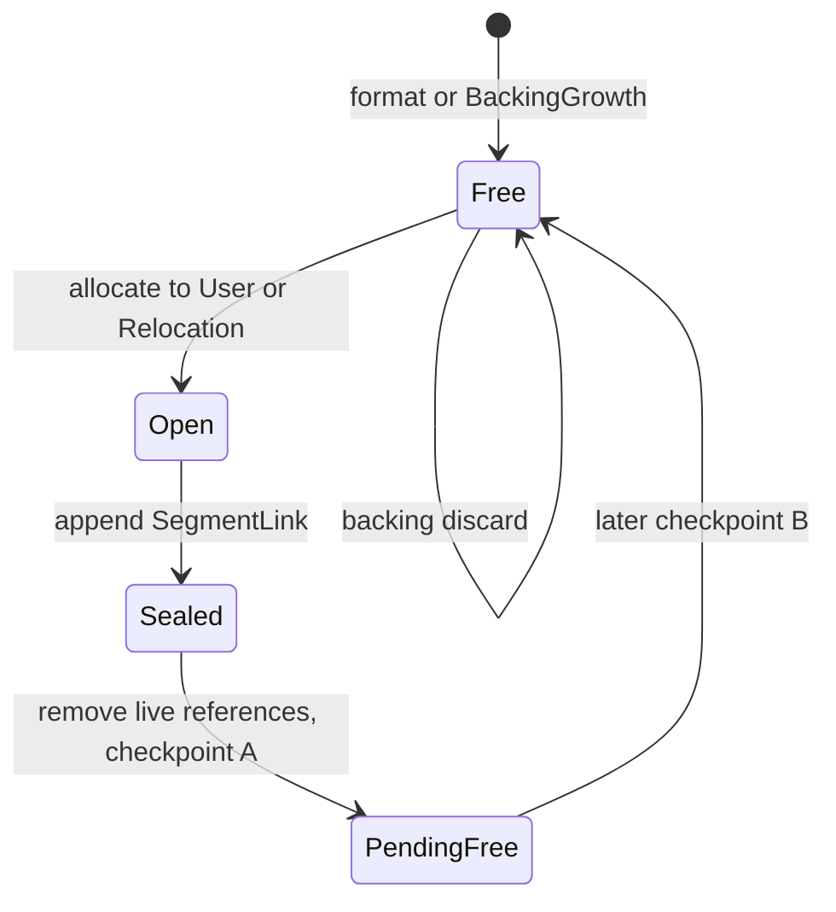

# ADR-08 Segmented log and space reclamation

Date: 2026-09-19; approach decided 2026-09-20; editorial revision, fixed-two-head decision and
compression split 2026-09-20 Author: Miguel Filipe Status: draft. The approach is decided. Encodings
and protocol gaps still require review; sizing and thresholds require measurement. Nothing is
implemented. On-disk format: 4 (proposed) Would update: ADR-07 (reusable log and mapping index),
ADR-04 (segment reclamation replaces replacement-image compaction), ADR-03 (discard advertisement)
Related: [ADR-09 compression follow-up](ADR-09-RELOCATION-COMPRESSION.md), [prior-art
review](papers/README.md), [workbench](TMD-WORKBENCH.md), [technical review and
amendments](docs/REVIEW-ADR-08.md)

## Context

Format 3 never reuses space. Each overwrite leaves an obsolete payload and, after checkpointing, an
obsolete mapping snapshot. Repeated writes to one LBA eventually fill the backing and return
`ENOSPC`. A database's lifetime therefore depends on bytes written rather than bytes stored.

We need to reclaim that space while the device continues serving requests. The target is stateful
systems: databases, key-value stores and indexing engines. Filesystem workloads check for blind
spots.

This document specifies the mechanisms that change together in format 4: framing, allocation,
metadata publication, replay, relocation and reuse. It states the unchanged guarantees those
mechanisms need. The [encoding reference](#encoding-reference) belongs to this specification.

[ADR-07](ADR-07-PAGED-MAPPING-AND-CACHE.md) remains authoritative for cache representation, CLOCK
internals, prefetch and existing metrics. This ADR replaces its automatic cache budget with a share
of the total heap budget. [ADR-01](ADR-01-LOG-STRUCTURED-BLOCK-DEVICE.md) records the underlying
device and failure contract. The workbench owns experiment procedures and workload definitions.

## Decision

Use a segmented log with two fixed append heads and one writer. A background cleaner reads sealed
segments and submits raw relocation proposals. The writer validates each proposal, appends accepted
copies and updates the mapping. It reuses a victim only after two checkpoint publications remove
both roots' dependencies on it.

The user head receives new writes. The relocation head receives accepted copies. Data, mapping
snapshots, mapping index pages and segment table pages share segments according to the placement
rules below.

The mapping index uses fixed direct and indirect pointer arrays in the descriptor (the ext2-shaped
design). Client discard removes mappings. Backing discard releases free segments to the underlying
allocator.

These choices are decided. Segment size, batch size, thresholds and exact encodings remain draft.
Logical growth and automatic growth policy are separate work. Format 4 includes durable backing
growth so external capacity can become usable without replacing the image.

Compression is a separate delivery in [ADR-09](ADR-09-RELOCATION-COMPRESSION.md). Format 4 stores
and relocates raw payloads. Reclamation must work, report its costs and pass aged acceptance without
a codec. Compressed records, their read path, shared-chunk accounting and codec selection are
outside this delivery.

### Why two fixed append heads?

We separate new writes from data that survived long enough to be relocated. Survivors may have
longer remaining overwrite lifetimes. Keeping them together may reduce repeated copying.

This is a placement heuristic, not a claim that every relocated block is cold. Prior art supports
this approach (F2FS, FAST '15 and Van Houdt, 2013). Measure its benefit against one head under aged
workloads.

The roles are fixed: `HeadId::User = 0` and `HeadId::Relocation = 1`. There is no configurable head
count or dynamic lifetime classifier. One writer owns both cursors and assigns one global LSN
sequence. The cleaner prepares proposals in the background; the writer performs all appends.

| Record being appended                                                                                                    | Head                             |
| ------------------------------------------------------------------------------------------------------------------------ | -------------------------------- |
| New user payloads; `LbaDiscard`; `BackingGrowth`                                                                         | User                             |
| Newly generated mapping snapshots, mapping index pages and segment table pages, including checkpoint and recovery output | User                             |
| Accepted relocation copies of payloads or metadata, regardless of the source head                                        | Relocation                       |
| `SegmentLink`                                                                                                            | The head whose segment it closes |

Metadata generated to publish a relocation goes to the user head; copied metadata goes to the
relocation head. The extra head requires another append cursor, replay cursor and open-segment
capacity allowance. Reserved cleaning capacity remains a separate requirement.

### Why this approach?

| Alternative | Reason for the decision |
|---|---|
| Run the cleaner entirely on the writer | Rejected as the final architecture. Victim reads and preparation delay requests. We first build this serialized path to test relocation and reuse. |
| Cleaner prepares; writer applies | Chosen. One owner retains control of mapping and allocation state. Victim reads and preparation run on another thread; copy writes still occupy the writer. |
| Let the cleaner write and mutate the mapping | Rejected. It requires synchronization around the cache, index, segment table and LSN allocation. There is no measurement that justifies a second writer. |
| Dedicated metadata segments | Rejected for now. They add a head and a second allocation class. Reconsider only if measurements show that mixed metadata causes significant cleaning cost. |
| Mutable metadata slots | Rejected. Copy-on-write pages let checkpoints rewrite changed metadata and retain older roots. |

Seltzer et al. [§4](papers/1995-usenix-file-system-logging-versus-clustering.pdf) measured a 34%
throughput loss when cleaning ran in their TPC-B experiment at 48% utilization. EBS
[§3.1](https://www.usenix.org/system/files/fast24-zhang-weidong.pdf) identifies contention between
I/O and background work as a tail-latency problem. These results motivate separating work; they do
not predict this engine's latency. LFS [§3.6](papers/1992-tocs-log-structured-file-system.pdf) and
§4.1 provide the precedent for metadata pages in the log. See [evidence and
policy](#evidence-and-policy) for the assumptions that still need measurement.

## System model

### Terms and ownership

| Term              | Meaning                                                                                                                                           |
| ----------------- | ------------------------------------------------------------------------------------------------------------------------------------------------- |
| Writer            | The foreground thread. It serves requests and alone mutates the log, mapping cache, mapping index and segment table.                              |
| Cleaner           | The background thread. It reads a checkpoint view and submits conditional relocation proposals.                                                   |
| Segment           | A fixed-size region of the log. A sealed segment receives no further appends until reuse.                                                         |
| Head              | An append cursor and its open segment. The two fixed roles are User and Relocation.                                                               |
| Snapshot          | A `MappingPage` record containing 336 mapping entries.                                                                                            |
| Mapping index     | The tree that locates snapshots. Direct index pages point to snapshots; indirect index pages point to direct pages.                               |
| Segment table     | Persistent state, owning head while open, and seal LSN for each segment.                                                                          |
| Seal LSN          | The LSN of the `SegmentLink` that sealed a segment. It supplies the initial age estimate.                                                         |
| Live record       | A payload selected by the current mapping, or metadata selected by the current checkpoint structures. Recovery can also protect obsolete records. |
| Victim            | A sealed segment selected for cleaning. Relocation copies its live records elsewhere.                                                             |
| Descriptor / root | One of two fixed checkpoint blocks. “Root” names its role in recovery.                                                                            |
| Checkpoint        | A descriptor and its referenced mapping and segment metadata. `checkpoint_lsn` orders checkpoints.                                                |
| LSN               | Logical sequence number. All records share one sequence; the proposed reuse argument relies on its ordering.                                      |
| Utilization `u`   | Live fraction of a segment.                                                                                                                       |
| Fill factor `F`   | Live bytes divided by physical capacity.                                                                                                          |
| Garbage ratio     | Dead bytes divided by used bytes.                                                                                                                 |
| Free ratio        | Free bytes divided by physical capacity.                                                                                                          |

The writer owns all mutable engine state: the mapping cache, current and candidate indexes, segment
states and live-byte counts. It also owns both append positions and durability cursors.

The payload write buffer is separate from the mapping cache. A buffered write can be visible before
it has a physical mapping.

The cleaner owns a read-only backing descriptor, its own `io_uring`, aligned read buffers and
proposal storage. Its immutable `CleanerView` contains a checkpoint LSN, the checkpointed resident
mapping index and copies of segment entries and live counts.

A bounded channel carries proposals to the writer. It adds no lock around engine state.

### What must reclamation preserve?

1. Never overwrite a physical block while either valid root references it. A root's replay path also
   counts as a reference.
2. Replace a relocated mapping only if it still points to the proposed source at apply time.
3. Never replay a record left over from a segment's earlier use.
4. Never let user writes consume the space needed for cleaning to make progress.
5. Only the writer mutates the mapping cache, mapping index, segment table and log.

### Device contract

The logical block size is 4 KiB. Logical capacity is at most `2^31` blocks (8 TiB). Physical
addresses use `u32`. Bit 31 of a mapping address is reserved and must be zero. Addressable payload
storage remains limited to 8 TiB.

A future encoding requires explicit compatibility rules before this bit can gain meaning. Byte
offsets, backing counts and LSN arithmetic use checked `u64` operations.

A successful write completion does not imply durability. A successful FLUSH persists all earlier
completed writes and discards. FUA persists its required write before completion. Clean close drains
buffered data and persists state. Before FLUSH, crash recovery may retain only a valid prefix of
complete records. The engine never returns a payload whose checksum fails.

The backing must honor successful fsync. Checksums detect accidental corruption; they do not
authenticate hostile storage or repair damaged bytes. Process-kill tests do not prove power-loss
behavior.

Invalid requests and admission failures return before modifying state or issuing I/O. A short or
failed backing operation latches the volume as failed. It cannot continue reads, writes or flushes.
Startup rejects unsupported formats and unknown record kinds without modifying the image. No
conversion from earlier formats is specified.

## Persistent layout

```text
block 0                      green checkpoint descriptor
block 1                      blue checkpoint descriptor
block 2 onward               whole, fixed-size segments

segment start(s) = 2 + s × blocks_per_segment

checkpoint descriptor
  ├─ direct index pages ───────────────────┐
  ├─ indirect index pages → direct pages ──┴→ mapping snapshots → payloads
  ├─ segment table pages
  └─ last record boundary of each fixed head
```

Segment size is fixed at format time and derives from backing size. The initial candidates are 8 and
16 MiB for small volumes. The two-block prefix leaves segments offset from natural device alignment.
Measure the effect on backing discard before freezing this choice.

### Segments and record chains

Records occupy whole blocks and never cross a segment boundary. Raw data records contain 1 to 338
payload blocks followed by one footer. Other record kinds occupy one block.

Each record carries its kind, volume ID, LSN, previous record boundary and own boundary. A boundary
is the physical block containing the footer or one-block record. Each head has its own chain. The
writer completes a record before issuing the next and assigns consecutive global LSNs across both
heads. A record points back to the previous record on its own head; LSNs within one chain can have
gaps.

When the next record does not fit, the writer advances that head:

1. Append a `SegmentLink` as the final record in the old segment.
2. Open the free segment named by the link.
3. Append the next record there, with its previous boundary pointing to the link.

A write-buffer group may span segments. The group is not atomic.



Only `Free` segments are allocatable. A sealed segment with no live records skips copying but still
passes through the freeing barrier.

Segment entries persist state, owning head while open, and seal LSN. Each head owns at most one open
segment. The seal LSN is zero in `Free` and `Open`; sealing stores the closing link's LSN. No
segment belongs to both heads. The writer clears the owning-head bit when the segment leaves `Open`.
Live counts remain in RAM. Startup rebuilds them.

The proposal has no segment header, reuse generation or summary. A cleaner reads the whole sealed
segment and finds records by their checked footer chains. Data footers supply LBAs. Metadata records
supply page IDs.

The reuse argument depends on two LSN claims. Before a segment becomes free, every LSN from its
earlier use is below both roots' checkpoint LSNs. LSNs reissued after tail truncation are above
those checkpoint LSNs. These claims need explicit reuse tests, as does stale-tail clearing at both
append positions.

### Mapping and segment metadata

An LBA selects `page_id = LBA / 336` and `entry = LBA % 336`. Each entry stores a physical address
and payload checksum. Address zero means unmapped and requires checksum zero. A nonzero address
identifies its raw payload block. Reject addresses with the reserved high bit set.

The mapping index contains `MappingIndexPage` records with 1,008 child pointers each. The descriptor
has 64 direct-page pointers and 8 indirect-page pointers. Both arrays always exist. A small volume
leaves most entries zero; growing past the direct range fills an indirect pointer without changing
the root's shape.

| Structure | Entries | Coverage stated by the draft |
|---|---:|---:|
| Mapping snapshot | 336 LBAs | 1.3125 MiB logical |
| Direct index page | 1,008 snapshots | about 1.3 GiB logical |
| 64 direct index pointers | 64,512 snapshots | 82.7 GiB logical |
| 8 indirect index pointers | 8,064 direct pages | 10.2 TiB logical |
| Segment table page | 448 segments | depends on segment size |
| 930 table pointers in descriptor | 416,640 segments | 6.4 TiB at 16 MiB per segment |

The table reach is 3.2 TiB with 8 MiB segments and 12.7 TiB with 32 MiB segments. Address encoding
is a separate limit. Larger table reach requires larger segments or another tree level. The proposed
state-change journal would consume table-pointer space and is deferred.

A 128 MiB logical volume has 98 mapping snapshots and one direct index page. A 4 TiB backing with 16
MiB segments contains 262,143 whole segments and needs 586 table pages.

Table pages become dirty when a segment changes state. Direct index pages become dirty when snapshot
pointers change. Indirect pages become dirty when their direct-page pointers change. Unchanged
pointers retain their existing records.

The resident mapping index remains a flat array of snapshot locations. The tree changes its
persistent representation. Live snapshots, direct pages, indirect pages and table pages must all
survive cleaning until their replacement is safe.

### Which metadata stays resident?

The flat resident index maps each mapping-page ID to its checkpoint snapshot's physical block. CLOCK
does not manage this index. It manages cached `MappingPage` entries. After evicting a clean mapping
page, the reader uses the resident index to load it again. Dirty mapping pages remain in the cache
until successful checkpoint publication makes them clean.

Direct and indirect index pages are the persistent representation of that flat index. They do not
require permanent slots in the mapping-page cache. Their current locations, dirty state and
publication workspace still require a separate memory allowance. Protecting a record from disk reuse
does not require keeping its complete contents in RAM.

For logical capacity `L` bytes, one flat index contains `ceil(L / (4096 * 336))` entries of four
bytes:

| Logical capacity | Bytes per resident index |
|---|---:|
| 128 MiB | 392 |
| 1 GiB | 3,124 |
| 4 GiB | 12,484 |

Peak memory also includes the candidate index and any older index retained by a cleaner view. Count
every distinct allocation that can coexist. Sharing an allocation does not copy it, but can delay
its reuse.

### How do we bound and preallocate heap memory?

The total heap budget is a configured proportion of the logical volume size:

```text
heap_budget_bytes = floor(logical_volume_bytes * configured_heap_proportion)
```

Configuration divides this total among eviction, write buffers, the mapping-page cache and required
supporting state. Every heap allocation must belong to one of these budgets. Their sum must not
exceed the total heap budget.

| Budget | Included allocations |
|---|---|
| Eviction (cleaner and relocation) | Read windows, retained payloads, metadata buffers, proposal descriptors and queued or in-flight batches. |
| Write buffers | User payload arena, LBA lookup, sort state and I/O vectors. |
| Mapping-page cache | Entry arrays, slot state, CLOCK bits, lookup capacity, sorting scratch and alignment. |
| Required supporting state | Resident/candidate indexes, cleaner views, segment state, live counts, recovery/checkpoint scratch, queues, runtime bookkeeping and allocator overhead. |

The heap proportion and its division are configuration choices. Resident metadata and scratch are
part of this total, not extra allowances outside it. Cap mapping-cache allocation at the volume's
mapping-page count.

Validate and preallocate the complete operating storage before recovery can write:

1. Calculate each allocation's capacity, alignment and maximum simultaneous count.
2. Check that the configured budgets cover those allocations and the mapping cache's minimum working
   set.
3. Reject an insufficient configuration without silently increasing the total budget.
4. Allocate the buffers and state for startup, normal I/O, checkpointing, cleaning, recovery and
   shutdown.

The cache minimum must cover the configured write buffer's worst-case mapping working set. Cleaner
apply batches must also fit available mapping capacity before the writer appends them. Backing
growth must stay within the preallocated segment-state capacity or fail before recording the
extension.

Transfer ownership of preallocated cleaner buffers through handles or references without copying
payloads. The cleaner must not reuse a buffer until the writer finishes using it. When its pool is
full, stop preparing work until buffers return. Scan victims through bounded read windows and sort
bounded proposal batches. Do not retain whole victims when they exceed the eviction budget.

After initialization, ordinary I/O, checkpointing and cleaning must not allocate or grow heap
storage. Verify this with allocation instrumentation, including recovery and maximum backpressure.
The complete allocation inventory and proof that each configured split can make progress remain
acceptance requirements.

Heap reservation is separate from backing-space reservation for writes. Report thread stacks, mapped
ring memory, kernel resources and process RSS separately from the heap budget.

## Foreground operations

### How do writes use the cache?

The bounded payload buffer coalesces repeated writes to one LBA. Reads consult pending payloads
before the physical mapping. Buffering does not dirty a mapping page. Completing a data record and
installing its mapping does.

The mapping cache holds whole pages. CLOCK evicts only clean pages and bounds victim search to two
passes. If no clean victim exists, the cache requests a checkpoint. The cache itself does not
perform I/O.

A loaded checkpoint snapshot or implicit zero page starts clean. Only successful checkpoint
publication clears dirty flags.

Cache representation, lookup storage, prefetch and allocation accounting retain [ADR-07’s
contract](ADR-07-PAGED-MAPPING-AND-CACHE.md#what-does-the-ram-budget-include). The configured cache
share of the total heap budget replaces ADR-07's independent automatic cache budget. The cache must
hold the effective write buffer’s worst-case mapping working set. Startup rejects incompatible
budgets before recovery writes. Cleaner buffers and retained views must fit their configured shares
of the same total heap budget.

Before releasing a buffer, the writer prepares the group:

1. Check that its mapping pages and existing dirty pages fit the cache. If they do not, publish a
   checkpoint first.
2. Check whether the group would exceed the replay-byte limit. If it would, publish a checkpoint
   first.
3. Sort the buffer by LBA.
4. Pack the buffer into records of at most 338 payloads.

The configured checkpoint interval must hold a complete effective buffer. No cache-pressure or
replay-threshold checkpoint occurs within the group.

For each record, the writer follows this order:

1. Compute checksums bound to the payloads' destination locations.
2. Submit the payloads and footer.
3. Wait for exact completion.
4. Update mappings, live counts and the append cursor.

Only complete records advance the append cursor. FLUSH drains the group, then performs one data-log
fsync. Checkpoint barriers are separate.

### How does the writer reserve space before accepting a write?

A new buffered LBA requires space for its payload and mapping snapshots. Before accepting the write,
the writer checks that enough backing space remains for the resulting buffer.

This space reservation is bookkeeping. It does not write or preallocate those records. Replacing a
payload already in the buffer does not increase its space requirement.

The inherited format-3 estimate is `N + R + D + P`, measured in **4 KiB log blocks**. Count the
pending buffer as it would be after accepting the proposed write:

| Term | Blocks reserved for |
|---|---|
| `N` | Pending payloads: one block per distinct buffered LBA, including the proposed new LBA. |
| `R` | Data-record footers: one block per packed record. In format 3, `R = ceil(N / 338)`. |
| `D` | Snapshots of mapping pages that are already dirty: one block per dirty page. |
| `P` | Snapshots of the distinct mapping pages touched by the pending payloads: one block per page, identified by `LBA / 336`. |

Count `D` and `P` separately even when they include the same mapping page. A checkpoint before
buffer release can persist that page's existing changes. Releasing the buffer then dirties it again
and requires another snapshot.

For example, suppose the buffer holds 10 payloads in one mapping page, and that page is already
dirty. The inherited rule reserves `10 + 1 + 1 + 1 = 13` blocks.

This is not yet a complete format-4 reservation rule. Segment boundaries can require additional data
footers, link records and unused tail space. Publication also writes mapping index pages and segment
table pages. The format-4 calculation must cover those costs while leaving the cleaner's reserved
capacity unavailable to foreground writes. The exact packing and reservation protocol remains
unresolved.

### How do reads work?

An unmapped LBA returns zeros. A mapped LBA requires one payload read and its location-bound
checksum check. A mapping-cache miss can add a snapshot read. Pending payloads take precedence over
the physical mapping, as in the write-buffer contract.

### How does client discard work?

The frontend advertises discard and write-zeroes. For a discard, the writer follows this order:

1. Append an `LbaDiscard` record containing the LBA ranges.
2. Unmap those entries and subtract their old live-byte contributions.

Reads then return zeros. FLUSH makes the discard durable. Replay applies discards and writes in LSN
order. The conditional relocation check prevents a stale copy from restoring an unmapped entry.

Logical Disk [§3](papers/1993-logical-disk-technical-report.pdf) describes filesystem free-block
notification. Without that signal, this block layer learns about dead payloads only through
overwrites.

Write-zeroes advertisement is part of the proposal. Its operation and flag handling still need a
complete contract.

## Checkpoint and recovery

### What does checkpoint publication persist?

The checkpoint LSN orders roots. There is no separate checkpoint counter. Each new publication must
include at least one newly appended log record, including when only metadata changes. Skip an
unchanged checkpoint. If publication is required without other log output, append a fresh segment
table page to advance the LSN. The writer rejects LSN overflow and conflicting valid roots with
equal checkpoint LSNs. Equal roots may differ only in slot identity and the resulting checksum.

The writer serializes publication with request handling. It retains the active state until the
replacement descriptor is durable.

The writer publishes a checkpoint in this intended order:

1. Append dirty mapping snapshots and segment table pages.
2. Fsync data and those metadata records.
3. Append dirty direct index pages.
4. Append dirty indirect index pages.
5. Fsync index records.
6. Write the inactive descriptor with the checkpoint LSN and both head boundaries.
7. Fsync the descriptor.
8. Select the candidate state and mark cached mapping pages clean.

All referenced records must precede descriptor persistence. The descriptor includes the LSNs of
records written during its publication.

A failed copy or publication never authorizes eviction, continued writes or reuse. The older
descriptor and every dependency needed to recover from it stay protected.

### How does startup select a root?

Startup validates the saved checkpoint before replaying later log records. It selects a root as
follows:

1. Read both descriptors.
2. Consider candidates in descending checkpoint LSN order.
3. Validate the candidate's identity, geometry, checksums, padding and pointer bounds before
   following pointers.
4. Load its mapping index tree and segment table.
5. Read all mapping pages referenced by the checkpoint’s index and validate their integrity. Reject
   snapshot identity, page ID, bounds or LSN mismatches.
6. Accept the candidate only if all required metadata is valid.

If a candidate fails validation, discard its candidate RAM state and try the older candidate from
step 3. If neither candidate works, fail without writes.

A zero index pointer means an entirely unmapped page. Entries beyond logical capacity are zero.

An external backing extension is unavailable until a durable `BackingGrowth` claims it. Actual
backing shorter than the recovered provisioned bound is an error.

After selecting a root, startup rebuilds live counts from its metadata. Replay then applies tail
changes to those counts. Startup also establishes which segments either root's replay paths protect.

### How do the two fixed heads replay?

Each descriptor records the last boundary for User and Relocation. User writes and relocation copies
use the same replay rules for their record kind.

Recovery merges the two chains in global LSN order:

1. Initialize one cursor per head from the descriptor's boundaries. Set the expected global LSN to
   `checkpoint_lsn + 1`.
2. Probe the next record on each chain.
3. Stop at the end of the valid prefix if neither cursor has the expected LSN.
4. Apply the record with the expected LSN according to the table below.
5. Advance that head's cursor and the expected global LSN. Repeat from step 2.

A `SegmentLink` advances only its named head. Its ID must match the chain being traversed.

| Record kind | Replay action |
|---|---|
| `Data` | Install the record's LBA mappings and checksums. |
| `LbaDiscard` | Unmap the named ranges. |
| `SegmentLink` | Traverse the head transition and update segment state. |
| `BackingGrowth` | Advance the provisioned bound before later records use the new range. |
| `MappingPage`, `MappingIndexPage`, `SegmentTablePage` | Traverse checked framing; do not install the body as logical state. |

Snapshot-style records have independent header checksums. Body corruption need not block traversal
from an older root. Recognizable damaged framing and unsupported kinds fail closed. They do not
authorize tail clearing.

The engine checks data checksums when it reads payloads. Valid metadata does not establish valid
payload bytes.

The writer serializes record issue across heads. An earlier record cannot remain outstanding on one
head while a later record completes on the other.

Each root supplies a starting point for both chains. Reuse must protect every replay path from
either root, including paths through the less active head.

### What if replay exceeds the cache?

Recovery first scans and protects the complete valid tail. If all mapping pages touched by the tail
fit in the cache, recovery replays the tail once.

Otherwise, recovery processes mapping-page windows that fit the cache:

1. Reserve space for all recovery output before writing. If space is insufficient, fail the open
   operation without destroying recoverable state.
2. Replay the same fixed tail for each window.
3. Append that window's snapshots into a candidate index without overwriting source records. Repeat
   from step 2 for the next window.
4. After every window completes, publish one final checkpoint covering the whole tail.

Recovery must never publish a partial replay result. A crash during reconstruction must still permit
recovery through the original checkpoint and tail. The reservation requirement also applies when the
touched pages fit in the cache.

Before serving requests after recovery, startup clears the bounded stale-tail window at both
recovered append positions, then fsyncs the cleared windows. The exact rule remains a format-4 proof
obligation because of segment boundaries and reuse.

## Cleaner and reuse

### How does the cleaner prepare work?

A sealed segment is eligible only when it is off both roots' replay paths. The writer tracks those
dependencies at runtime; recovery reconstructs them at open. Eligibility is separate from current
liveness.

The cleaner prepares each cycle as follows:

1. Select a bounded number of victims (initially four).
2. Scan each segment through bounded read windows.
3. Identify live payloads and snapshots against the cleaner's view.
4. Verify source payload checksums before proposing copies.
5. Sort and pack the live payloads into proposed `Data` records, each with at most 338 payloads.
6. Send bounded batches of these records to the writer by reference.

Each proposal names its view checkpoint LSN, victims, source locations, LBAs and checksums. Snapshot
proposals contain page ID, source block and bytes.

The proposed sort keys are LBA, age, or age bucket followed by LBA. The age definition for sorting
remains open. LBA order improves mapping-page locality; age order aims to separate update
frequencies. LFS §3.5 sorts by age; Lomet and Luo
[§5.3](papers/2020-preprint-log-structured-space-reclamation.pdf) uses estimated update frequency.
The workbench compares the keys and victim counts 1, 4 and 16.

Four 16 MiB victims at 50% live contain about 32 MiB of live bytes before proposal metadata and
scratch buffers. Cap retained bytes as well as victim count. Read windows and proposal batches must
fit the configured eviction budget. Pass data and metadata to the writer by reference. Target a
cleaner buffer capacity close to the user write-buffer capacity. Small volumes must not require
buffers large enough to hold whole victims. The RAM types in the encoding reference describe
contents; the complete allocation inventory remains an acceptance requirement.

### How does the writer apply a proposal?

The writer applies proposals between completed engine operations. The user write buffer need not be
empty.

For each record already packed by the cleaner:

1. Compare each proposed LBA's current `physical_addr` with its source block. Skip mismatches and
   LBAs with buffered user writes. Skip the record if no payloads remain.
2. Assign destination addresses and an LSN on the relocation head. Finalize the record header,
   footer and checksums for the accepted payloads and their destination addresses.
3. Write the record using references to the cleaner's payload buffers. Wait for exact completion.
4. Install the accepted mappings.

The writer preserves the proposed order. It does not sort payloads, combine proposals or fill gaps
left by stale payloads. Filtering adjusts references and record metadata without copying payload
bytes. This path bypasses the user write buffer. The cleaner's buffers remain reserved until the
writer releases them.

For a snapshot proposal, the writer uses these checks and actions:

1. Require the source to match the current index and the mapping page to be clean. Skip a dirty page
   because checkpoint publication writes its current contents.
2. Append an accepted snapshot as a new log record.
3. Set its new candidate index pointer.

The design relies on source checksums and apply-time validation to reject stale reads. This includes
a segment freed and reused while the cleaner reads it. This is a claim to test, not a demonstrated
isolation guarantee. Source identity across reuse and relocation of other metadata types remain
review obligations.

### How does the writer schedule maintenance?

The idle wait detects a lack of user requests. Its initial candidate range is 1 to 5 ms, subject to
measurement. A separate maximum maintenance interval prevents continuous user traffic from starving
reclamation. Free-space pressure also triggers maintenance. At the reserve, defer user writes that
would consume protected space.

This Rust-like pseudocode describes scheduling, not libublk APIs:

```rust
while !shutdown_requested() {
    process_cleaner_control_events()?;

    if maintenance_due() || free_space_pressure() {
        advance_reclamation_one_step()?;
        schedule_next_maintenance();
    }

    let wait = idle_wait.min(time_until_maintenance());
    match wait_for_admissible_request_or_control(wait)? {
        Event::User(request) => apply_user_request(request)?,
        Event::CleanerReady => process_cleaner_control_events()?,
        Event::Timeout => advance_reclamation_one_step()?,
        Event::Shutdown => break,
    }
}
```

The wait retains deferred writes in bounded request slots. It can still return other admissible
requests. Continuous pressure runs maintenance between requests; without runnable work, the loop
waits for an event. One maintenance step applies a prepared record or advances a required checkpoint
publication. The scheduler must service pending publications even while relocation records keep
arriving. An empty proposal queue must not prevent the checkpoints needed to free an emptied victim.

The writer updates live-byte counters as mappings change. Computing the garbage ratio uses
maintained totals. The cleaner examines a bounded number of segment counters per selection step and
retains its scan position. It uses nonblocking proposal submission. A full queue pauses copying,
while acknowledgements and authorized segment-release work remain runnable through separately
reserved control state.

The queue needs a timeout completion and a cleaner notification, such as an `eventfd` poll, through
io_uring. The exact integration remains unverified against libublk. Current engine calls wait
synchronously for backing I/O. Therefore, the maintenance deadline schedules work at the next safe
boundary; it is not an I/O completion bound.

### When may the writer reuse a victim?

After all current references leave victim `V`, the writer uses this barrier:

| Point | Recoverable roots | State of `V` | Allowed action |
|---|---|---|---|
| Before publication | Two older roots | `Sealed` | Preserve source bytes. |
| Checkpoint `A` durable | Older root, `A` | `PendingFree` in `A` | Preserve `V`; the older root may need it. |
| Checkpoint `B` durable | `A`, `B` | `Free` in `B` | Allocate or discard `V` after runtime readers release it. |
| Newest root unusable; select `A` | `A` | `PendingFree` | Repeat the barrier before allocating. |

`A` and `B` name successive publications, with `A.checkpoint_lsn < B.checkpoint_lsn`. Each writes
changed segment table pages, so each advances the log without user writes. Checkpoint `A` must
recover without `V` even though its table keeps `V` pending. `B` replaces the last root that could
need the old bytes. This is stronger than moving live payloads: snapshots, index pages, table pages
and replay links all count as dependencies.

One barrier can release several victims. Cache pressure, replay bounds and close normally trigger
checkpoints, but progress under idle or reserve pressure still requires the relevant publications to
happen.

The writer authorizes physical discard only after durable release and after runtime readers release
the segment. The cleaner may execute authorized discards as part of its state machine, using a
writable backing descriptor. The allocator excludes each segment with an outstanding discard until
completion. Discard can be skipped before submission.

After a segment becomes free, file backing can release its extents with hole punching; device
backing uses `BLKDISCARD`. This is distinct from client discard. WiscKey
[§3.3.2](papers/2016-fast-wisckey.pdf) and §3.5 supplies the persist-copies, persist-locations,
free-space ordering and hole-punching precedent. INFLOW
[§4.5.1](papers/2014-inflow-dont-stack-your-log-on-my-log.pdf) explains why invalidations must
propagate through stacked logs.

### Does cleaning require a compressor?

No. The baseline cleaner verifies raw payloads and packs proposed `Data` records. The writer filters
stale payloads, finalizes record metadata and recomputes checksums for destination locations. It
copies metadata under the publication rules.

This raw path is the future performance baseline. It needs no no-op codec, chunk container or codec
dependency.

Reclamation recovers obsolete space, not space occupied by live payloads. A fully live victim gives
no payload-space gain. The reserve and progress proof must work without assuming compression
savings.

## Evidence and policy

### What determines cleaning cost?

LFS §3.4 models total read-plus-write traffic per new user byte as `2 / (1 - u)` when cleaning reads
whole segments. Lomet and Luo §2.1 expresses extra copy writes as `(1 - E) / E`, with victim
emptiness `E = 1 - u`. These quantities are different from total bytes written, `1 / E`.

| Device fill factor `F` | Victim emptiness `E` | Total writes per user byte `1 / E` |
|---:|---:|---:|
| 0.50 | 0.80 | 1.25 |
| 0.70 | 0.53 | 1.89 |
| 0.80 | 0.375 | 2.67 |
| 0.90 | 0.19 | 5.26 |
| 0.95 | 0.094 | 10.6 |

These are Lomet and Luo's Table 1 values for uniform overwrites with age-based cleaning. They are a
calibration target for the simulator, not measured limits for this device. Metadata and layered
storage change the result.

LFS §3.5 shows why greedy alone is insufficient under skew: cold segments can remain just above its
cleaning threshold. Cost-benefit selection and age sorting separate hot and cold data. These results
do not establish this engine's performance.

### When does cleaning run, and which victims?

| Condition | Action | Initial rule |
|---|---|---|
| Free segments below the low watermark | Clean continuously; prioritize apply over new writes at the reserve | Greedy under foreground pressure: minimum live bytes. |
| Idle with worthwhile victims | Clean even when free space is sufficient | Cost-benefit: `(1 - u) × age / (1 + u)`, age from `current_lsn - seal_lsn`. |
| High fill factor and poor victims | Request backing growth, or return `ENOSPC` if unavailable | Growth target and owner remain policy decisions. |

The low watermark must leave enough time to replenish the reserve. Sustaining user write rate `W`
against victims of utilization `u` needs copy bandwidth `W × u / (1 - u)`, before metadata costs.
The intended contract is bounded stalls and no `ENOSPC` while a victim with positive net gain
exists. This needs a reservation proof and measured service capacity.

Use a band measured in segments; percentages are misleading on a small device. F2FS
[§2.5](papers/2015-fast-f2fs.pdf) supplies the foreground-greedy/background-cost-benefit precedent.
Seal LSN measures log-record distance, not elapsed time or LFS's youngest-block modification time.
Random and round-robin selection are simulator baselines. Update-frequency tracking and more append
heads wait for evidence.

### How much storage backing does a 128 MiB volume need?

The proposed progress floor is:

```text
minimum segments = ceil(live_max × (1 + m) / S) + 2 + R
```

Where:

| Symbol | Meaning |
|---|---|
| `live_max` | Maximum live payload bytes: 128 MiB in this example. |
| `m` | Metadata allowance as a fraction of live payload bytes: `0.01` means 1%. |
| `S` | Segment size in bytes. |
| `2` | Two segments for the two open heads. |
| `R` | Number of free reserve segments, not the packed-record count in admission. |
| `ceil(...)` | Round up to the next whole segment count. |

Metadata allowance `m = 0.01` and reserve count `R = 1` are unmeasured assumptions.

| Segment size | Two fixed heads |
|---:|---:|
| 8 MiB | 20 segments, 160 MiB |
| 16 MiB | 12 segments, 192 MiB |
| 32 MiB | 8 segments, 256 MiB |

The figures are segment capacity; the two descriptor blocks are additional. This formula is a
proposed floor, not a verified guarantee that a whole relocation and both checkpoints fit.

Efficiency is a separate target. At `F = 0.8`, the uniform model predicts about 2.7 writes per user
byte. For 128 MiB of live payload, the draft budgets 160 MiB of segment capacity plus two open
segments. Metadata and reserved-space denominators must be consistent before selecting a backing
size. No compression savings enter the capacity or progress calculation.

### What must measurements report?

`SpaceUsage` reports fill factor, garbage ratio, free segments, cleaned-segment emptiness,
best-victim score and allocated backing bytes. Count user, relocation and metadata writes
separately. Engine amplification does not measure the SSD's internal writes.

The [workbench](TMD-WORKBENCH.md) defines simulation, trace replay and live workloads. It compares
raw-cleaning policies before fixing constants, then measures aged behavior at 128 MiB and 4 GiB
logical sizes. Report latency, CPU, memory, recovery cost and amplification after the log has
wrapped. Fresh-volume throughput cannot gate this design.

## Backing growth

External tooling grows and provisions the medium before the engine claims the new range. The writer
then follows this order:

1. Verify the actual backing size. A retry at the already-recovered target bound succeeds without
   another record.
2. Require the `BackingGrowth` record to fit in the old provisioned range.
3. Append the record.
4. Fsync the record before allocating any new segment.

New whole segments enter the table as `Free`. Ordinary cleaning can allocate them.

Replay advances the provisioned bound before following later records into new segments. An
unrecorded extension stays unused. A caller that loses the completion response reads the recovered
bound before retrying.

Logical growth is separate. The mapping tree removes the need to move fixed index bodies. However,
`LogicalGrowth`, frontend geometry changes and the revision of ADR-04 are outside this proposal.

The grow-versus-clean controller is also undecided. The engine exposes the measurements it needs.

## Consequences and open decisions

The safety argument changes from never overwriting to never overwriting a recovery dependency.
Two-root protection and rejection of earlier-use records are therefore format requirements.
Medium-fault and repeated-crash tests must exercise both, not only clean restart.

Costs include a cleaner thread, second ring and descriptor, immutable checkpoint views, proposal
storage and copy writes on the request path. Checkpoints write only changed index pages, but
recovery reads a tree scattered through the log. Relocation also advances the replay-byte budget and
can increase checkpoint frequency.

| Open decision | Required evidence or completion |
|---|---|
| Segment size and watermark band | Reservation proof, simulator and backing-discard measurements. |
| Victim count and output sort key | Amplification, mapping locality and peak memory. |
| Idle wake-up and apply budget | Integration with the actual libublk loop; bounded shutdown and idle progress. |
| Source validation across reuse | Stale-view and freed-under-read cases. |
| Descriptor pointer split | Logical/backing capacity calculations and metadata-write measurements. |
| Growth controller | Ownership and timing of growth requests. |

A segment-state journal, summaries/validity bitmaps, update-frequency estimates, more heads, shared
cleaner threads and logical growth are deferred. They add state or policy without being required to
establish the chosen mechanism.

Compression and a possible decoded-chunk cache belong to [ADR-09](ADR-09-RELOCATION-COMPRESSION.md).
Its measurements and format review do not gate raw reclamation.

## Proposed deliveries

These are delivery groups, not individual PRs. Resolve the remaining protocol findings before format
activation. Compression is not a prerequisite for any group.

| Delivery | What ships | Evidence |
|---|---|---|
| 0. Raw policy model and accounting contract | Simulator without compression; definitions for current, protected, free and written bytes. | Calibrate uniform updates against Table 1; make no compression assumptions. |
| 1. Format 4 foundation | Segments, index tree, table pages, links, backing growth, two-head replay, live counts, sanitation, reservation and `SpaceUsage`. | Metadata publication/fallback, link/growth boundaries, byte conservation and mapping memory/access checks. |
| 2. Serialized raw cleaner | Inline victim reads, conditional apply for payloads and metadata, two-checkpoint freeing and reuse. | Relocation and freeing boundaries, fallback after reuse, earlier-use records and verified overwrites beyond capacity. |
| 3. Discard | Client discard and write-zeroes contract; mapping/buffer ordering; backing discard after durable release. | Write/discard/write, zero reads, FLUSH/FUA and pending backing discard versus segment allocation. |
| 4. Cleaner thread | Move reads, sorting and selection to the worker; bound proposals, views and idle apply. | Retain serialized correctness cases; add stale views, reuse races, idle progress and shutdown. |
| 5. Growth and aged acceptance | Daemon backing growth and complete raw-cleaning reports. | Aged workload runs at both scales, bounded resource use, amplification and restart verification. |

[ADR-09](ADR-09-RELOCATION-COMPRESSION.md) starts from this raw-cleaning baseline. Codec experiments
can run independently, but compressed output requires its own reviewed format and acceptance gates.

## Encoding reference

This is part of the same specification. Types are decoded Rust values, not memory layouts to cast
onto disk. Codecs encode little-endian fields explicitly, validate enum numbers and reject unknown
values. Unused fields, array entries and padding are zero and checksum-covered. Bounds are checked
before allocation or I/O. Repeated entries use parallel field arrays. The same index identifies the
same entry in each array.

The following type layouts retain the proposal's literal fields and offsets. They remain draft where
the review finds conflicts. Supporting type `CheckpointSlot` stores `Green = 0` and `Blue = 1`; its
descriptor slot must match physical block 0 or 1.

### Record header and kinds

```rust
/// The first 32 bytes of every record, unchanged from format 3.
pub struct RecordHeader {
    // 0..4   magic "VBLF"
    // 4      format version: 4
    pub kind: RecordKind,       // 5
    // 6..8   zero
    pub volume_id: u64,         // 8
    pub lsn: u64,               // 16: consecutive globally across both heads
    pub previous_boundary: u32, // 24: footer block of the previous record, in any segment
    pub boundary: u32,          // 28: footer block of this record
}

#[repr(u8)]
pub enum RecordKind {
    Data = 1,             // unchanged: 1 to 338 raw 4 KiB payloads, then a footer
    MappingPage = 2,      // unchanged: one 336-entry snapshot
    SegmentTablePage = 3, // one block: states of 448 consecutive segments
    SegmentLink = 4,      // one block: its named head moves to another segment
    BackingGrowth = 5,    // one block: the backing grew (ADR-04)
    // Value 6 is reserved; format-4 readers reject it.
    LbaDiscard = 7,       // one block: LBA ranges the client released
    MappingIndexPage = 8,        // one block: a leaf or indirect page of the mapping index
}

// Every one-block metadata record ends the way a mapping page does:
//   4072..4080  header checksum: XXH3-64 over bytes 0..40, so that recovery can
//               traverse a record whose body is damaged
//   4080..4088  zero
//   4088..4096  record checksum: XXH3-64 over bytes 0..4088
```

Each raw `Data` footer places 338 `u32` LBAs at bytes 32..1384 and 338 `u64` checksums at
1384..4088. Its checksum occupies 4088..4096. LBAs are unique and in range. Payload count is 1..338.
Within a contiguous head segment, it is `boundary - previous_boundary - 1`; physical payload `i` is
at `previous_boundary + 1 + i`. The transition after a `SegmentLink` needs segment-aware derivation.

Raw payload checksums use `XXH3-64(seed=volume_id, LE(lba:u32, physical_block:u32) ||
payload[4096])`. Format 3 hashes a full metadata block with bytes 4088..4096 zeroed. The proposed
trailer above instead states a 0..4088 range; this distinction must be settled rather than inherited
implicitly.

A `MappingPage` starts with the common header at 0..32, page ID at 32..36 and zero padding at
36..40. The two `MappingEntries` arrays follow, with the metadata trailer at 4072..4096. Its
independent header checksum covers bytes 0..40. A directory lookup verifies both checksums, kind,
version, volume ID, page ID, physical boundary, entry bounds and maximum checkpoint LSN. Replay can
use a valid independent header without using a damaged snapshot body.

### Segment table and mapping index

```rust
/// The persistent state of 448 consecutive segments. Page `p` covers segments
/// `448 * p .. 448 * p + 448`. Entries past the last segment are zero.
pub struct SegmentTablePage {
    pub header: RecordHeader,          // 0..32, kind = SegmentTablePage
    pub page_id: u32,                  // 32: position in the table, see segment_table_pages
    // 36..40 zero
    pub segment_seal_lsn: [u64; 448],  // 40..3624: closing SegmentLink LSN; zero while Free or Open
    pub segment_flags: [u8; 448],      // 3624..4072: state and owning head
    // 4072..4096 metadata trailer
}

#[repr(u8)]
pub enum HeadId {
    User = 0,
    Relocation = 1,
}

#[repr(u8)]
pub enum SegmentState {
    Free = 0,
    Open = 1,
    Sealed = 2,
    PendingFree = 3,
}
```

Each flags byte uses this encoding:

| Bits | Mask | Meaning |
|---|---|---|
| 0–2 | `0x07` | `SegmentState`: Free 0, Open 1, Sealed 2, PendingFree 3. Values 4–7 are invalid. |
| 3–6 | `0x78` | Reserved; must be zero. |
| 7 | `0x80` | `HeadId`: User 0, Relocation 1. Must be zero outside Open. |

Encode `flags = state | (head_id << 7)`. Readers reject reserved bits and unknown state values. The
arrays use exactly `448 × (8 + 1) = 4032` bytes, with no per-entry padding.

```rust
/// One page of the mapping index. A Direct page lists MappingPage records; an
/// Indirect page lists Direct pages. Direct page `p` covers mapping pages
/// `1008 * p .. 1008 * p + 1008`. Direct pages 0..64 are reached through
/// `mapping_index_direct_pages`; Direct page `64 + 1008 * q + i` is child `i`
/// of the Indirect page in `mapping_index_indirect_pages[q]`. Zero means
/// "nothing below". Children past the volume's last page are zero.
pub struct MappingIndexPage {
    pub header: RecordHeader,     // 0..32, kind = MappingIndexPage
    pub page_id: u32,             // 32: position within its level
    pub level: MappingIndexLevel, // 36
    // 37..40 zero
    pub child_blocks: [u32; 1008], // 40..4072: physical block of each child record
    // 4072..4096 metadata trailer
}

#[repr(u8)]
pub enum MappingIndexLevel {
    Direct = 1,   // its child_blocks are MappingPage records
    Indirect = 2, // its child_blocks are Direct MappingIndexPage records
}
```

### Checkpoint descriptor

```rust
/// One 4 KiB block at physical block 0 or 1. Format 3's reserved index bodies
/// and their checksum are gone; the mapping index is a tree of MappingIndexPage
/// records rooted here. The log starts at block 2.
pub struct CheckpointDescriptor {
    // 0..4   magic "VBLC"
    // 4      format version: 4
    pub slot: CheckpointSlot,                   // 5: green 0, blue 1
    // 6..8   zero
    pub volume_id: u64,                         // 8
    pub logical_block_size: u32,                // 16: 4096
    pub volume_blocks: u32,                     // 20: grows only through a future LogicalGrowth record
    pub backing_blocks: u64,                    // 24: the provisioned bound, grown by BackingGrowth records
    pub checkpoint_lsn: u64,                    // 32
    // 40..48 zero; no separate checkpoint counter
    pub blocks_per_segment: u32,                // 48: segment size in blocks, fixed at format
    pub user_last_record_boundary: u32,        // 52: last boundary on User at this checkpoint
    pub relocation_last_record_boundary: u32,  // 56: last boundary on Relocation at this checkpoint
    pub mapping_index_direct_pages: [u32; 64],  // 60..316: blocks of Direct MappingIndexPage records 0..64; zero = none
    pub mapping_index_indirect_pages: [u32; 8], // 316..348: blocks of Indirect MappingIndexPage records; zero = unused
    pub segment_table_page_count: u32,          // 348: ceil(segment count / 448)
    pub segment_table_pages: [u32; 930],        // 352..4072: block of each SegmentTablePage record
    // 4072..4088 zero
    // 4088..4096 descriptor checksum
}
```

### Segment link, backing growth and discard

The closing link's header LSN is the segment's seal LSN; no duplicate field is needed in the link.
Its unused bytes remain reserved. One link block costs about 0.024% of a full 16 MiB segment.
Embedding another metadata object would couple its lifetime and recovery rules to the link. We defer
that reuse until a specific object justifies it.

```rust
/// Closes the named head's segment and names the next one. It is the last record in
/// the segment it closes. The first record of the next segment has
/// `previous_boundary` equal to this record's `boundary`.
pub struct SegmentLink {
    pub header: RecordHeader, // 0..32, kind = SegmentLink
    pub next_segment: u32,    // 32
    pub head_id: HeadId,      // 36: must match the head whose chain contains this link
    // 37..4072 zero
    // 4072..4096 metadata trailer
}

/// Records that the backing grew. Replay applies it before any later record
/// may reference a segment in the new range. Idempotent by target bound.
pub struct BackingGrowth {
    pub header: RecordHeader,          // 0..32, kind = BackingGrowth
    pub previous_backing_blocks: u64,  // 32
    pub new_backing_blocks: u64,       // 40
    // 48..4072 zero
    // 4072..4096 metadata trailer
}

/// LBA ranges the client released. Replay unmaps them in LSN order. A discard
/// is durable after the next successful FLUSH, like a write.
pub struct LbaDiscard {
    pub header: RecordHeader,        // 0..32, kind = LbaDiscard
    pub range_count: u32,            // 32: 1 to 504
    // 36..40 zero
    pub start_lbas: [u32; 504],   // 40..2056: first LBA of each range
    pub block_counts: [u32; 504], // 2056..4072: length of each range; unused entries zero
    // 4072..4096 metadata trailer
}
```

### Mapping entries

```rust
/// The MappingPage record and cached MappingEntries retain ADR-07's
/// two parallel arrays. Entry i identifies a raw payload or is unmapped.
pub struct MappingEntries {
    pub physical_addr: [u32; 336],     // 40..1384 in the record
    pub payload_checksum: [u64; 336],  // 1384..4072 in the record
}
```

Address zero means unmapped and requires checksum zero. A nonzero address points directly to a raw
payload; bit 31 must be zero. Record kind 6 and the high address bit have no accepted encoding in
format 4. Readers reject them, so a future compression extension cannot be silently misread by a
raw-only engine.

### Runtime state shared through proposals

These containers stand for explicitly bounded, preallocated storage. Only `CleanerView` is shared
for reading; proposals transfer ownership to the writer. The writer retains mutable engine state.
Parallel arrays have equal entry counts. Payload arenas contain aligned 4 KiB byte blocks; metadata
stays in separate arrays. All capacities belong to the configured memory budget.

```rust
/// Persistent segment fields, indexed by segment ID, with the same flags encoding as on disk.
pub struct SegmentEntries {
    pub seal_lsn: Box<[u64]>,
    pub flags: Box<[u8]>,
}

/// The writer's segment state. All arrays use the same segment ID.
pub struct SegmentStatus {
    pub entries: SegmentEntries,
    pub live_bytes: Box<[u64]>,      // rebuilt at open, adjusted on every mapping update
    pub on_replay_path: Box<[bool]>, // protects either head's replay path from either root
}

/// What the cleaner reads from. Everything in it is immutable.
pub struct CleanerView {
    pub checkpoint_lsn: u64,
    pub mapping_index: Arc<[u32]>,     // the checkpointed resident mapping index, shared by reference
    pub segments: SegmentEntries,     // copy of the table's parallel arrays at the checkpoint
    pub live_bytes: Box<[u64]>,        // copy at the checkpoint
}

/// One message from the cleaner to the writer.
pub struct RelocationProposal {
    pub view_checkpoint_lsn: u64,
    pub victims: Vec<u32>,
    pub record_payload_ends: Vec<u32>, // exclusive end of each prepared record in payloads
    pub payloads: ProposedPayloads,
    pub snapshots: ProposedSnapshots,
}

/// Verified raw payloads. Source identity across reuse still needs a protocol.
pub struct ProposedPayloads {
    pub lbas: Vec<u32>,
    pub source_blocks: Vec<u32>,
    pub source_checksums: Vec<u64>, // source-location-bound; not destination checksums
    pub bytes: Vec<AlignedBlock>,   // aligned 4 KiB byte blocks from the proposal pool
}

pub struct ProposedSnapshots {
    pub page_ids: Vec<u32>,
    pub source_blocks: Vec<u32>, // must match the current index at apply; dirty pages are rejected
    pub bytes: Vec<AlignedBlock>,
}
```

Record `r` uses payloads from the previous record's end (zero for the first) to
`record_payload_ends[r]`. Ends increase strictly, each record contains 1 to 338 payloads, and the
final end equals the payload count. An empty payload set has no record ends. The cleaner sorts and
packs each record before submission. The writer preserves these boundaries and references accepted
byte blocks directly from the proposal arena.
