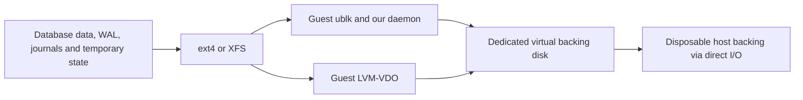

# Benchmarking and performance

Date: 2026-11-27
Status: current reference for format 4 (v2.0 and later); keeps the format-3 (v1.x) history
Provenance: merged by LLM from the earlier performance documents listed under Replaces; not yet reviewed
Replaces: `ADR-07-PERF-RESULTS.md`, `ADR-08-PERF-RESULTS.md`, `TMD-WORKBENCH.md`,
`docs/V1.3-BENCHMARK-PLAN.md`, `docs/PLAN-SQLITE-EXT4-PERFORMANCE.md`,
`docs/PROMPT-PERF-BATCHING.md`, `docs/WORKBENCH-READINESS.md`, `docs/WORKBENCH-VM.md`, the
workbench reporting guide in `tools/workbench/README.md`, the aged and ungated parts of
[BLOCKCHECK-PLAN.md](BLOCKCHECK-PLAN.md), and the baseline comparison of
[SQLITE-EXT4.md](SQLITE-EXT4.md). The old files are in Git history.
Related: [ADR-10 workbench tests and reports](../ADR-10-WORKBENCH-TESTS-AND-REPORTS.md),
[ADR-08](../ADR-08-SEGMENTED-LOG-AND-SPACE-RECLAMATION.md),
[ADR-07](../ADR-07-PAGED-MAPPING-AND-CACHE.md),
[v2.0 qualification](V2.0-QUALIFICATION.md), [tools README](../tools/README.md)

This document holds everything about performance: how to run each benchmark, which workloads and
KPIs we use, the machines and VMs they run on, the open plans, and every recorded result.
Correctness suites live elsewhere: [SQLite/ext4](SQLITE-EXT4.md), [SQLite/XFS](SQLITE-XFS.md),
the [blockcheck plan](BLOCKCHECK-PLAN.md) and the [README test steps](../README.md#testing).

Each section is labelled by the on-disk format it applies to:

- **Current** means format 4, shipped in v2.0 (`031d778`) and later.
- **Historical** means format 3 (v1.2 to v1.2.3) or format 1 (v1.1 and earlier). A v2.0 build
  can't open those images, so a historical result can only be repeated from its own release tag
  with freshly formatted images.

## What do we measure, and what don't we claim?

We keep performance separate from correctness. The correctness gates (`make test`,
`make test-acceptance`, the ext4, XFS and SQLite lifecycles, blockcheck) decide whether a build is
acceptable. Performance has no gate: ADR-08 states that fresh-volume throughput can't gate the
format-4 design, and the format-4 engine enables overwrite-heavy workloads that format 3 can't
sustain. That capability is expected to cost some throughput.

The rules that apply to every result in this document:

- No steady-state number comes from a fresh volume. Benchmark after use, not on an empty system
  (Seltzer, §5).
- Engine amplification counts the engine's own writes. It doesn't measure the SSD's internal
  writes.
- Results on tmpfs or on a host filesystem measure the engine plus that stack. They are relative
  comparisons, not absolute device latency.
- SIGKILL results are process-restart evidence, not power-loss evidence.
- Short runs with three repetitions don't establish statistical equivalence. Host frequency policy
  and background activity were uncontrolled on every host used so far.

## How do I run the benchmarks?

Run every command from the repository root unless the section says otherwise. Run build recipes
serially with respect to benchmarks: recreating a native prefix while another process uses it can
invalidate measurements or interrupt a build. The fixtures are disposable files or explicitly
disposable volumes. Use a block device only if it is disposable: the aged SQLite harness formats a
block device only with `--erase-backing-device`.

| Harness | Format | What it measures | Section |
|---|---|---|---|
| `tools/adr08-bench/` | Current, compares with format 3 | Engine: fresh volume, aged reclamation, maintenance, memory and restart | [ADR-08 engine comparison](#adr-08-engine-comparison-v20-rc) |
| `tools/manual-qualification/aged_fio_profile.py` | Current | fio argument generator for the aged-fio profile; doesn't run fio | [v2.0 aged fio](#v20-aged-fio-qualification) |
| `tools/aged-sqlite/` | Current | Aged SQLite A/F | [Aged SQLite A/F](#aged-sqlite-af) |
| `tools/write-path/compare.sh` | Current | Engine write path of git revisions under hyperfine | [Compare the write path of two revisions](#compare-the-write-path-of-two-revisions) |
| `tools/workbench/workbench.py` | Format-independent | Planned matrix and reports from existing evidence | [Read the matrix and reports](#read-the-matrix-and-reports) |
| `tools/sqlite/baseline.py` | Format-independent | Matched SQLite baseline selection and comparison | [Compare a SQLite baseline](#compare-a-sqlite-baseline) |
| `tools/go-ycsb/time-ext4.py` | Host ext4, no device | Duration calibration of the YCSB portfolio | [YCSB host-ext4 calibration](#run-the-ycsb-host-ext4-calibration) |
| `tools/vm/setup.sh`, `tools/vm/boot-probe.sh` | No device | KVM guest prerequisites | [KVM boot probe](#run-the-kvm-boot-probe) |
| `tools/mapping-bench/` | Historical (formats 1 and 3) | v1.1 to v1.2.3 engine and fio comparisons | [Results history](#results-history) |

### How do we keep results reproducible?

Short, independent runs go through [hyperfine](https://github.com/sharkdp/hyperfine): warm-up runs,
at least 15 measured runs, mean and standard deviation, and JSON output. A long, stateful run such
as [Aged SQLite A/F](#aged-sqlite-af) can't repeat inside hyperfine. Its stability measure is the
stop rule instead: two consecutive windows must agree within 5%. Repeat the whole run to compare
builds.

Both kinds of run do the following:

- Fix every random input with a seed: the go-ycsb `workload.seed` and the write-path seed.
- Start from a freshly formatted backing.
- Pin the measured processes to CPUs with `taskset`. Give the daemon and the client different
  physical cores of the same type. The Ryzen AI 9 HX 370 is a hybrid CPU: CPUs 0 to 3 are Zen 5
  cores (5.16 GHz maximum) that share one L3 cache, and CPUs 4 to 11 are Zen 5c cores (3.29 GHz
  maximum) on a second L3 cache. CPU `n` and CPU `n + 12` are the two threads of one core. Use
  only CPUs 0 to 3 for measured processes.
- Record the host state that changes results: kernel, CPU model, frequency governor, boost, load
  average, available memory, and the commit and SHA-256 of every binary.

The harnesses warn about, but don't fix, these host settings, which need root:

```sh
sudo cpupower frequency-set -g performance                      # or write each scaling_governor
echo 0 | sudo tee /sys/devices/system/cpu/cpufreq/boost         # fixed clock, no thermal drift
```

Close other work before a run. Compare results only when their recorded host state matches.

### Compare the write path of two revisions

```sh
make bench-write-path REVS="v2.1 HEAD"     # or: tools/write-path/compare.sh <rev>...
```

For each revision, the script builds the engine with the current
`rust/examples/write_path_bench.rs`, so an older revision gets the same benchmark. Each run formats
a fresh tmpfs backing in hyperfine's `--prepare` step, which isn't timed. It then measures 262,144
seeded random 4 KiB writes through `Volume::write_block`, with a flush every 64 writes, on a 4 GiB
volume with 6 GiB of raw backing. The engine runs in process, without ublk, so the result is
engine CPU. Change the workload with `WRITES`, `FLUSH_EVERY`, `LOGICAL_MIB`, `RAW_MIB`, `SEED`,
`RUNS`, `WARMUP` and `CPUS`. The evidence goes to `evidence/write-path-<ns>/`: `hyperfine.json`,
`hyperfine.md`, `environment.txt` and `revisions.txt` (commit and binary hash).

### Run the ADR-08 engine comparison

This is the current engine benchmark. `run.py` builds the format-3 baseline from
`git archive 57d56cc` and the candidate from the working tree. Each build has its own target
directory under `rust/target/adr08-bench/`. Both versions run the same driver
(`tools/adr08-bench/main.rs`) through a per-version adapter.

```sh
cd /path/to/clone && export CARGO_TARGET_DIR="$PWD/rust/target"
python3 tools/adr08-bench/run.py --output evidence/adr08-implementation/perf/adr08-bench-tmpfs-8c7f650.jsonl \
    --fixture-dir /tmp/some-tmpfs-dir --repetitions 3
python3 tools/adr08-bench/summarize.py evidence/adr08-implementation/perf/adr08-bench-tmpfs-8c7f650.jsonl \
    --csv evidence/adr08-implementation/perf/adr08-bench-tmpfs-8c7f650.csv \
    --report evidence/adr08-implementation/perf/report-tmpfs-8c7f650.md
```

Use new output paths for a new run.

### Run the aged-fio profile

The aged-fio workload writes about 86 GiB of client data. It isn't part of `make test`, CI,
`make test-all` or `make test-compaction-small`. Run it only on explicit operator request, on a
disposable device, with an agreed write budget. The
[v2.0 qualification](V2.0-QUALIFICATION.md#manual-aged-fio-profile-high-write-volume) gives the
procedure and the geometry. A VM backed by a physical SSD still writes to that SSD.

### Read the matrix and reports

Reporting reads existing evidence only. It needs no VM, mount, device access or sudo, and it
leaves raw evidence unchanged.

1. Print the planned matrix:

   ```sh
   uv run --quiet python tools/workbench/workbench.py matrix
   ```

   The command expands [matrix.json](../tools/workbench/matrix.json) and prints RAM, capacity and
   execution readiness for each configuration. `not_ready` means that the CLI can't launch that
   configuration yet. There is no `workbench run` command.

2. On a fresh checkout, restore the ignored raw SQLite directories:

   ```sh
   tar -xzf evidence/sqlite-xfs-acceptance-2026-09-20.tar.gz
   ```

3. Compare the accepted SQLite/ext4 and SQLite/XFS matrices:

   ```sh
   uv run --quiet python tools/workbench/workbench.py report \
     evidence/sqlite-1789917416605635188 \
     evidence/sqlite-1789917155929943435 \
     --output /tmp/sqlite-comparison
   ```

4. To narrow a report, add repeated `--case` selectors. Quote globs in zsh:

   ```sh
   uv run --quiet python tools/workbench/workbench.py report \
     evidence/sqlite-1789917155929943435 \
     --case speedtest-main --case 'kv-random-update-*' \
     --output /tmp/xfs-selected
   ```

For a newly executed test, substitute its evidence directory. The output directory must be new:
the CLI refuses an existing one, so a rerun can't replace a report by accident. It prints three
paths:

| File | Use |
|---|---|
| `report.md` | Run status, a table comparing case times, compact KPI and latency tables |
| `cases.csv` | One row per case and repetition for spreadsheet comparisons, including load and drain times, device counters and RSS where measured |
| `report.json` | Structured rows, configurations, source paths, failures and per-operation latency counts |

Exit codes:

| Code | Meaning |
|---|---|
| 0 | The selected evidence was processed with acceptable source status. It doesn't mean that an I/O-stress benchmark, a VM suite or a storage-performance acceptance passed. |
| 1 | A failed, incomplete or invalid run is in the report. The report is still written. |
| 2 | An input or output error. |

The parser recognizes SQLite manifests and the original go-ycsb timing reports. It reuses the strict
SQLite baseline validator for complete 87-case matrices; individual pass records keep their
logical-validation and ledger checks. YCSB inputs are the original `raw-ext4-timing-*/report.json`
directories, not the manually combined portfolio summaries. The reporter reads YCSB latency
percentiles only from the final cumulative log summary and checks their sample counts. It keeps
correctness and calibration as separate result classes. Filtering completed cases can't turn an
incomplete batch into a pass.

Generated examples:

- [SQLite/ext4 and XFS](../evidence/reports/sqlite-filesystems-2026-09-20/report.md): 174 verified
  case repetitions.
- [YCSB A/F/E75 timing calibration](../evidence/reports/ycsb-calibration-2026-09-20/report.md):
  six cases, with the original scopes and missing metrics explicit.

To reproduce the second example, pass all three timing directories with
`--case a --case f --case e75`, which excludes the historical E95 cases. The command exits with
code 1: the first source batch has completed SQLite cases but no final batch status or cleanup
confirmation. The report keeps that incomplete status.

Run the reporter regression tests without a VM or live devices:

```sh
uv run --quiet python -m unittest discover -s tools/workbench -p 'test_*.py'
```

### Compare a SQLite baseline

Only a complete, correctness-passing 87-run SQLite matrix can become a baseline. The repository
contains `evidence/sqlite-ext4-baseline.json` and the
[SQLite/XFS baseline](../evidence/sqlite-xfs-baseline-2026-09-20.json).

1. To select another run, replace the example run path and choose a new output filename. Selection
   refuses to overwrite an existing file:

   ```sh
   uv run --quiet python tools/sqlite/baseline.py select \
     evidence/sqlite-RUN evidence/new-sqlite-baseline.json
   ```

2. To compare a later complete run, replace the candidate path with its evidence directory:

   ```sh
   uv run --quiet python tools/sqlite/baseline.py compare \
     evidence/sqlite-ext4-baseline.json evidence/sqlite-CANDIDATE
   ```

3. Run the baseline parser tests, which need neither SQLite nor mounts:

   ```sh
   uv run --quiet python tools/sqlite/test_baseline.py
   ```

A comparison requires matching workloads, settings, SQLite build, hardware, kernel, backing
geometry, medium and cache conditions. It also requires matching filesystems: it rejects a mixed
matrix or an ext4/XFS comparison. An intentional block-device commit change requires
`--allow-commit-change`. A database or benchmark upgrade requires a new baseline. Artifact hashes
detect changes to the selected results.

The comparison reports percentage changes in median workload time, workload-plus-drain time,
throughput and available tail latency. It marks overlapping ranges inconclusive and applies no
regression threshold. A self-comparison is labelled as such; its zero changes are not an
independent performance result. Rerun apparent changes that overlap observed variation, preferably
with interleaved baseline and candidate runs.

### Run the YCSB host-ext4 calibration

This calibration estimates durations and checks request counts, synchronous writes and final record
counts. It formats no device, and its reads can be cached, so it doesn't establish storage
performance.

Prerequisites: a user systemd manager, cgroup v2 memory controls, `strace`, GNU `time` and ext4 at
`/var/tmp`.

1. Build go-ycsb: `make setup-go-ycsb`.
2. Build RocksDB after go-ycsb finishes: `make setup-rocksdb`.
3. Run the six cases in a 256 MiB cgroup without swap:

   ```sh
   systemd-run --user --wait --pipe --collect \
     -p MemoryMax=256M -p MemorySwapMax=0 --working-directory="$PWD" \
     "$(command -v uv)" run --quiet python tools/go-ycsb/time-ext4.py
   ```

The script checks the memory limits and the filesystem before the workloads, probes sync calls,
runs A/F/E75 on both databases in a temporary directory, records load and run times with row-count
validation, and saves evidence under `evidence/raw-ext4-timing-<run-id>/`. The
[tools README](../tools/README.md) describes the recipes, the pinned go-ycsb fork and the build
identities.

### Run the KVM boot probe

The probe checks guest prerequisites on the recorded host kernel. It needs KVM access and doesn't
test this repository's code. `make test-all` doesn't run it.

```sh
bash tools/vm/setup.sh
bash tools/vm/boot-probe.sh 320
```

`setup.sh` builds a minimal initramfs and extracts a checksum-pinned kernel package; it installs
nothing on the host. The probe boots with one vCPU and 320 MiB by default, checks ublk, ext4, XFS
and disabled swap, then powers off. It accepts 320 to 4096 MiB and rejects other sizes before it
launches QEMU. It prints its evidence directory, `evidence/vm-320m-<run-id>/`, which holds
`command.txt`, `build-manifest.txt` and `console.log`. It isn't a command for running our device
with a filesystem and a database inside a VM.

## Workloads and KPIs

### Which KPIs do we report?

Keep these as separate KPIs; no single number summarizes a run:

| KPI | Definition and availability |
|---|---|
| Throughput | Operations per second; kIOPS means thousands of 4 KiB operations per second (multiply by 3.90625 for MiB/s). YCSB uses logical requests per second; F's extra update calls are not extra logical requests. SQLite `speedtest1` has no comparable operation count. |
| Latency | p50, p99, p99.9 and max per operation, flush p99 separately, always with sample counts. YCSB adds p99.99. Report latency before and after aging separately. |
| Load, workload, drain, validation and restart times | Separate phases. SQLite uses its recorded internal phase timings. YCSB calibration uses process elapsed time including database open and close; a separate drain time is unavailable there. |
| Backing I/O | Read and write bytes, data-I/O requests and flushes. For SQLite, the sum of the workload, drain and residual segments, excluding initialization and verification. These are daemon backing counters, not host physical-device traffic. |
| Write amplification | Device bytes written divided by client bytes written. Blockcheck uses the backing LV's `/sys/block` counters, not the daemon's counters. |
| Copy amplification | Relocation copies per user write (format 4). |
| Endurance | Client bytes before the first `ENOSPC`, divided by backing bytes. |
| `ENOSPC` count and longest stall | Planned for blockcheck; measured by the ADR-08 engine comparison. |
| Memory | Peak process RSS, cgroup `memory.peak`, heap budget and heap allocated (format 4), mapping-cache bytes. RSS is a sampled value, not a peak, unless the column says peak. |
| Open and reopen time | Including recovery and checkpoint validation. |
| Occupied physical space | Not collected by the current suites. Planned for blockcheck from the backing file's `st_blocks`. Cumulative bytes written are not occupied space. |

Reporting rules:

- A missing metric is `N/A` in Markdown, blank in CSV and `null` in JSON. It is never zero. Zero
  is a measured zero.
- Report every sample. Markdown shows medians for repeated cases; CSV and JSON keep every sample.
  Don't invent between-run medians or ranges for single runs.
- Don't average interval percentiles. Merge histogram counts for a run total.
- Don't merge different evidence classes, rank implementations or infer regression percentages
  across unlike settings.
- Label sparse tails. At p99.99, one million samples leave roughly 100 observations in the upper
  tail. Don't increase a run budget only to support a percentile.
- Label YCSB latencies as single-client, closed-loop service latencies. They don't represent
  queueing delay under a fixed offered arrival rate.
- Keep verification, rewrites and image capture outside timed intervals.

Review triggers are not automatic CI failures on an uncontrolled host:

- The format-3 mapping experiments used a 90% throughput floor and a 10% p99 increase ceiling
  against v1.1.
- Blockcheck uses a 10% throughput loss or a 20% P99 increase as a finding, and a 50% throughput
  loss or a 2× P99 increase as a severe finding. Neither fails a candidate. See
  [ungated blockcheck measurements](#ungated-blockcheck-measurements).

### Engine benchmarks

**Current.** The ADR-08 driver (`tools/adr08-bench/main.rs`) writes 4 KiB blocks through
`write_block` with a 4 MiB write buffer and calls `flush` every 256 writes. It reads through
`read_block` with content verification. The candidate runs the daemon's scheduler policy:
`maintain_for(Idle, 2 ms)` when 100 ms passed since the last tick. The driver never idles, so only
due ticks fire. Its jobs are in
[ADR-08 engine comparison](#adr-08-engine-comparison-v20-rc).

**Historical.** The format-3 driver in `tools/mapping-bench/` uses a 4 GiB logical volume, a fresh
1 GiB regular-file backing, a 4 MiB write buffer and a 64 MiB checkpoint interval:

- Sequential writes cover 64 MiB and flush every 256 blocks.
- Scattered writes cover 4,096 seeded addresses and flush every 32. Coalescing leaves 4,080
  payloads.
- Reads perform 32,768 operations after warmup. The scattered set has 3,277 blocks, one per
  mapping page; the hot set has 32 blocks.
- Read payloads, and written data after close and reopen, are verified. No workload relies on
  space reclamation.

The v1.2.3 prefetch experiment used its own population and four read workloads; see
[v1.2.3](#v123-336-entry-pages-and-adjacent-page-prefetch).

### The YCSB portfolio: A, F and E75

**Planned, format-independent.** The database performance portfolio keeps workloads A and F and
adds E75 as the only scan and insert profile:

| Case | Database | Logical request mix | Durability |
|---|---|---|---|
| sqlite-a | SQLite | 50% reads, 50% updates | WAL, synchronous=FULL |
| rocksdb-a | RocksDB | 50% reads, 50% updates | WAL enabled, sync=true |
| sqlite-f | SQLite | 50% reads, 50% read-modify-write requests | WAL, synchronous=FULL |
| rocksdb-f | RocksDB | 50% reads, 50% read-modify-write requests | WAL enabled, sync=true |
| sqlite-e75 | SQLite | 75% scans, 25% inserts | WAL, synchronous=FULL |
| rocksdb-e75 | RocksDB | 75% scans, 25% inserts | WAL enabled, sync=true |

Each case loads 8,192 records (32 MiB of value payload) once, then runs 131,072 logical requests
with one worker, seed 123 and no rate limit. The request budget consolidates the earlier per-case
allocation: three runs of 32,768 requests total 98,304, rounded up at the user's request to one run
of 131,072 (128 Ki). Setup savings don't increase the measured request budget, and the
consolidation doesn't change ADR-06's correctness repetitions. Repeat a performance run only to
investigate a failure or an apparent difference; one run doesn't establish repeatability.

Each record has one constant-length 4,096-byte value, excluding the key and database encoding. Set
both `fieldcount=1` and `fieldlength=4096`; upstream defaults are ten 100-byte fields. The workload
properties are in [`tools/go-ycsb/workloads`](../tools/go-ycsb/workloads/):
`common.properties` combined with `a.properties`, `f.properties` or `e75.properties`.

- A and F keep hashed key order. F performs a read followed by an update; it isn't an atomic
  transaction. Count logical requests separately from database calls, and verify that updates
  change values. Workload F's `TOTAL` counts database calls; subtract its additional update calls
  when checking the logical-operation count.
- E75 inserts increasing keys with 20-digit zero padding and `insertorder=ordered`. Each scan
  requests 16 consecutive records, with both scan-length bounds set to 16. Scan starts are uniform
  over the initial loaded key range, which matches the pinned generator: new inserts extend the
  ordered key space but not the scan-start range. Count the records and bytes actually returned,
  including short scans at the end. The upstream `workloade` file uses `maxscanlength=1`, so it is
  unsuitable unchanged.
- Mix percentages are selection probabilities. At the expected 25% insert share, E75 adds 128 MiB
  and returns approximately 6 GiB of scan payload. These are application bytes, not disk I/O.
  Ordered inserts are logically append-only; database journals, indexes and compaction still
  rewrite blocks. E75 has approximately 32,768 inserts, which is too few to resolve p99.99
  reliably.

The 8,192-record dataset is too cacheable to establish read-I/O stress. Calibrate database overhead
and actual block reads before choosing a larger dataset. Loading more records is a separate
workload change, not a consequence of the consolidated repetitions. The final dataset size is
open.

The same workload definition doesn't produce identical block traces: database behavior and timing
differ. `--target` throttles attempted operations; it doesn't guarantee deterministic idle
intervals under scheduler or database stalls.

PostgreSQL isn't in the portfolio. The pinned go-ycsb imports `db/pg` and registers `pg` and
`postgresql`, so it can send A/F/E75 requests to a local PostgreSQL server with its data and WAL
on ext4 or XFS over our device. Before adding it:

- integrate the server lifecycle and memory controls;
- verify the durability settings;
- fix the driver's missing `ORDER BY YCSB_KEY` in scans;
- check `ON CONFLICT DO NOTHING` inserts with independent counts;
- record PostgreSQL's value-storage and compression settings for 4 KiB fields.

Adding the three workloads on all four storage scenarios would add 12 cases, bringing the matrix
to 36. PostgreSQL's pgbench, checksum and restart checks remain ADR-06 correctness gates, separate
from this matrix.

### SQLite native workloads

The SQLite correctness suites run `speedtest1` and `kvtest` from SQLite 3.51.3 under DELETE/EXTRA,
WAL/FULL and WAL/NORMAL. [SQLite/ext4](SQLITE-EXT4.md#what-runs) lists the cases, and
[how measurements are interpreted](SQLITE-EXT4.md#how-are-measurements-interpreted) states what
their timings can and can't support. Their timings are initial baselines; see
[SQLite filesystem baselines](#sqlite-filesystem-baselines).

### Aged device workloads

**Current.** Aged workloads fill a format-4 volume, then overwrite it until the log has wrapped
several times. They use the blockcheck [stop rule](BLOCKCHECK-PLAN.md#endurance-stop-rule): run at
least a minimum multiple of the backing, then stop at steady state or at a maximum multiple. Steady
state means two consecutive equal windows agree within 5% on throughput and write amplification.
The [aged fio and SQLite cases](#aged-fio-and-sqlite-cases) define the two device workloads.

## Environment

### Hosts behind the recorded results

| Results | Host |
|---|---|
| ADR-08 engine comparison (current) | Linux 7.0.0-31-generic, 24 CPUs, 61 GiB RAM; rustc 1.97.1, `--release`, `--locked`; runs pinned to CPU 0 with `taskset` |
| v1.2 to v1.2.3 mapping experiments (historical) | AMD Ryzen AI 9 HX 370, Linux 7.0.0-31-generic, Rust 1.97.1, fio 3.41. Engine and daemon on CPU 0; fio on CPU 1 with `psync`, queue depth 1, direct I/O and CRC32C verification. Private Btrfs backings with `chattr +C`; builds in `/tmp` |
| SQLite baselines and YCSB calibration | The development host; tmpfs backing for SQLite, root ext4 at `/var/tmp` for YCSB |

Blockcheck's earlier performance results come from other hardware than its planned host. Before
the first candidate run, the fresh comparison runs v1.2.3 against itself on that host to measure
noise; see [which baseline the numbers need](#which-baseline-do-these-numbers-need).

### Backing fixtures

| Fixture | Use | Caveat |
|---|---|---|
| tmpfs | ADR-08 primary fixture, SQLite suites | Page-cache bound, no compression; isolates engine cost; says nothing about physical media |
| Btrfs with `compress=zstd:1` and `chattr +C` | ADR-08 secondary fixture; v1.x private backings (`chattr +C`) | The filesystem dominates: compression, copy-on-write, asynchronous discard. Run-to-run variation exceeds the engine difference |
| XFS file on LV `ubuntu-vg/blockcheck` at `/mnt/blockcheck` | Blockcheck and aged cases | Timed runs start from a fully written backing file so XFS allocates nothing during O_DIRECT overwrites; the raw LV `blk-128mib-0` is the control for XFS overhead |
| Raw LVM logical volume | Proposed by the workbench memo | Not integrated; see [supplied LVM volumes](#supplied-lvm-volumes) |
| VM test disk | Planned VM comparison | See [VM environment](#vm-environment) |

File backing on tmpfs or Btrfs puts a second allocator and a page cache between the engine and the
device. Results on it measure that stack. When a physical SSD is under test, record the device
model, firmware and preconditioning state, because the SSD's own log sits under ours (INFLOW §3.3)
and its GC state changes results by 2× (FAST '26, §7.2, Fig. 13).

### Supplied LVM volumes

The host exposes `/dev/ubuntu-vg/blk-128mib-0` and `/dev/ubuntu-vg/blk-4gib-0`. Nothing has
written to them. Their existence alone is not a backing-device safety check: a harness must
validate identity, capacity, mounts and use before formatting. Any LVM test must identify and
validate an explicitly disposable target before writing.

Backing sizes proposed so far, each for a different purpose:

| Source | Small scale | Large scale | Status |
|---|---|---|---|
| Format-3 finite-log suggestion | 1 GiB for 128 MiB logical | 8 GiB for 4 GiB logical | 1 GiB matches the existing acceptance; 8 GiB was a proposed budget, not a measured minimum |
| Workbench memo draft for ADR-08 | About 192 MiB (16 MiB segments, fill factor 0.8) | About 5.3 GiB | Draft estimates |
| Blockcheck | 128 MiB logical, 128 MiB to 1 GiB + 8 KiB | 4 GiB logical, 5 or 6 GiB + 8 KiB | Frozen sizes; see the [blockcheck plan](BLOCKCHECK-PLAN.md#backing-sizes) |
| v2.0 aged fio | n/a | 4 GiB logical on 6 GiB raw (release runs); 4,915 MiB raw for future runs | See [v2.0 aged fio](#v20-aged-fio-qualification) |

The accepted XFS fixture exposes 512 MiB because the default formatter doesn't support a 128 MiB
XFS scale.

### VM environment

**Planned, deferred.** The VM decision is accepted, but storage and CPU isolation aren't
integrated, and the README lists the VM comparison as deferred.

#### Why QEMU/KVM?

The initial SQLite timing runs served their reads from RAM. Limiting the database cache alone
didn't constrain the filesystem page cache, and a storage comparison must also account for
filesystem metadata, block-layer structures and our daemon's memory.

We use QEMU with KVM directly and run the entire tested stack inside the guest. The guest RAM
budget covers the guest kernel, filesystem caches, go-ycsb, the database and either our daemon plus
ublk or LVM-VDO. Both implementations use the same boundary. We don't pass a host-created ublk or
VDO device through as the tested backend. Load and run happen inside the same guest.

A separate guest kernel makes the whole machine's memory boundary explicit and gives a
reproducible kernel, tool builds, CPU topology, device geometry and filesystem configuration.
Containers with cgroups can constrain process memory and charged page cache, but share the host
kernel. Kata adds an OCI runtime interface and a guest agent around VMs, which this standalone lab
doesn't need. Firecracker is also KVM-based, but its inspected built-in block backend uses buffered
host I/O, and another backend would add integration work. QEMU exposes the storage controls we need
directly. Sources: [QEMU block options](https://www.qemu.org/docs/master/system/qemu-manpage.html),
[Kata architecture](https://github.com/kata-containers/kata-containers/blob/main/docs/design/architecture/README.md),
[Firecracker block implementation](https://github.com/firecracker-microvm/firecracker/blob/main/src/vmm/src/devices/virtio/block/virtio/device.rs).

Keep all paired results on the same virtual hardware and label them as VM measurements, not
bare-metal throughput.

#### Memory budget

1. Start at 320 MiB with one vCPU, no balloon device and no swap (including zram).
2. Increase RAM in 64 MiB steps until every selected stack, including PostgreSQL, completes load,
   workload, drain and validation without OOM or allocation failures. Don't assume PostgreSQL is
   the largest consumer before measuring it.
3. Fix one common RAM size for every paired comparison, including both 128 MiB and 4 GiB logical
   devices and both storage backends.

Logical device capacity, larger backing-store capacity and guest RAM are three separate quantities.
Device capacity doesn't set guest RAM. Record configured RAM and guest `MemTotal`, which is smaller
because of kernel reservations, plus available memory, cache use and OOM events. A stack that fits
in RAM doesn't prove that its reads reach storage, so dataset and cache calibration stay separate.
Sizing probes don't qualify as paired benchmark runs until every stack uses the selected RAM size.
The host cgroup calibration is historical; it isn't the selected benchmark machine.

VDO is part of guest sizing. The
[kernel requirements](https://docs.kernel.org/admin-guide/device-mapper/vdo.html#memory-requirements)
list 38 MB of fixed memory plus approximately 150 MB for the minimum block-map cache, before the
deduplication index. Increase the common guest RAM if needed; don't put either storage backend
outside the guest.

QEMU and KVM host overhead is outside guest RAM. Record host memory and CPU use separately. A host
cgroup can constrain QEMU with enough headroom for the guest and virtualization overhead; don't set
its limit equal to guest RAM. Prevent host swapping of the VM during measurements. These controls
constrain the test environment, not the RAM of unrelated host processes.

#### Two disks, one tested storage path

| Guest disk | Contents and role |
|---|---|
| OS disk | Minimal root filesystem, pinned tools and configuration; excluded from test-disk I/O totals |
| Test backing disk | One dedicated raw virtual disk, backed by an explicitly disposable host LV or raw image; all tested database state ends up here |



Each run selects one backend. Our daemon opens the guest test disk and exposes `/dev/ublkb*`
there; the alternative creates VDO there. The database filesystem sits above the selected device.
Raw-volume support and identity validation must be integrated before this topology qualifies for
acceptance.

- Keep database data, WAL and journals, SST files and temporary database state on the test
  filesystem. Don't substitute a host-shared filesystem.
- Keep expected results and evidence outside it, and exclude verification from workload timings.
- Use distinct stable disk identities and check the target before formatting.
- Use `cache=none` for virtual disks, which is equivalent to `cache.direct=on` with
  `cache.no-flush=off`. It bypasses host page caching for disk data and keeps guest flushes. Verify
  these options and the actual I/O counters; a guest RAM limit alone doesn't prevent host caching.

Separate disk counters distinguish OS traffic, but separate virtual disks on one physical drive
still share that drive's bandwidth and latency.

#### CPU control

Fix the vCPU count and CPU model across paired runs; the initial probe uses one vCPU. The
database, our daemon or VDO, and guest kernel work share that guest CPU budget. QEMU's host I/O and
emulator threads use additional host CPU, which we measure separately.

Pin vCPU threads and QEMU I/O and emulator threads to recorded host CPU sets. Reserve physical
cores for the benchmark, and keep interactive sessions, builds and other agents off those cores and
their SMT siblings. Affinity alone doesn't reserve CPUs: claim exclusive placement with an
exclusive host cpuset partition, and verify its effective CPU set and validity before each run
([kernel cpuset partitions](https://docs.kernel.org/admin-guide/cgroup-v2.html#cpuset)).

Record topology, affinity, NUMA placement, frequency policy, host load and guest steal time. Core
isolation doesn't remove shared last-level cache, memory bandwidth, interrupt or physical-storage
contention; keep those limits visible in results.

#### Database and guest settings

Initial settings, subject to a recorded guest preflight:

| Layer | Setting |
|---|---|
| SQLite | One connection; page_size=4096 before creation; cache_size=-16384 (16 MiB suggested page-cache limit); mmap_size=0; WAL/FULL; wal_autocheckpoint=1000 |
| RocksDB | One column family; explicit 16 MiB block cache with index and filter blocks charged to it; write_buffer_size=16 MiB; max_write_buffer_number=2; mmap off; automatic compaction on; WAL and sync on; compression off |
| Guest | QEMU/KVM starts at `-m 320M -smp 1`; calibrate one common RAM size; swap disabled; no balloon; fresh guest per case |
| Workload process and file cache | Share the fixed guest RAM; record anonymous and file-cache usage; no host-global cache drops |
| Block implementation | Run our daemon or VDO inside the guest RAM budget; also record their individual memory use |
| Virtual storage | Direct host I/O (`cache=none`); preserve guest flushes; expose 4096-byte logical and physical sectors |

The database caches are not total process-memory limits. Read back the effective settings and
record cache hits and misses, cgroup anonymous and file memory, reclaim, memory pressure and OOM
events. An OOM invalidates the run. Measure backing reads and CPU time before claiming that I/O
limits throughput. See [SQLite's cache controls](https://www.sqlite.org/pragma.html#pragma_cache_size),
[RocksDB memory accounting](https://github.com/facebook/rocksdb/wiki/Memory-usage-in-RocksDB) and
the [kernel cgroup documentation](https://docs.kernel.org/admin-guide/cgroup-v2.html#memory).

#### 4 KiB geometry

The accepted ublk runs already advertise and check 4096-byte logical and physical sectors. Their
ext4 output reports 4 KiB blocks; XFS reports `bsize=4096` and `sectsz=4096` for data and log. The
formatters discover device geometry; they don't receive explicit size flags. See the
[ext4 evidence](../evidence/sqlite-1789919055507253962/speedtest-main--wal-full--repetition-1/commands.log)
and [XFS evidence](../evidence/sqlite-1789919057604434536/speedtest-main--wal-full--repetition-1/commands.log).
These raw directories are ignored by Git; restore them from
`evidence/sqlite-xfs-acceptance-2026-09-20.tar.gz`.

The comparison runner must:

- require 4 KiB logical sectors on both paths before formatting;
- record physical sector and minimum-I/O sizes;
- set filesystem blocks explicitly with `mkfs.ext4 -b 4096` and
  `mkfs.xfs -b size=4096 -s size=4096`, then verify the resulting geometry;
- configure VDO's minimum I/O size as 4096, with 512-byte emulation disabled.

An ext4 block-size option doesn't change the block device's logical sector size.

## Plans and open work

### Aged fio and SQLite cases

**Current, open.** These two blockcheck cases add sustained load from standard tools. They don't use
the blockcheck checker: `aged-fio` measures device performance and `aged-sqlite` checks database
and filesystem integrity under aging. Both use the same daemon adapters, sampler,
[memory cap](BLOCKCHECK-PLAN.md#how-is-the-memory-cap-set), stall limits and
[stop rule](BLOCKCHECK-PLAN.md#endurance-stop-rule) as the other blockcheck cases. Each runs on the
candidate's default segment size only.

v1.2.3 runs both cases on the same backing until its log is full. We report the bytes it wrote
before its first error, as a multiple of the backing size. That error is expected and doesn't count
as a failure. v1.2.3's log may fill during the SQLite load itself.

#### `aged-fio`

The device has 4 GiB logical size and 6 GiB + 8 KiB backing (fill factor 0.67, a gated row).

1. Write every LBA sequentially, then flush (live fraction 1.00).
2. Run fio with `rw=randwrite bs=4k direct=1 ioengine=io_uring iodepth=32 fsync=256`, once with
   uniform addresses and once with `random_distribution=zipf:1.2`.
3. Run fio in windows of one backing size each. Between windows, apply the stop rule.

fio logs bandwidth and latency per second (`log_avg_msec=1000`). The sampler reads device writes
from `/sys/block/ublkbN/stat` and backing writes from the backing LV's `/sys/block/dm-N/stat`.

The v2.0 release ran a one-time aged-fio qualification on the same 4 GiB on 6 GiB geometry; see
[v2.0 aged fio](#v20-aged-fio-qualification).

#### `aged-sqlite`

The device has 4 GiB logical size and 4 GiB + 8 KiB backing. The client uses 75% of the volume,
so live data is about 3 GiB and the fill factor is about 0.75. ext4 must discard freed blocks;
otherwise every block that ext4 ever used stays live.

1. Format the device with `mkfs.ext4`, then run `tune2fs -o discard`. The existing mount helper
   mounts without options, and ext4 applies this superblock default. A loop-device test on
   2026-10-20 confirmed that deleted files then release space.
2. Mount the device through the existing mount helper.
3. Load go-ycsb SQLite records with 4 KiB values. Calibrate `recordcount` on a 4 GiB host ext4
   image before the candidate run, so that ext4 reports about 3 GiB used after the load.
4. Repeat the run phase of workload A (50% reads, 50% updates). Use a separate fresh device for
   workload F (50% reads, 50% read-modify-write). Count progress in device bytes written, and
   apply the stop rule between run phases.
5. Run `PRAGMA integrity_check` and compare the record count with the loaded count.
6. Unmount and run `e2fsck -fn`.
7. Stop the daemon cleanly, serve the same backing again, mount it and repeat step 5.

`findmnt` doesn't show the superblock default. The device's discard fields in
`/sys/block/ublkbN/stat` prove that discards reached the device.

The harness in `tools/aged-sqlite/` implements this case. [Aged SQLite A/F](#aged-sqlite-af) lists
where it differs from this plan.

The gate assumes at most 3136 MiB of live data: at that size, 4 GiB of backing is at least 1.25
times the ADR-08 floor for 8, 16 and 32 MiB segments. The sampler records ext4 used space every
second. If it exceeds 3136 MiB, the run is outside the gate and is reported as measured only.

#### Gates for the aged cases

| Gate | Pass condition |
|---|---|
| Aged fio | Both `aged-fio` runs reach the stop rule without `ENOSPC` or EIO. |
| Aged SQLite | Both `aged-sqlite` runs reach the stop rule without `ENOSPC`, EIO or a read-only remount. `PRAGMA integrity_check` passes and the record count matches before and after the restart. `e2fsck -fn` reports no errors. The device's discard count is greater than zero. |

The other blockcheck gates are in the [blockcheck plan](BLOCKCHECK-PLAN.md#gates).

#### Delivery

Add `aged-fio` and `aged-sqlite` using the v1.2.3 and candidate adapters from blockcheck delivery 2.
Calibrate the SQLite `recordcount` on a 4 GiB host ext4 image before the candidate run.

### Ungated blockcheck measurements

**Current, planned.** Blockcheck reports these measurements without a gate:

| Measurement | Report |
|---|---|
| Fresh comparison | A reproducible throughput loss above 10% or a P99 increase above 20% is a finding. A throughput loss above 50% or a P99 increase above 2× is a severe finding. Neither fails the candidate. |
| Compaction memory | Candidate peak minus `P_base`, compared with the 16 MiB allowance. If the candidate's `--help` exposes heap or eviction budgets, we set them explicitly and report peak memory against them. |
| Memory spike | Candidate peak minus `P_base` of at least one segment size is a finding. It suggests that the cleaner retains a whole victim, which ADR-08 forbids. Other causes are possible, so the finding needs diagnosis. |
| Steady state | Whether each `aged-overwrite` run reached steady state before its maximum multiple. |
| Live fraction 0.90 | Endurance, write amplification and latency, beside the gated 1.00 runs. |

`P_base` is v1.2.3's `memory.peak` on the same case, scale, write buffer and cache settings, on the
blockcheck host.

The regression trigger takes the blockcheck implementation prompt's 10% and 20%, which replace the
template's 90% and 110%. We expect P99 on ublk to vary more than throughput. This isn't measured;
the noise baseline checks it.

Comparisons: v1.2.3 fresh against the candidate fresh gives the format cost. The candidate fresh
against the candidate aged gives the reclamation cost. The fill-factor sweep gives the value of
extra space.

#### Which baseline do these numbers need?

Earlier performance results come from other hardware. Before the first candidate run, we run the
fresh comparison for v1.2.3 against itself on the blockcheck host. If that noise exceeds the 10% or
20% trigger, we revisit the trigger before the candidate run. The same runs measure `P_base`.

### VM comparison against LVM-VDO

**Deferred.** The README lists the comparison against LVM thin provisioning and LVM-VDO in
memory-bounded VMs as deferred work, and the KVM boot probe is kept for it. The v1.3 release this
plan targeted was never tagged; v2.0 followed v1.2.3.

Four storage scenarios, each running A, F and E75 on SQLite and RocksDB:

| Scenario | Benchmark cases |
|---|---:|
| ext4 baseline on LVM-VDO | 6 |
| XFS baseline on LVM-VDO | 6 |
| Our block device with ext4 | 6 |
| Our block device with XFS | 6 |

That is 24 performance runs, one run per case. VDO provides thin provisioning itself, so an extra
dm-thin layer isn't needed for the first comparison. Keep VDO compression and deduplication
disabled at first. Enable compression on both paths only after our compression (ADR-09) is ready,
with separately identified value-compressibility profiles. Database-level compression stays
disabled. Record the value-generation identity and duplicate content.

The plan also asked for a historical comparison of v1.0 and v1.1 on our device, each with ext4 and
XFS, reusing the two VDO baselines: eight scenarios, or 48 runs. `matrix.json` still expands these
48 cases. The README lists that v1.x historical comparison as dropped.

Use the same physical storage medium, filesystem capacity, filesystem features, mount options,
database builds and workload memory limits. Record the complete device stack. Use the same discard
policy on both paths: no mkfs discard, online discard or timed trim in this first comparison. The
plan deferred trim measurements because format 3 had no discard support; format 4 now advertises
discard.

Keep a 4 GiB filesystem as the initial candidate size. Calibrate filesystem headroom, transient
database space, cumulative backing writes and child deadlines before the full run. If it can't fit,
increase the geometry for all paired runs and record the change; don't silently shorten one
candidate.

#### Physical space

Measure space before formatting, after filesystem creation, after load, every five seconds during
the workload, and after drain and close. Keep these quantities distinct:

| Quantity | Evidence |
|---|---|
| Application and filesystem use | Record count and value bytes, database file sizes and allocated file blocks, filesystem used and free bytes |
| Our device's consumed storage | Allocated log extent including obsolete records and metadata; current live payload separately; reserved backing capacity separately |
| VDO consumed storage | Raw `vdostats --all` data, overhead and used-block counters with the reported block size; absolute use and growth from the empty-volume baseline |
| Underlying allocation | LVM physical extents reserved; dm-thin allocated chunks if present; allocated host-file blocks for file fixtures |

Cumulative bytes written are write amplification, not occupied space. A linear LV reserves its full
capacity even if our log has consumed only a prefix; don't present that prefix as reclaimed host
storage. Report fixed metadata, peak use, final use and the ratio of consumed storage to live
payload for both paths. Don't infer device occupancy from `df` or from a block node's `st_blocks`.

VDO has large fixed metadata costs; the kernel documentation describes a 3 GB minimum reservation.
Size its backing separately after checking the local version and configuration. The supplied
128 MiB LV is not a VDO candidate. This plan creates, converts and formats no LV. Sources:
[dm-vdo geometry and metadata](https://docs.kernel.org/admin-guide/device-mapper/vdo.html),
[LVM-VDO usage counters](https://man7.org/linux/man-pages/man7/lvmvdo.7.html).

#### Evidence and timing outputs

Save phase-separated load, workload, drain and close, validation, restart and revalidation times.
Report logical requests per second and scan records and bytes per second. Keep per-operation HDR
histograms with count, p50, p95, p99, p99.9, p99.99 and maximum, plus ten-second interval
histograms. The pinned go-ycsb already computes p99.99 with HDRHistogram
(`pkg/measurement/histogram.go`).

Keep `result.json`, raw histograms, `io.json`, `space.jsonl`, `manifest.json`, commands and raw
logs. Include physical read and write bytes, operations and flushes at named layers, CPU and RSS,
database background work, effective settings, exact build and source hashes, kernel, geometry,
cache state, content checks and cleanup. `summary.csv` reports completed runs and ratios between
matching paths. Preserve failures and partial measurements. Record matching request and
value-sequence hashes across paired runs.

The host-ext4 calibration gives about 2 minutes 45 seconds of load plus run for one six-case
portfolio, or 11 minutes for four scenarios at identical speeds. Budget 15 to 20 minutes for the
24-case matrix; this is a planning allowance, not an upper bound. Our-device and VDO timings,
stricter I/O-cache controls and the full correctness gates are unmeasured. See
[YCSB host-ext4 calibration](#ycsb-host-ext4-calibration).

### Workbench integration status

Status on 2026-09-20, updated for the go-ycsb fork on 2026-11-27.

Done:

- The [reporting CLI](#read-the-matrix-and-reports) displays all 48 planned cases and produces
  Markdown, CSV and JSON from selected SQLite and YCSB evidence directories. It keeps failure
  states, source paths, measurement scope and unavailable metrics.
- The KVM boot probe passes at 320 MiB.
- go-ycsb builds with both drivers from the [msf/go-ycsb](https://github.com/msf/go-ycsb) fork; see
  the [tools README](../tools/README.md).
- `make setup-rocksdb` builds the missing `db_stress` and the native benchmark and checking tools
  from pinned sources with GCC 13. The artifact hashes and build manifest are in
  `tools/build/rocksdb-9.11.2/`.
- `tools/native/setup.sh` extracted the checksum-pinned PostgreSQL 18.6 server package under
  `tools/build/workbench-native/root`; its `postgres --version` reports 18.6. No system package was
  installed and no PostgreSQL service was started.

Open:

- The VM configuration and test launcher. A selected configuration and test set must produce the
  report automatically and print its location, including when a case fails. The database image and
  virtual test disks aren't integrated.
- The final common guest RAM size.
- Space accounting, I/O calibration and independent full-content verification before the storage
  comparison. The workload still discards scan contents, so a successful exit isn't scan
  validation. The full restart lifecycle is also open.
- Raw-volume support, trace capture and replay, and simulation.
- PostgreSQL's server-on-ublk lifecycle, ordered-scan validation and filesystem acceptance.

#### What the pinned go-ycsb does

The source findings below describe the unmodified upstream commit
`427715abeef2186b123cc93ced4acb385ff59ce1`. The fork fixes the ones marked as fixed.

| Requirement | Upstream behavior | Fork |
|---|---|---|
| Drivers | SQLite and RocksDB sit behind the `libsqlite3` and `rocksdb` build tags. The original binary had neither, and the 2019 RocksDB binding calls the removed `rocksdb_block_based_options_set_block_cache_compressed`. | Uses `github.com/linxGnu/grocksdb` v1.9.9 (upstream build targets RocksDB 9.11.1); both drivers enabled |
| Reproducible requests | `pkg/workload/core.go:143` seeds each worker with `time.Now().UnixNano()`. | Adds `workload.seed` |
| Explicit skew | `core.go:665` passes the fixed `generator.ZipfianConstant` (0.99). The stock workload A file selects `uniform`, despite its Zipfian comment. A 1.35 exponent needs an adaptation; verify generator support before choosing it. | Set properties explicitly |
| SQLite durability | `db/sqlite/db.go:72-82` configures journal mode but has no synchronous-mode property. | Applies and reads back WAL/FULL, a 16 MiB cache and disabled mmap |
| RocksDB durability | `db/rocksdb/db.go:98-105` builds default write options. `rocksdb.use_fsync` chooses a sync mechanism; it doesn't set per-write `sync=true`. | Synchronous writes, 16 MiB block cache, compression disabled |
| Success accounting | `pkg/client/client.go:140-146` prints operation errors and still counts the operation as completed. | Open: the lab must reject operation errors and verify successful counts |
| Logical verification | `core.go:247-251` accepts an empty result during deterministic-value verification. | Open: keep an independent full key and value check before and after restart |
| Ordered scans | SQLite `db.go:237-246` omits `ORDER BY YCSB_KEY`. RocksDB `db.go:195-217` returns its full preallocated slice, including nil rows after a short scan. `core.go:509` discards scan contents. | Orders SQLite scans, fixes RocksDB short-scan length and frees scan values; scan-content verification is open |
| E workload | The supplied `workloade` sets `maxscanlength=1`. | Local profiles request 16 records with ordered, zero-padded keys |
| Tail latency | `pkg/measurement/histogram.go` computes p99.99 with HDRHistogram. | Keep per-operation counts and raw histograms |

The vendored-code lint check keeps two findings: the seeded benchmark PRNG triggers G404, and the
external baseline forbids upstream-style `fmt.Errorf` in favor of a different errors dependency. No
lint rule was disabled. The go-ycsb package prefix supplies RocksDB 9.11.2. Until 2026-11-27 it
also supplied SQLite 3.46.1, while the SQLite acceptance suite used 3.51.3. Since then go-ycsb links
the lab's static SQLite 3.51.3 from `make setup-sqlite`: the same object, compile options and
checkpoint observer as the `sqlite3` shell. go-ycsb results from before that date ran SQLite 3.46.1.

#### What the RocksDB tools audit found

Installed RocksDB tools are `db_bench`, `ldb` and `sst_dump`, package version `9.11.2-1`. The
v9.11.2 source audit established:

- `verification_only=true` with a persisted `expected_values_dir` verifies existing contents
  without running the logical workload. `read_only=true` instead repopulates before reopening and
  is unsuitable for restart verification.
- Several fault-injection frequencies default to 1000. Every fault option must be explicitly
  disabled for ADR-06.
- `db_bench`'s `flush` waits and checks errors. `waitforcompaction` calls `WaitForCompact` but only
  prints its status; the lab must check that status.
- Both tools leave the final close status unchecked. Strict acceptance still needs checked
  finalization and measured drain boundaries in the workload process.

PostgreSQL 18.6 client tools are installed. The inspected `/usr/lib/postgresql/18/bin` doesn't
contain `postgres`, `initdb`, `pg_ctl`, `pgbench` or `pg_checksums`.

### Workbench layer proposal

**Historical, dropped.** The README lists the workbench layers as dropped. This proposal was
written on 2026-09-20 (author Miguel Filipe, status proposal), before ADR-08 shipped. It keeps
facts and open questions that later work may reuse.

The problem it addressed: the ADR-07 experiments used separate fio sequences on a 128 MiB device
backed by a 1 GiB file on tmpfs, compared with the previous tag, and defined no reusable workload
inputs. Three gaps remained:

1. No representative workloads. The engine benchmarks use synthetic sequential and seeded random
   sequences. The SQLite/ext4 suite is a correctness gate with small datasets (32 BLOBs, 4,096
   reads, a 512 MiB write ledger) and says nothing about steady state.
2. No fast inner loop. Every realistic run goes through ublk, a mount helper and a live
   filesystem: minutes per run, with operator approval. ADR-08 policy questions and ADR-09 codec
   questions need thousands of runs.
3. Extra layers under test: file backing on tmpfs or Btrfs.

ADR-08 also needed write amplification measured after the log has wrapped, on a volume aged into
steady state, which the gates couldn't do. The target workloads are stateful systems (databases,
key-value stores and indexing engines); general filesystem use is a blind-spot check.

Goals were: a policy question answered in seconds, an engine change in minutes, a live acceptance
in under an hour; reproducibility (fresh fixtures, pinned tool versions with hash manifests, fixed
seeds, recorded environment, the same trace against every candidate); few dependencies (raw LVM
volumes, no filesystem between engine and device); and reuse across ADRs. Power loss, multi-node
work and exhaustive filesystem coverage were non-goals.

| Layer | What runs | Backing | Time per run | Answers |
|---|---|---|---|---|
| L0 simulator | Mapping and segment model only, no payload bytes | none | seconds | Raw-cleaning policy: selection, watermarks, segment size, `N` victims and sort key; later the ADR-09 compression ratio |
| L1 engine replay | A captured block trace replayed straight into the Rust engine | raw LVM volume, or a file for unprivileged runs | minutes | Amplification, latency, checkpoint and cleaner cost, memory, recovery time |
| L2 live | ublk device, filesystem, real workload | raw LVM volume | tens of minutes | End-to-end numbers, trace capture, blind spots |

- **L0** follows Lomet and Luo (§6.1.1): a simulator that writes page IDs, not contents. It models
  LBAs, segments, live bytes per segment, the two fixed append heads (User for new writes and
  generated metadata, Relocation for accepted copies; one shared head kept as a comparison) and raw
  cleaning. Inputs are synthetic generators (uniform, 80/20 and 90/10 Zipf, moving hotspot) or a
  captured trace. Output is CSV of amplification, free segments, cleaned-segment emptiness and fill
  factor over time. It must first reproduce Lomet and Luo's Table 1 to two digits under uniform
  writes with age-based cleaning (§8.1). It would live in the crate as an example with no I/O
  dependencies.
- **L1** replays a trace through `write_block`, `read_block` and `flush` at maximum speed or at
  recorded timing, records per-operation latency and engine statistics at fixed intervals, and
  verifies every written LBA. The trace can't come from the `debug` log, which issues one locked,
  unbuffered `write(2)` per request on the queue thread (`rust/src/logging.rs`) and "perturbs
  timing and must never be enabled during measurement". The proposal was a separate path: 32-byte
  binary records (timestamp, operation, flags, start sector, sector count, result or latency) in a
  preallocated ring written with one atomic index update, dropping and counting records when full;
  a drain thread with large sequential writes; a converter to the `debug` log's `key=value` form; a
  trace header with workload, tool versions, geometry, record count, drop count and content hash.
  `blktrace` and `fio --read_iolog` were the independent cross-checks. Traces carry no payload
  bytes, so compression experiments need a separate payload corpus. Traces would live under
  `traces/`, separate from `evidence/`.
- **L2** adds trace capture, raw-volume backing and the workload catalogue to the existing lab.

Fixed parameters: logical sizes 128 MiB and 4 GiB, with 32 GiB optional; aging to the target fill
factor, then overwrite until amplification over the last two windows agrees within 5% (Lomet and
Luo wrote 100 times the system size, §6.2; FAST '26 preconditioned with two whole-disk sequential
writes and 8 hours of 4 KiB random writes, §7.2); three interleaved repetitions with median and
range; engine metrics from the engine's own counters.

| Class | Workload | Phases | Why |
|---|---|---|---|
| Database and key-value store | `go-ycsb` core workloads A to F against SQLite and RocksDB | load, then each workload to steady state | One workload definition across engines; measure hot-set fractions before comparing Zipf parameters; record actual idle gaps under rate control |
| Database, engine-native | SQLite `speedtest1` and `kvtest`, plus a sustained `kvtest` overwrite sized to wrap the log | existing catalogue, then overwrite | Already integrated; WAL and rollback journal write very differently |
| Indexing engine | SQLite FTS5 over a fixed text corpus, then incremental updates | bulk index, then update and re-index | An inverted index rewrites posting pages, the cleaner's hard case |
| Key-value store, engine-native | RocksDB `db_bench`: `fillrandom`, `overwrite`, `readrandomwriterandom`, with `sync=1` variants | fill, overwrite to steady state, mixed | Reference LSM workload; its compaction is a second log on top of ours (INFLOW's scenario) |
| Database, later phase | PostgreSQL through `go-ycsb` or `pgbench` | init, then mixed | WAL plus heap pages, unlike SQLite |
| Blind spot | Filebench `varmail` and `fileserver` on ext4 | steady state, then delete and rewrite | fsync-heavy small files and deletes, where discard shows up; fall back to `fio` with a small-file job and an untar if Filebench won't build |

go-ycsb was the backbone because one tool runs the same logical workload against different engines,
as a single Go binary with no JVM competing with the daemon for CPU. Filebench is dormant upstream,
its last release is years old and it needs flex and bison to build; the plan was to pin a commit.
The YCSB record size should be a multiple of the database page, not YCSB's 1 KiB default. Engine
metrics proposed: client, payload, metadata and cleaner bytes and their ratios; fill factor, garbage
ratio, free segments, cleaned-segment emptiness and best-victim score; checkpoint count and
duration, cache hits and misses, recovery time after a clean close and after SIGKILL. Compression
experiments use
[ADR-09's measurement definitions](../ADR-09-RELOCATION-COMPRESSION.md#what-must-we-measure) and
compare the same aged traces with compression on and off.

Indicative make targets were `bench-sim`, `bench-replay TRACE=... BACKING=...`,
`bench-capture WORKLOAD=... SCALE=...`, `bench-live WORKLOAD=... SCALE=...` and `bench-report`.
None exist. The deliveries were the trace ring with converter and replayer; the L0 simulator; pinned
workload fixtures and captures; and raw-volume backing with aging, first used to rerun the v1.2.3
comparison on an aged raw volume.

Open questions it left:

1. Is a disposable LVM volume available on the development host, or does L2 need a second machine?
2. How large a text corpus for FTS5, and which one, so the fixture stays under a few hundred
   megabytes and is redistributable?
3. Should L1 replay at recorded timing as well as at maximum speed? Recorded timing reproduces idle
   gaps, which matter for the cleaner's opportunity trigger.
4. What ring size and drop policy let the trace survive a drain-thread stall at the device's peak
   rate?

### SQLite/ext4 performance spike

**Historical, format 1, implemented in v1.1.** Revision 2 of this plan (2026-09-13) paused ADR-06 delivery
and made request batching the whole spike, because the device used ublk in its slowest legal
configuration and the engine wrote 2 bytes for every byte of payload. Changes A, B and C landed in
`6e959f0`, `a2c9283` and `65709d6`, with opt-in counters in `fa364ba`, and shipped in v1.1
(2026-09-15). The results note `RESULTS-PERF-BATCHING.md` is in Git at tag v1.1. Filesystem and
database durability settings stayed unchanged.

The code before the spike (read from source, not measured):

| Fact | Location |
|---|---|
| One queue, queue depth 1 | `block-storage-ublk.rs`:36-37 |
| `max_sectors` is 8, so the maximum request is 4 KiB | `block-storage-ublk.rs`:319 |
| `IO_BUFFER_BYTES` served as logical block size, maximum request size and capacity unit | `block-storage-ublk.rs`:33,310,319 |
| The device advertises `UBLK_ATTR_VOLATILE_CACHE`, so the kernel already sends FLUSH where it needs durability | `block-storage-ublk.rs`:317 |
| Each `write_block` built one 8 KiB record (4 KiB payload + 4 KiB footer) with one `writev` and one `submit_and_wait`: two syscalls and 2× bytes per 4 KiB write | `lib.rs`:203-275 |
| `write_block` zero-initialized an 8 KiB stack record; `read_block` zero-initialized a 4 KiB stack block | `lib.rs`:177,230-232 |
| The decoder accepted up to 338 payloads under one footer; no writer produced more than one | record format, recovery path |
| `flush()` was a bare `fsync`; FUA was rejected | `lib.rs`:137-151, `block-storage-ublk.rs`:1290 |
| The checkpoint interval was 64 MiB of log; the body wrote 384 KiB in 96 separate submit-and-wait operations | `checkpoint.rs`:17,50-167 |

**Change A, wide request path.** Split `IO_BUFFER_BYTES` into `LOGICAL_BLOCK_BYTES` (4096, the
sector and engine block size, also used for capacity) and `MAX_REQUEST_BYTES` (131072; sets
`max_sectors = MAX_REQUEST_BYTES >> 9` and the per-tag `io_buf_bytes`). Allocate one `IoBuf` per
tag, index buffers by tag, and split multi-block requests into logical blocks; reject unaligned
requests. Two startup flags:

| Knob | Default | Constraint |
|---|---|---|
| `--max-request-bytes` | 131072 (128 KiB, 32 blocks) | multiple of `LOGICAL_BLOCK_BYTES`, page-aligned, at most 338 blocks |
| `--inflight-memory-bytes` | 4194304 (4 MiB) | at least one request |

Queue depth is derived, `inflight_memory_bytes / max_request_bytes` clamped to 1 through 4096
(32 at the defaults), and logged with the total buffer memory. `QUEUE_COUNT` stays 1 as a design
invariant: the engine has one serialized writer and one write-back buffer. The 338-block ceiling
keeps one ublk request inside one log record; deriving the size from the footer (1,384,448 bytes)
would tie device geometry to the format. ublk's own limits are far above these values: a 32 MiB
page-aligned per-I/O buffer (`ublk_cmd.h`:144, `UBLK_IO_BUF_BITS` 25; `ctrl.rs`:20,2181
`MAX_BUF_SZ`), a 512 KiB libublk default (`ctrl.rs`:777) and a queue depth of 4096
(`ublk_cmd.h`:140). The expected effect was that ext4 issues one request where it used to issue up
to 32, with several requests outstanding, and no change to bytes written. The lab's
sectors-divided-by-eight metric then counts 4 KiB units, not requests, so record actual request
counts and sizes.

**Change B, write-back buffer.** It is legal because the device advertises a volatile write cache:
the device may complete a WRITE before it is durable, and the filesystem asks for durability with
FLUSH and FUA. `REQ_PREFLUSH` means flush before this write; `REQ_FUA` means this write is durable
when it completes. Linux removed write barriers in 2010, and ordering is the filesystem's job.

1. A WRITE copies its payload into a preallocated buffer indexed by LBA and completes at once.
2. A repeat write to the same LBA overwrites the buffered copy, which also satisfies the decoder's
   rejection of duplicate addresses in one record.
3. A READ checks the buffer before the mapping table.
4. FLUSH, a FUA write, a full buffer or 338 buffered payloads triggers a release: one record per
   338 payloads, one `writev` each (bounded by the footer and by `IOV_MAX` of 1024), then exactly
   one `fsync`, then completion. A full 16 MiB buffer releases as 13 records.

`--write-buffer-bytes` defaults to 4 MiB (1024 blocks), maximum 16 MiB (4096 blocks), allocated
once. The ceiling exists because a release writes and fsyncs the whole buffer. The 4 MiB default was
a prediction that SQLite WAL/FULL flushes often enough to release at tens of blocks; the
payloads-per-release histogram decides the final value. Log blocks are reserved when a payload
enters the buffer, so `ENOSPC` comes from the offending write, and the buffer is clamped to a
fraction of device capacity at open (16.1 MiB of reservation is an eighth of the 128 MiB fixture,
and more than the whole 32-record volume of ublk/fio scenario 7). FUA is implemented as "release
now, then complete". Calculated footer overhead falls from 2.000× of payload bytes to 1.125× at 8
payloads per record, 1.031× at 32 and 1.003× at 338.

**Change C, hot-path allocation.** Preallocate the record arena per `Volume` and never zero it;
read straight into the destination-backed aligned buffer; write the checkpoint body through a
bounded aligned 128 KiB buffer, which cuts body submissions on the fixture from 96 to 3 with the
same bytes and layout. Target: no heap allocation on the read or write path and constant resident
memory, verified by peak RSS over a long run.

Follow-on, after A to C: raise the checkpoint interval from 64 MiB to 512 MiB, measured on its own
with clean-restart and long-tail recovery times. The 512 MiB write ceiling can't reach that
interval, so the experiment needs a 768 MiB ceiling on the 1 GiB backing and one interval crossing
per fresh repetition.

Out of scope: `UBLK_F_BATCH_IO` and the `UBLK_U_IO_PREP_IO_CMDS`, `UBLK_U_IO_COMMIT_IO_CMDS` and
`UBLK_U_IO_FETCH_IO_CMDS` transport. With queue depth above 1 the legacy
`UBLK_U_IO_COMMIT_AND_FETCH_REQ` SQEs already share one `io_uring_enter`, so batch mode saves ring
bookkeeping (hundreds of nanoseconds), not syscalls, and needs a rewrite against `libublk`'s
`UblkBatchQueue` with a feature probe and fallback. Reopen it only if a CPU profile shows queue
transport above 5% of daemon CPU time; kernel support is present (`ublk_cmd.h`:356) and `libublk`
0.4.7 ships `io_batch.rs`. Also out of scope: multiple queues, zero-copy, `SQPOLL`, registered
buffers, background checkpointing, compaction, wraparound and format changes. `ublk_drv` runs
request handling as `task_work` on the daemon's io_uring task, so test CPU migration with `taskset`
rather than code, and don't pin the database to the daemon's core.

Measurement: opt-in counters and a bounded checkpoint event list, emitted outside timed work.

| Measurement | Record |
|---|---|
| Bytes | Logical bytes from ublk; engine payload, footer, checkpoint body and descriptor bytes separately; `engine backing bytes / logical ublk write bytes` and `footer bytes / payload bytes` |
| Batch occupancy | Payloads per released record, as a distribution: the primary evidence for Change B |
| Requests | ublk request count and size distribution; releases by trigger (FLUSH, FUA, byte cap, payload cap) |
| Submissions | Backing operations and `submit_and_wait` calls by purpose; daemon CPU time |
| Checkpoints | Count, trigger, per-stage times, total and maximum pause |
| Recovery and RAM | `open()` split into map load, tail replay and stale-tail clear; records and bytes replayed; daemon peak RSS |

Workloads were `speedtest1` main, seeded random 8 KiB BLOB updates in one transaction, and the same
updates with one commit each, at WAL/FULL, 4096-byte pages, a 1 MiB SQLite cache, mmap disabled
and a 4 MiB dataset, calibrated once for 1 to 5 seconds of work and frozen. The final
implementation was to be retested under DELETE/EXTRA and WAL/NORMAL. go-ycsb was rejected for this
spike (Go `database/sql` and cgo layers; concurrency-throughput workloads on a one-queue device)
and reconsidered for RocksDB, with `workloada` and `workloadc` as candidates. The three paths were
native ext4 on a disposable loop image, ext4 over the unchanged engine and ext4 over each candidate,
all 128 MiB with 4 KiB sectors and matched mkfs features, journal geometry and mount options, in
release mode after one debug-against-release check, with three fresh alternating repetitions. The
loop control needed separate operator approval because the helper only permits owned ublk
fixtures. Runs kept one live workload at a time, 60-second command deadlines and a 600-second
comparison-round limit, and preserved raw commands, results and failed fixtures. The planned
deliverable was one results note with per-change deltas against the unchanged release build,
remaining distance to native ext4, and each change kept or reverted on its own; throughput alone
was not to decide if pause, recovery, memory or correctness regressed.

Correctness gates for the spike: batch boundaries at 1, 2, 337, 338, 339 and 676 payloads;
configuration validation (a buffer size that isn't a block multiple, a size above the maximum, and
a request size or depth whose product exceeds the memory budget); a duplicate LBA in one window;
read-after-write without a flush; `ENOSPC` from the offending write; FLUSH completing only after
the buffer is durable; partial and short backing writes; SQLite integrity and content equality
across a clean restart; `make test-ublk-fio` unchanged, where scenario 5 (SIGKILL after a
successful flush) and scenario 7 (33-write exhaustion) are the first to break; and the full
ext4/SQLite gate once on the selected build. A flushed write that disappears is a release blocker,
not a tuning result. The implementing agent ran these gates after each change:

```sh
cd rust && cargo fmt --check && cargo clippy --all-targets -- -D warnings && cd ..
make lint test
```

and after change B and after the checkpoint change:

```sh
make test-acceptance
make test-ublk-fio
```

## Aged SQLite A/F

**Current.** `tools/aged-sqlite/run.py` runs the [`aged-sqlite` case](#aged-sqlite) on one ublk
device. It records throughput, latency, write amplification and `blkctl info` samples. With
`PROFILE=1` it also records a perf profile of the daemon. Use it to qualify aging and to find CPU
bottlenecks in the daemon.

### Prerequisites

- The [normal-user ublk setup](../README.md#normal-user-ublk-setup), `make setup-go-ycsb` and
  `make setup-sqlite`.
- The protocol-4 mount helper: run `make build-ext4`, then
  `sudo bash scripts/install-ext4-helper.sh`. Its bench actions mount only ublk devices that you
  own, with a size of 4, 8, 16, 32 or 64 GiB, and they mount with the `discard` option.
- Free memory for a tmpfs backing. The backing uses up to its full size in RAM: 8 GiB by default.
- For `PROFILE=1`: `kernel.perf_event_paranoid` at 1 or less. perf names kernel symbols only when
  `kernel.kptr_restrict` is 0; the harness warns otherwise.

### Run it

```sh
make bench-aged-sqlite                                   # ext4, workload A, 8 GiB on an 8 GiB tmpfs file
make bench-aged-sqlite BENCH_ARGS="--workload f"
make bench-aged-sqlite BENCH_ARGS="--fs xfs"
make bench-aged-sqlite PROFILE=1                         # frame-pointer build, perf record of the daemon
python3 tools/aged-sqlite/run.py --help                  # all options
```

`PROFILE=1` builds the daemon with the Cargo `profiling` profile (release code with line tables) and
`-C force-frame-pointers=yes`, so `perf record --call-graph fp` can unwind it.

The backing can be one of these:

| Backing | Options | Notes |
|---|---|---|
| tmpfs file (default) | none | `/tmp/<owned>/backing.img`, removed after a pass |
| File on a host filesystem, such as XFS | `--backing /mnt/xfs/aged.img [--backing-gib N]` | The file must not exist. The harness removes it after a pass. |
| Block device | `--backing /dev/X --erase-backing-device` | Formatted in place with `--block-device`. The device size is the raw size. You need read and write access. |
| RAM block device | `sudo modprobe brd rd_nr=1 rd_size=8388608`, `sudo chown $USER /dev/ram0`, then as a block device | `rd_size` is in KiB. |

`--size-gib` sets the logical size and must be in the helper's allowlist. The formatter rejects 8 GiB
logical on 8 GiB raw at the default 100% minimum logical fill (best estimate 97%), so the harness
formats with `--min-logical-fill-factor 90`. Change it with `--min-logical-fill`.

### What the harness does

1. Creates an I/O ledger and formats the backing with it. The ledger counts every backing write of
   the engine: payloads, relocation, metadata and checkpoints.
2. Serves the backing and checks the device size and the 4 KiB logical block.
3. Makes the filesystem. ext4 uses `mkfs.ext4 -E lazy_itable_init=0,lazy_journal_init=0`, so that
   lazy initialization doesn't write in the background during the load. XFS uses the helper's
   `bench-format-xfs`, which runs default `mkfs.xfs`.
4. Mounts through the helper and checks that the mount options include `discard`.
5. Loads `client-fill × logical / 4096` records (default fill 0.75), rounded down to a multiple
   of 100, in batches of 100. go-ycsb always completes its last batch.
   `fieldlength=4000` keeps one record in one 4 KiB SQLite page: a 4 KiB table leaf holds at most
   4061 bytes inline. Use `--records` to override the count.
6. Runs a calibration phase of 20,000 operations, then windows. Each window's operation count comes
   from the device bytes per operation of the phase before it, so that a window writes about one
   backing size to the device.
7. Stops when the [stop rule](BLOCKCHECK-PLAN.md#endurance-stop-rule) decides. The minimum is
   3 × backing of device writes and the maximum 10 × backing; two consecutive windows must agree
   within 5% on throughput and write amplification. These are the 4 GiB-scale values. The count
   includes only the run phases.
8. Checks the database (`PRAGMA integrity_check`, record count), the mount (no read-only remount),
   unmounts, runs `e2fsck -f -n` or `xfs_repair -n`, stops the daemon, and runs
   `blkctl info --segments` and `blkctl check`.
9. Serves the backing again, mounts it and checks the database again.

The harness differs from the plan in these ways:

- The default size is 8 GiB, not 4 GiB.
- Discard comes from the `discard` mount option, not from `tune2fs -o discard`. XFS has no
  superblock default for discard, so the option works for both filesystems.
- The record count comes from the page arithmetic above, not from a host calibration.
- There is no memory cap and no v1.2.3 comparison yet.

The SQLite settings are durable and fixed: WAL, `synchronous=FULL` (every commit syncs the WAL),
4 KiB pages, a 16 MiB page cache, no mmap and `wal_autocheckpoint=1000`. The pinned
[msf/go-ycsb](https://github.com/msf/go-ycsb) reads each setting back and fails on a mismatch.
go-ycsb links the lab's SQLite 3.51.3, the same build as the `sqlite3` shell that checks the
database. The harness fails a run unless go-ycsb reports that version. The lab build also reports
every automatic WAL checkpoint, which upstream SQLite runs without checking the result, and the
harness fails a run when one fails.
go-ycsb runs one thread with uniform keys and random values. `dataintegrity` stays off: it makes
every update write the value that the record already holds, and SQLite commits an unchanged row
without a write, so no update would reach the device. The calibration phase fails the run if the
workload writes less than 2 KiB to the device per operation. The harness sets
`silence=false`, so go-ycsb prints operation errors, and any error fails the run.

### What it measures

| Measurement | Source |
|---|---|
| Throughput | Requested operations divided by the time span of go-ycsb's per-operation timestamps. go-ycsb's measurement counts don't add up to the operations: it also counts every DB call as `TOTAL`, and F counts the inner `READ` and `UPDATE` of each `READ_MODIFY_WRITE`. |
| Latency | p50, p99, p99.9, p99.99 and maximum for each operation type and phase in `summary.json`; one row per second and operation type in `<phase>-series.csv`. `--keep-latency-csv` keeps go-ycsb's raw csv. |
| Write amplification | Backing write bytes from the I/O ledger divided by device write bytes from `/sys/block/ublkbN/stat`. The kernel counts write-zeroes requests as device writes. |
| Samples, every 30 s | `samples.jsonl`: device and medium counters, daemon CPU ticks, RSS and threads, and filesystem used bytes. These read only sysfs, `/proc` and the ledger. |
| Backing state, between windows | `blkctl.jsonl` and `blkctl/<phase>.txt`: the parsed `blkctl info --blocks` (used, live, metadata, dead, free, segment states) after the load and after each window. It reads the backing for seconds, so it never runs inside a measured window. Its counts lag by up to one checkpoint interval ([ADR-11](../ADR-11-BLKCTL-INSPECTION-TOOL.md)). |
| Daemon totals | The daemon's shutdown records (`request_totals`, `log_writes`, `reclaim_stats`, `space`) in `summary.json`. |
| Profile | `perf.data` with frame-pointer call graphs and kernel stacks, and a flat profile in `perf-report.out`. |

The evidence directory is `evidence/aged-sqlite-<ns>/`, and Git ignores it. `summary.md` holds
the phase table and the gates. Every command's output is in `<step>.out`.

If a step fails, the harness unmounts and stops the daemon if it can. It keeps the owned directory
and the backing, and prints the command that removes them. A tmpfs backing keeps its RAM until you
remove it.

Pin the daemon and the client, for example
`BENCH_ARGS="--daemon-cpus 2,3 --client-cpus 0,1"` on the Zen 5 cores. `summary.json` records the host state at the
start and the load average at the end; see
[How do we keep results reproducible?](#how-do-we-keep-results-reproducible).

### Run the matrix on RAM

The matrix runs the same benchmarks on different storage stacks, with every run alone on the host.
Each stack gets exactly the same raw space: one 9 GiB logical volume, or a 9 GiB thin pool, on a
brd RAM disk. A filesystem or a thin pool pays its own overhead from those 9 GiB, so a file
backing is smaller than the raw LV. `--backing-mib max` sizes the file to the free space of its
filesystem, less 32 MiB for the filesystem's own allocations. The NVMe sees none of the
benchmark's writes.

| Variant | Stack under the client | Kind |
|---|---|---|
| `raw-lv` | our device on `bench/raw`, 9 GiB | filesystem and block |
| `xfs-lv` | our device on a file filling XFS on `bench/xfs`, 9 GiB | filesystem and block |
| `ext4-lv` | our device on a file filling ext4 on `bench/ext4`, 9 GiB | filesystem and block |
| `thin-xfs` | `bench/thin`, 8 GiB virtual, in a 9 GiB thin pool (64 MiB of metadata, no spare) | filesystem baseline |
| `plain-xfs` | `bench/xfs` itself, XFS on a plain 9 GiB LV | filesystem baseline |
| `thin-raw` | `bench/thinfio`, 8 GiB virtual, in the same thin pool | block baseline |
| `plain-raw` | `bench/raw` itself, a plain 9 GiB LV | block baseline |

| Benchmark | Client | Unit | Default fill |
|---|---|---|---|
| `sqlite-a`, `sqlite-f` | go-ycsb with SQLite 3.51.3 (WAL, `synchronous=FULL`) | YCSB operation | 75% |
| `rocksdb-a`, `rocksdb-f` | go-ycsb with RocksDB 9.11.2 (synced writes, no compression, 16 MiB block cache) | YCSB operation | 50% |
| `fio-uniform`, `fio-zipf` | fio, the v2.0 aged-fio profile: fill every LBA, then 4 KiB random writes at queue depth 32 with an fsync every 256 writes | 4 KiB write | 100% |

Filesystem benchmarks run on SQLite's or RocksDB's filesystem, which is XFS in
every variant. So against a baseline, the only difference is the layer below XFS: our engine and
ublk, dm-thin, or a plain LV. fio runs on the block device itself. The fills leave room for each
engine's own space use: RocksDB's compaction output.

Each client checks its data after aging and again after a restart:

- **SQLite:** `PRAGMA integrity_check` and the record count.
- **RocksDB:** `ldb checkconsistency` and the key count.
- **fio:** none of its own. Our device still gets `blkctl check` and the restart.

Baseline mode (`--baseline-device`, plus `--baseline-mount` for filesystem clients) runs the same
load, windows and checks without our daemon. Its write amplification is the medium's writes
divided by the device's writes, for example the thin pool's data device against the thin LV.

```sh
sudo tools/aged-sqlite/ram-lvm.sh setup                   # brd, VG "bench", LVs, mounts under /mnt/bench
make bench-aged-matrix MATRIX_ARGS="--variants raw-lv xfs-lv ext4-lv --benchmarks sqlite-a --repeats 3"
make bench-aged-matrix MATRIX_ARGS="--variants raw-lv thin-xfs plain-xfs thin-raw plain-raw \
    --benchmarks sqlite-a rocksdb-a fio-uniform --repeats 3"
sudo tools/aged-sqlite/ram-lvm.sh teardown
```

The runner:

- Runs one test at a time, in an order shuffled with a fixed seed. It skips pairs that don't
  apply, such as fio on a filesystem baseline.
- Waits before each run until the measured CPUs are less than 5% busy over 5 s, then 30 s more.
  It doesn't use the load average: a task blocked in the kernel counts as load without using a CPU.
- Pins measured processes to the Zen 5 cores: the daemon to CPUs 2 and 3, and the client
  (go-ycsb with SQLite or RocksDB inside, or fio) to CPUs 0 and 1. The harness, `blkctl` samples, `mkfs` and `sqlite3` run
  on CPUs 4 to 11 (Zen 5c, a separate L3 cache).
- Keeps passing runs when you start it again on the same `--out` directory.

`report.html` has one section per benchmark: a table with a row per stack and a column per
measure, and a bar chart per measure with a bar per stack. Each cell is the median of the passing
repeats with the min–max range. A run's measures come from its last two windows. Daemon CPU is the
daemon's user and system time per unit. Client CPU is the client's own CPU time per unit, from
`wait4`. Neither includes kernel work for other tasks, such as dm-thin.

### First observations

These come from plumbing probes on 2026-11-27, not from a benchmark run:

- `mkfs.ext4` on a 4 GiB device sent 32,769 discard requests of 128 KiB each. The engine wrote
  33,813 metadata blocks (132 MiB) for them: about one log block per discard request. Source: the
  ublk device's `/sys/block` counters and the daemon's `log_writes` record.
- Under fio 4 KiB random writes at queue depth 8 on a 4 GiB device, `Volume::write_block` took
  13.7% of the daemon's samples. 5.7% was the `dirty_pages().count()` scan of the mapping cache
  that `write_block` calls; xxh3 took 4.6%. Branch `fix/dirty-page-count` keeps the count instead.
  The write-path comparison measured it at 1.744 s ± 0.027 s against 2.118 s ± 0.035 s for v2.1
  (1.21 times faster, 15 runs each). The host ran the powersave governor with boost on.

## Results history

Newest first. Each entry names its format, commits and evidence.

### v2.0 aged-fio qualification

**Current, format 4.** One-time release measurements for v2.0 (`031d778`). On separate, fully
populated 4 GiB logical volumes with 6 GiB raw backing and 32 MiB segments, uniform random writes
completed 24 GiB and Zipf random writes completed 54 GiB. Both reached the predefined steady-state
stop without `ENOSPC`, panic or OOM. The two runs issued 86 GiB of client writes including both
fills. Evidence: [fio measurements](../evidence/v2.0/aged-fio.json). The
[v2.0 qualification](V2.0-QUALIFICATION.md) gives the context and the tighter 4,915 MiB geometry for
future runs.

### ADR-08 engine comparison (v2.0-rc)

**Current, format 4 against format 3.** Recorded with the v2.0 merge `031d778` (2026-11-18). The
comparison runs the format-4 engine (`v2.0-rc`, candidate commit `8c7f650`) against the last
format-3 engine (`57d56cc`, baseline). ADR-08 requires four comparisons: pre-cleaning behavior on a
fresh volume; aged raw reclamation at 128 MiB and 4 GiB; progress and latency under maintenance;
memory and restart.

| Item | Value |
|---|---|
| Machine | Linux 7.0.0-31-generic, 24 CPUs, 61 GiB RAM; runs pinned to CPU 0 with `taskset` |
| Toolchain | rustc 1.97.1, `--release`, `--locked` |
| Driver | 4 KiB writes through `write_block` with a 4 MiB write buffer, `flush` every 256 writes; reads through `read_block` with content verification |
| Ticks | The candidate runs the daemon's scheduler policy: `maintain_for(Idle, 2 ms)` when 100 ms passed since the last tick; the driver never idles, so only due ticks fire |
| Fixtures | Primary: tmpfs (page-cache bound, no compression). Secondary: Btrfs with `compress=zstd:1` and `chattr +C` |
| Repetitions | 3, jobs shuffled per repetition with a fixed seed; medians reported |

Each version is built in release mode from a copy of its tree. Raw records, CSV files and generated
reports are under `evidence/adr08-implementation/perf/`. The tables come from
[report-tmpfs-8c7f650.md](../evidence/adr08-implementation/perf/report-tmpfs-8c7f650.md), the run
on the tagged candidate. Earlier runs on `2303843` (before the final review fixes) are kept beside
it and differ by a few percent. The [Btrfs report](../evidence/adr08-implementation/perf/report-btrfs.md)
is a data point, not the comparison.

#### Fresh volume, nothing to reclaim (tmpfs)

128 MiB volume, 512 MiB backing, 16,384 operations.

| Job | Baseline ops/s | Candidate ops/s | Change | Baseline flush p99 | Candidate flush p99 |
|---|---:|---:|---:|---:|---:|
| Sequential write | 1,054,644 | 1,054,657 | +0.0% | 0.33 ms | 0.28 ms |
| Random write | 989,274 | 1,011,842 | +2.3% | 0.26 ms | 0.39 ms |
| Sequential read | 467,901 | 479,940 | +2.6% | n/a | n/a |
| Random read | 463,346 | 468,504 | +1.1% | n/a | n/a |

Read p50 and p99 are 2 and 3 µs for both engines. Resident memory is 7.5 MiB for the baseline and
10.8 to 10.9 MiB for the candidate; the difference is the cleaner's window buffers, the second view
and the segment state.

On Btrfs the same jobs gave 147k and 321k ops/s (baseline) against 113k and 106k ops/s (candidate)
for sequential and random writes, with flushes 2 to 4 times longer. Two checks show a filesystem
effect, not an engine regression:

- A controlled A/B run on a directory with copy-on-write disabled put the two engines within 8%.
- Under `strace -c` both engines issued the same number of `io_uring_enter` calls per release.

Fresh-volume throughput is not a KPI of this design.

#### Aged raw reclamation (tmpfs)

The job writes a working set once, then overwrites random blocks inside it until it has written
twice the log capacity. The baseline has no reclamation and stops at the sixteenth `ENOSPC`. The
candidate must complete every write.

| Job | Version | Completed | ENOSPC | ops/s | op p99.9 | op max | Copies | Copies per write | Segments freed | Reopen |
|---|---|---:|---:|---:|---:|---:|---:|---:|---:|---:|
| 128 MiB, 50% live (64 MiB live, 256 MiB backing) | baseline | 49,005 | 16 | 1,101,248 | 1 µs | 0.00 ms | n/a | n/a | n/a | 0.74 ms |
| | candidate | 131,072 | 0 | 574,991 | 1 µs | 29.8 ms | 11,823 | 0.09 | 52 | 2.46 ms |
| 128 MiB, 80% live (64 MiB live, 160 MiB backing) | baseline | 24,383 | 16 | 1,041,127 | 0 µs | 0.00 ms | n/a | n/a | n/a | 0.92 ms |
| | candidate | 81,920 | 0 | 333,229 | 1 µs | 20.1 ms | 45,942 | 0.56 | 59 | 3.45 ms |
| 4 GiB, 50% live (1 GiB live, 2 GiB backing) | baseline | 246,903 | 16 | 722,413 | 1 µs | 0.02 ms | n/a | n/a | n/a | 3.86 ms |
| | candidate | 1,048,576 | 0 | 184,098 | 2 µs | 40.2 ms | 558,169 | 0.53 | 890 | 8.08 ms |

- **No `ENOSPC` while live data fits.** The candidate completed twice the log capacity of
  overwrites at 50% and 80% fill on both scales, with zero `ENOSPC`. The baseline failed after 0.19
  to 0.4 of one capacity.
- **Copy amplification.** 0.09 copies per user write at 50% fill on 128 MiB; 0.53 to 0.56 at 80%
  fill on 128 MiB and at 50% fill on 4 GiB. Lomet and Luo's uniform model predicts `u / (1 - u)`
  extra copy writes per user write: 1.0 at 50% and 4.0 at 80%. The measured values are lower
  because footers count as dead space, the cleaner picks the emptiest segments under pressure, and
  idle cleaning waits until a quarter of a segment is dead.
- **Bounded stalls.** The worst single write took 20 to 40 ms. That write ran pressure reclamation
  inline: a scan wait, copies and up to two publications. p99.9 stayed at 1 to 2 µs because 99.9%
  of writes only fill the buffer.
- **Throughput under aging** was 0.52, 0.32 and 0.25 of the baseline's fresh-volume rate on the
  three jobs. All of the difference is reclamation work on the writer thread.
- **Restart after aging** took 2.5 to 8.1 ms. The baseline's smaller volume took 0.7 to 3.9 ms.

#### Scheduled ticks against inline pressure only (tmpfs)

| Job | Completed | ops/s | op max | Ticks | Tick p99 | Pressure steps | Pressure waits | Copies |
|---|---:|---:|---:|---:|---:|---:|---:|---:|
| 128 MiB 50%, inline pressure only | 131,072 | 576,962 | 29.8 ms | 0 | n/a | 976 | 451 | 11,823 |
| 128 MiB 50%, with due ticks | 131,072 | 562,206 | 31.2 ms | 2 | 1 µs | 977 | 452 | 11,823 |

Both rows do the same work. The driver is a saturating single thread with no idle gaps, so only the
100 ms due ticks fire: two in a 0.23 s run. Half of the log is free during the run, so the due ticks
rest at once (ADR-08 decision 19). The idle policy needs idle gaps, which the ublk daemon has
between requests and the driver doesn't.

Pressure waits (a write blocked on the cleaner's window read) occurred in about 46% of the pressure
steps. In the live ublk-fio run on the same commit, the daemon ran 615 ticks with 177 cleaner
wake-ups across 26 daemon lifetimes. Before the wake-up fix, one lifetime saw 90,414 wake-ups for
156 ticks.

#### Memory and restart (tmpfs)

`Heap total` is the ADR-08 budget, `max(1% of the volume, 16 MiB)`, or the explicit total. `Heap
allocated` is what the engine preallocated inside the budget. RSS includes the io_uring rings, the
thread stacks and the driver. The RSS-after-reopen column comes from the evidence report.

| Job | Version | Open | RSS after open | RSS after writes | Reopen | RSS after reopen | Heap total | Heap allocated | Cache |
|---|---|---:|---:|---:|---:|---:|---:|---:|---:|
| 128 MiB, default budget | baseline | 1.89 ms | 7.2 MiB | 7.4 MiB | 2.11 ms | 7.4 MiB | n/a | n/a | 389 KiB |
| | candidate | 4.50 ms | 10.5 MiB | 10.7 MiB | 4.01 ms | 10.9 MiB | 16.0 MiB | 7.3 MiB | 389 KiB |
| 1 GiB, 12 MiB total | baseline | 2.25 ms | 9.8 MiB | 10.5 MiB | 2.95 ms | 10.5 MiB | n/a | n/a | 3.0 MiB |
| | candidate | 4.73 ms | 13.2 MiB | 13.8 MiB | 4.64 ms | 13.9 MiB | 12.0 MiB | 10.0 MiB | 3.0 MiB |
| 1 GiB, default budget | baseline | 2.34 ms | 9.8 MiB | 10.5 MiB | 3.04 ms | 10.5 MiB | n/a | n/a | 3.0 MiB |
| | candidate | 5.07 ms | 13.2 MiB | 13.8 MiB | 5.26 ms | 13.9 MiB | 16.0 MiB | 10.0 MiB | 3.0 MiB |
| 4 GiB, default budget | baseline | 2.43 ms | 10.8 MiB | 11.5 MiB | 3.23 ms | 11.4 MiB | n/a | n/a | 4.0 MiB |
| | candidate | 6.39 ms | 22.2 MiB | 22.8 MiB | 6.70 ms | 23.0 MiB | 41.0 MiB | 19.1 MiB | 12.1 MiB |

- **A 1 GiB volume opens and runs under a 12 MiB total.** It allocates 10.0 MiB and reaches
  13.9 MiB RSS after reopen. For fairness, the baseline received the same total minus its write
  buffer as its cache budget.
- **The 4 GiB volume** allocates 19.1 MiB of its 41 MiB budget; the mapping cache takes 12.1 MiB of
  that. RSS stays between 22.2 and 23.0 MiB.
- **Open** takes 4.5 to 6.4 ms, against 1.9 to 2.4 ms for the baseline. Format 4 loads and
  validates the table pages and every referenced snapshot before replay.
- **Steady state allocates nothing.** After open, writes, reads and maintenance make no heap
  allocation (`steady_state_writes_reads_and_maintenance_allocate_nothing`).

### YCSB host-ext4 calibration

**Historical era (v1.2.3 tooling), no device under test.** 2026-09-20. These runs estimate
durations; reads were cached. Settings: 8,192 initial records, 4 KiB values, 131,072 requests, one
worker, seed 123, synchronous writes, a 256 MiB cgroup without swap.

The A/F/E95 calibration measured 148.86 seconds for load plus run. E95 has since been replaced by
E75; the E95 rows keep their original labels:

| Database | Workload | Load | Run | Total |
|---|---|---:|---:|---:|
| SQLite | A | 2.42 s | 18.90 s | 21.32 s |
| SQLite | F | 2.37 s | 19.85 s | 22.22 s |
| SQLite | E95 | 2.37 s | 14.64 s | 17.01 s |
| RocksDB | A | 3.87 s | 32.13 s | 36.00 s |
| RocksDB | F | 3.82 s | 32.68 s | 36.50 s |
| RocksDB | E95 | 3.87 s | 11.94 s | 15.81 s |

The E75 cases measured 2.32 s load plus 19.70 s workload for SQLite, and 3.77 s load plus 22.71 s
workload for RocksDB. Reusing the unchanged A/F cases gives about 2 minutes 45 seconds for one
six-case portfolio. At identical speeds, four scenarios of the E95 portfolio would take 595.44
seconds (about ten minutes) before setup and full validation; with E75, about 11 minutes. This is
arithmetic extrapolation, not measured ublk or VDO performance.

These are process times, including database open and close. Validation and sync probes are outside
the table. Load is excluded from workload throughput and latency and counts only toward the elapsed
time of the full portfolio. Every workload phase ran longer than its load phase. Both databases
reported matching operation counts for each workload, and all cases passed their record-count
checks. SQLite also passed integrity and value-length checks. Both temporary directories were
removed. The E75 build adds a timeout to SQLite's setup checks; both batches use the same workload
and durability settings. The final SQLite settings helper also passed a fresh eight-record load
after a 30-second context bound was added.

The root ext4 filesystem has 4 KiB blocks over a 512-byte-sector LV; it isn't the 4 KiB-sector
comparison fixture. SQLite reads were cached (zero filesystem input blocks during each measured
run). No ublk or VDO ran.

Evidence: [E95 timing](../evidence/raw-ext4-portfolio-timing-2026-09-20.json), which links raw
commands, counts, resource usage and the excluded first RocksDB attempt (its post-run verifier used
an unsupported command-line flag), and [E75 timing](../evidence/raw-ext4-portfolio-e75-timing-2026-09-20.json),
which records both build identities and all source runs.

### go-ycsb driver probes

**No device under test.** 2026-09-20. Both drivers passed all six core workloads with 32 initial
records, 4 KiB values and 128 logical operations per fresh database; SQLite also passed
independent integrity, row-count and value-length checks
([smoke evidence](../evidence/workbench-go-ycsb-smoke-2026-09-20.json)). The local E95 and E50
property files passed tiny probes on both drivers with 64 loaded records and 256 requests per case;
SQLite's check verified integrity, the final record count, consecutive 20-digit keys and
4,096-byte values ([probe evidence](../evidence/workbench-ycsb-e-properties-2026-09-20.json)). These
host-filesystem probes are not ublk acceptance or performance baselines, and they don't establish
scan-result correctness, fixed seeds, memory controls or durability.

### KVM boot and page-cache probes

**No device under test.** 2026-09-20.

- The [320 MiB boot probe](../evidence/vm-320m-1789931760947726172/console.log) passed with ublk,
  ext4, XFS and no swap, reported 269,788 KiB `MemTotal` and 206,448 KiB available before any
  database, and powered off cleanly. It attached no test disks, ran no database and reserved no
  host CPUs.
- The earlier [256 MiB boot probe](../evidence/vm-256m-1789931259345264680/console.log) reported
  206,300 KiB `MemTotal` and 147,896 KiB `MemAvailable`, with the same prerequisites. The runner's
  minimum is now 320 MiB.
- A disposable host-ext4 experiment checked the page-cache mechanism: two reads of a 192 MiB file
  caused zero process-accounted storage read bytes under a 256 MiB cgroup, and 192 MiB per pass
  under a 64 MiB cgroup. Both runs disabled swap, completed without OOM and removed their fixtures.
  This is a kernel-cache probe, not a database benchmark. See the
  [256 MiB result](../evidence/page-cache-256m-probe-2026-09-20.json) and the
  [64 MiB result](../evidence/page-cache-64m-probe-2026-09-20.json).

### SQLite filesystem baselines

**Historical: ext4 on format 1, XFS on format 3.** Correctness runs whose timings are the initial
baselines. They are not crash, power-loss, physical-media or sustainable-throughput results.

| Filesystem | Date | Duration of 87 runs | Fixture | Baseline |
|---|---|---:|---|---|
| ext4 | 2026-09-13 | 131.696 s | 128 MiB device, 1 GiB tmpfs backing | `evidence/sqlite-ext4-baseline.json`, selected from [run 1789293925836503146](../evidence/sqlite-1789293925836503146/summary.json) |
| XFS | 2026-09-20 | 160.073 s | 512 MiB device, 4 GiB tmpfs backing; dirty tree based on `bc801ad7a39340609e672d2992f8cbc5275aa6ec` | [sqlite-xfs-baseline-2026-09-20.json](../evidence/sqlite-xfs-baseline-2026-09-20.json) |

The [generated comparison](../evidence/reports/sqlite-filesystems-2026-09-20/report.md) covers 174
case repetitions. The suites' result files and timing caveats are in
[SQLite/ext4](SQLITE-EXT4.md#how-are-measurements-interpreted) and [SQLite/XFS](SQLITE-XFS.md).

### v1.2.3: 336-entry pages and adjacent-page prefetch

**Historical, format 3.** 2026-09-19. Compares v1.2.3 with v1.2.2 at equal cache byte budgets.

The combined change improves sequential scans across mapping pages by **45 to 51%**. Metadata read
submissions fall about **76%**. Random-read throughput stays within 0.5% of baseline after a
sequential-access trigger was added. Ordinary sequential payload reads show mixed results; this is
not a general read-throughput or tail-latency improvement.

Format 3 in v1.2.3 holds 336 entries per MappingPage. The user explicitly permitted incompatible
prototype refinements within the same version. Images from earlier 320-entry releases aren't
supported or migrated; the experiment formats fresh images.

#### What did we test before accepting the change?

The predeclared primary test was a sequential scan crossing mapping-page boundaries with a cache
smaller than the working set, measured both after reopen and after filling the cache. Seeded
random reads were the regression control; ordinary sequential reads checked a workload dominated by
payload I/O. The initial review trigger was a >10% random-read throughput or P99 regression.

Both versions ran the same driver and identical LBAs. Each fresh fixture had a 4 GiB logical
volume, 1 GiB backing, a 256 KiB write buffer and a 64 MiB checkpoint interval. Population wrote one
payload every 320 LBAs across the volume, in shuffled order, then a contiguous 64 MiB payload
range. The fixed 320-LBA stride is deliberate: changing it with the format would compare different
logical workloads. All payloads are verified in full, including during timed reads. No workload
depends on space reclamation.

| Workload | Timed operations | Initial mapping-cache state |
| --- | ---: | --- |
| `page-cold` | 3,277 ascending reads at 320-LBA intervals | Empty after reopen |
| `page-steady` | Three ascending passes, 9,831 reads | Filled by one preceding ascending pass |
| `random` | 32,768 seeded random reads from that same address set | Filled by one ascending pass |
| `seq-blocks` | 16,384 consecutive payload reads (64 MiB) | Empty after reopen |

The final sweep contains **48 cases**: two versions, two cache budgets, four workloads and three
interleaved repetitions. Engine processes ran on CPU 0 with O_DIRECT and private Btrfs backings
using `chattr +C`. Host filesystem caches stayed warm; "cold" refers to our mapping cache. Format,
population, open and close are excluded from read timing. Maximum backing allocation was
96,694,272 bytes (92.21 MiB). Performance measurements ran separately from correctness gates.

#### What improved at equal cache budgets?

Medians of three runs. P99 is the median of each run's operation P99, including payload
verification.

| Cache request | Workload | v1.2.2 kIOPS | v1.2.3 kIOPS | Change | v1.2.2 P99, µs | v1.2.3 P99, µs |
| --- | --- | ---: | ---: | ---: | ---: | ---: |
| 512 KiB | Cold page scan | 9.69 | 14.14 | +46.0% | 186.99 | 161.72 |
| 512 KiB | Full-cache page scan | 9.48 | 14.33 | +51.2% | 158.02 | 159.15 |
| 512 KiB | Random reads | 9.43 | 9.38 | −0.5% | 152.22 | 154.06 |
| 512 KiB | Sequential payloads | 41.00 | 43.53 | +6.2% | 77.27 | 43.92 |
| 4 MiB | Cold page scan | 9.36 | 14.13 | +50.9% | 205.14 | 158.49 |
| 4 MiB | Full-cache page scan | 9.75 | 14.11 | +44.8% | 152.15 | 155.39 |
| 4 MiB | Random reads | 10.98 | 11.02 | +0.4% | 145.33 | 148.25 |
| 4 MiB | Sequential payloads | 43.05 | 41.35 | −3.9% | 41.65 | 59.00 |

"Full-cache page scan" means the cache has filled, not that it holds the whole map. The steady
scan's throughput gain doesn't imply lower P99: triggering requests still wait for a larger
metadata read, and the benefit comes from the later cache hits. Random-read P99 rises 1.2% and
2.0%, below the predeclared review trigger.

Sequential payload results are mixed. At 4 MiB the candidate's P99 spans 36.55 to 75.03 µs and the
baseline's spans 38.54 to 43.27 µs; their throughput ranges overlap. At 512 KiB the direction
reverses. These short runs don't establish an ordinary sequential-read improvement, and the 4 MiB
tail result is a reason for a longer controlled latency test.

| Requested cache | v1.2.2 allocated bytes / slots | v1.2.3 allocated bytes / slots |
| --- | ---: | ---: |
| 512 KiB | 524,128 / 135 | 522,272 / 128 |
| 4 MiB | 4,192,856 / 1,080 | 4,194,248 / 1,028 |

The candidate uses larger entry arrays and an accounted four-byte sorting scratch entry per slot,
so it holds fewer pages at the same budget. The resident index shrinks from 13,108 to 12,484 bytes.
Fixed 16 KiB read scratch lies outside the cache budget. Sampled RSS is similar: random reads at
4 MiB use 7.29 against 7.31 MiB. RSS is not a peak.

#### Do the I/O counters support the hypothesis?

Counts are identical across repetitions. These are foreground mapping reads, excluding open-time
checkpoint validation and payload reads.

| Workload / budget | v1.2.2 submissions / pages | v1.2.3 submissions / pages | Prefetched / used / evicted unused |
| --- | ---: | ---: | ---: |
| Cold page scan, either budget | 3,277 / 3,277 | 783 / 3,121 | 2,338 / 2,338 / 0 |
| Full-cache page scan, either budget | 9,831 / 9,831 | 2,348 / 9,363 | 7,015 / 7,015 / 0 |
| Random, 512 KiB | 31,339 / 31,339 | 31,305 / 31,335 | 30 / 1 / 29 |
| Random, 4 MiB | 21,852 / 21,852 | 21,563 / 21,574 | 11 / 3 / 8 |
| Sequential payloads, either budget | 52 / 52 | 14 / 49 | 35 / 35 / 0 |

Each mapping page contributes 4,096 metadata bytes. Packing reduces page-scan bytes by about 4.8%;
batching reduces submissions by about 76%. Every admitted prefetch page is used in the sequential
traces. Accidental sequential pairs in the random trace cause only 30 and 11 extra pages to be
read, so the random control avoids the read amplification of the first policy.

Open time also falls in this fixture: across the four workloads, median open is about 190 to
192 ms before and 89 ms after. Foreground prefetch runs after open, so it can't explain that
difference. Open still validates snapshots individually; the observation combines changed snapshot
order and page count without isolating either. No checkpoint-write speedup is claimed.

#### Why require sequential demand before prefetch?

The first 48-case trial prefetched on every eligible miss. It improved page-scan throughput, but
random throughput fell **22% at 4 MiB and 27% at 512 KiB**. At 4 MiB, metadata reads grew from
21,852 to 61,105 pages, and only 2,932 of 39,340 admitted prefetch pages were used. That failed the
predeclared random-read trigger.

The final policy starts prefetch only when a read advances to the next mapping page ID after the
preceding read. It reads at most four pages whose current index pointers are physically
consecutive. Admission uses unused slots or clean, unreferenced CLOCK entries, with a bounded
32-position probe. Speculation doesn't age hot pages, replace resident or dirty pages, or start a
pressure checkpoint. First use marks the page referenced. Writes and recovery don't prefetch.

The 336-entry layout, sorted snapshot publication and bounded read policy are measured together.
This experiment doesn't quantify the packing and sorting gains separately.

#### Evidence and reproduction

Both sweeps passed all 48 expected cases and full-payload verification. The five engine prefetch
tests cover independent I/O accounting in cold and full caches, sorted snapshots across
write-batch boundaries, resident and dirty protection, pointer gaps, speculative corruption, short
reads and nonsequential demand. Cache tests verify cold admission, use and eviction counters, sorted
iteration and zero allocations. The 336-entry codec tests verify all entries, exact offsets,
checksums and geometry boundaries. The
[release validation record](https://github.com/msf/msfblkdev/blob/v1.2.3/PLAN-PAGED-MAPPING.md#packing-and-prefetch-validation-2026-09-19)
(in Git at v1.2.3) links all 311 bounded and exhaustive commands and the passing live device,
filesystem and SQLite gates.

- [Final sequential-trigger results](../evidence/mapping-prefetch-336-sequential-2026-09-19.jsonl):
  SHA-256 `e4337c8ff26ded9f1925299d87f995f7143b3f0ce3f8803c85e3aece507bddcc`; candidate source
  SHA-256 `17f595f9fa41a74b00f3af51e2aaf3d1c46ec9347463db9508329eb5601523ff`.
- [Initial unconditional-prefetch trial](../evidence/mapping-prefetch-336-2026-09-19.jsonl): SHA-256
  `f3d00905f8e4e42a0390d5323c7b172e39c3b0cfb55638142798bb1710925a0d`; source SHA-256
  `5608f0833aefd81f901c9bb97f3a73a3e8c1ab956a5a362186acb29550e232f7`. This is not the released
  policy. The [rejected-policy patch](../evidence/mapping-prefetch-unconditional-2026-09-19.patch)
  reconstructs it from the final sources.

Raw `working` rows in the final sweep identify v1.2.3. Source digests hash sorted relative paths
and contents of the copied Rust tree, including the common driver and adapter; metadata also keeps
driver and binary hashes and the pre-commit base `ec052e4`. The implementation commits are
`1dfb4ba` (packing), `39f2d59` (sorting) and `c4466e7` (prefetch). All 85 Rust and Cargo files
match the measured candidate. Benchmark tools are `a6e8821`. The runner copies current sources and
archives v1.2.2 into private build trees. To repeat v1.2.3 exactly, run from that tag's checkout
with fresh build and output paths:

```sh
uv run --quiet python tools/mapping-bench/prefetch.py \
  --build-dir /tmp/msfblkdev-prefetch-next \
  --output evidence/mapping-prefetch-next.jsonl
uv run --quiet python tools/mapping-bench/summarize.py evidence/mapping-prefetch-next.jsonl
```

The next useful measurements were longer latency controls and fragmented or mixed access patterns.
These are engine read results, not fio or database throughput.

### v1.2.2: checkpoint batching

**Historical, format 3 against format 1 (v1.1).** 2026-09-19. Batching checkpoint writes fixes the measured submission
regression. Against v1.2.1, the automatic cache gains **46% fio scattered-write throughput** and
**52% engine throughput**. Full-cache final close falls from **58.06 ms to 11.66 ms**. The
checkpoint writes the same bytes with the same three fsync barriers.

| Release | Behavior | Label in this experiment's raw evidence |
| --- | --- | --- |
| v1.1 | Dense mapping, 128 KiB checkpoint writes | `v1.1` |
| v1.2 | Original paged mapping, one data record per mapping page | Not rerun here |
| v1.2.1 | Packed data records, individual 4 KiB checkpoint writes | `v1.2.1` |
| v1.2.2 | Packed data records, checkpoint writes up to 128 KiB | `working` |

The candidate was measured before committing, so its raw `working` label means v1.2.2 in this
experiment; the earlier packed-write experiment used `working` for v1.2.1. All paged releases use
format 3; v1.1 uses format 1.

#### What changed in checkpoint publication?

Pressure already checkpointed **all dirty pages**. v1.2.2 keeps that policy and groups up to 32
consecutive snapshot blocks into one positional io_uring write. It batches index-body writes the
same way, using fixed 128 KiB aligned scratch arrays. Each write must complete exactly before the
next batch. Each MappingPage keeps its LSN and checksums. Dirty pages become clean only after the
descriptor fsync succeeds.

This restores v1.1's 128 KiB submission bound without adding dependencies or changing record
packing, cache allocation, checkpoint frequency or the disk layout. We didn't sweep 2, 8, 16 and
32-page batch sizes; 32 is a measured improvement, not a proven optimum. Partial or failed writes
latch the volume and keep dirty protection. A batch is not crash-atomic; torn snapshot framing can
still make reopening fail closed.

#### Does it improve scattered writes and close?

Medians of three interleaved repetitions: 4 GiB logical volume, fresh 1 GiB backing, 4 MiB write
buffer. The scattered-write trace has 4,096 operations with a flush every 32. Main throughput
excludes final close.

| Engine scattered-write metric | v1.1 | v1.2.1 automatic | v1.2.2 automatic | v1.2.1 full | v1.2.2 full |
| --- | ---: | ---: | ---: | ---: | ---: |
| Throughput, kIOPS | 60.30 | 19.67 | 29.82 | 52.97 | 51.45 |
| Flush p99, ms | 0.69 | 28.62 | 6.49 | 0.79 | 0.94 |
| Data records | 128 | 128 | 128 | 128 | 128 |
| Pressure checkpoints | 0 | 3 | 3 | 0 | 0 |
| Final close, ms | 13.07 | 12.04 | 3.76 | 58.06 | 11.66 |
| Throughput including close, kIOPS | 49.99 | 18.60 | 28.90 | 30.68 | 44.43 |

At the automatic cache size, engine throughput rises **51.6%** and flush p99 falls **77.3%**. At an
explicit 4 MiB budget, throughput rises from 20.53k to 30.33k IOPS (**47.7%**), and flush p99 falls
from 27.98 ms to 6.62 ms. Both budgets still trigger three pressure checkpoints; the gain comes from
cheaper publication.

The full-cache trace has no pressure checkpoint inside its timed writes. Its throughput ranges
overlap: 50.52 to 54.49k IOPS for v1.2.1 and 48.14 to 53.14k for v1.2.2. The gain appears at final
close: **79.9% less time**, near v1.1's close cost. Throughput including close rises **44.8%**,
reaching **88.9% of v1.1**. This doesn't restore every engine KPI.

| fio metric | v1.1 | v1.2.1 automatic | v1.2.2 automatic | v1.2.1 full | v1.2.2 full |
| --- | ---: | ---: | ---: | ---: | ---: |
| Scattered writes, kIOPS | 31.27 | 13.79 | 20.18 | 29.47 | 30.34 |
| Scattered-write flush p99, ms | 1.12 | 45.88 | 9.50 | 2.07 | 1.00 |
| Scattered reads, kIOPS | 16.30 | 9.80 | 9.94 | 16.55 | 16.54 |
| Scattered-read completion p99, µs | 92.67 | 181.25 | 181.25 | 89.60 | 92.67 |
| Sequential reads, kIOPS | 33.99 | 34.06 | 34.13 | 34.49 | 34.13 |
| Sequential writes, kIOPS | 81.51 | 81.51 | 83.59 | 63.02 | 85.78 |
| Scattered-read daemon RSS, MiB | 20.17 | 11.98 | 11.97 | 20.26 | 20.31 |

Automatic-cache fio scattered-write throughput improves **46.3%**, and flush p99 falls **79.3%**.
The throughput ranges are 12.76 to 18.12k IOPS before and 18.70 to 22.63k after. Full-cache write
ranges overlap: 26.95 to 29.90k before and 28.64 to 31.03k after, against 28.25 to 32.25k for v1.1.
There is no pressure checkpoint in that timed full-cache trace, so its flush-tail change isn't
evidence of a checkpoint-batching gain. Sequential writes also vary widely: v1.2.1 full-cache runs
span 61.36 to 104.36k IOPS.

#### Which cache size approaches v1.1?

Cache allocations are unchanged from v1.2.1. For this volume and buffer, the automatic cache has
1,024 slots and allocates **3,977,360 bytes (3.79 MiB)**. An explicit 4 MiB budget gives 1,080
slots and 4,192,856 allocated bytes. A 16 MiB request caps at all 3,277 mapping pages, allocating
**12,684,056 bytes (12.10 MiB)**, plus a 13,108-byte resident index. v1.1's dense mapping allocates
12 MiB. These are not process RSS limits; the new scratch storage also sits outside the cache
budget.

The full cache reaches **101% of v1.1 fio scattered-read throughput and 97% of its scattered-write
throughput** in this run. Read p99 is equal and flush p99 is lower. That meets the provisional fio
review thresholds, but three short runs don't establish statistical equivalence. Engine throughput
including close still falls below the 90% floor, and engine flush p99 exceeds the 10% increase
ceiling. No tested setting matches every KPI.

The automatic cache still reaches only 61% of baseline fio scattered-read throughput and 65% of
scattered-write throughput. Its direct-engine scattered-read hit rate stays 31.65%, against 100% for
the full cache. Engine scattered reads are essentially unchanged: 19.02k IOPS full and 11.02k
automatic, against 19.10k for v1.1. Batching addresses write submission cost; it doesn't remove
metadata reads caused by cache misses.

#### Do exact I/O counts explain the gain?

A separate accounting diagnostic repeats the scattered-write trace. It excludes format and open,
and reports final close separately. Its timings are not performance results. All 25 cases passed.
Between v1.2.1 and v1.2.2, every matched case keeps the same payload and record counts, backing
reads, bytes written and fsync counts.

| Backing I/O, 4,096 scattered writes, flush every 32 | v1.1 | v1.2.1 automatic | v1.2.2 automatic | v1.2.1 full | v1.2.2 full |
| --- | ---: | ---: | ---: | ---: | ---: |
| Writes before close | 128 | 3,195 | 230 | 128 | 128 |
| Bytes written before close | 17,235,968 | 29,798,400 | 29,798,400 | 17,235,968 | 17,235,968 |
| fsyncs before close | 128 | 137 | 137 | 128 | 128 |
| Final-close writes | 97 | 398 | 15 | 2,363 | 76 |
| Final-close bytes | 12,587,008 | 1,630,208 | 1,630,208 | 9,678,848 | 9,678,848 |
| Final-close fsyncs | 3 | 3 | 3 | 3 | 3 |

Full-cache close writes 2,358 mapping snapshots, four index blocks and one descriptor. Batching
reduces **2,363 serial write completions to 76**: 74 snapshot writes, one index write and one
descriptor write. Default-cache pressure publications likewise reduce the writes inside the
workload. This confirms the submission regression and its correction without changing durability
barriers or reducing persisted state.

#### How were the v1.2.2 results verified?

The sweep passed **105 engine cases, 60 fio cases and 25 accounting cases**. All 150 archived fio
setup, warmup, measured and verification jobs reported zero errors. Maximum backing allocation was
93,933,568 bytes (89.58 MiB). No workload depends on reclamation. Cleanup left no benchmark backing,
live test device or mount. Host and workload conditions match the
[v1.2.1 experiment](#how-were-the-v121-runs-bounded-and-verified). There are only 128 scattered
flush samples per run.

The common workload driver is unchanged. Both measured candidate builds have source SHA-256
`02ed4127d0af05144b4c896b790c1b96c8a58641cdaacce712e498d333eb8fd2`. This hashes sorted relative
paths and contents of the copied Rust tree, including the driver and adapter. All 82 Rust source
and Cargo files match the measured candidate. The checkpoint implementation is commit `ff437d7`;
benchmark tools are `4e43479`. Gate filenames and raw metadata identify the pre-commit v1.2.1 base,
`4c8037a`. The
[checkpoint validation record](https://github.com/msf/msfblkdev/blob/v1.2.3/PLAN-PAGED-MAPPING.md#checkpoint-batching-validation-2026-09-19)
(in Git at v1.2.3) links the 305-command gates, crash tests, live filesystems and the 87-case SQLite
matrix.

- [Engine results](../evidence/mapping-bench-checkpoint-2026-09-19.jsonl): SHA-256
  `9f2412894fac59d936c02924e3047bd75fa2d2badc0a65973a8ad95bd6f638f6`.
- [fio results](../evidence/mapping-ublk-checkpoint-2026-09-19/results.jsonl) and
  [build metadata](../evidence/mapping-ublk-checkpoint-2026-09-19/metadata.json): results SHA-256
  `e02b82751aebaa013d68ceec14bbfa0dcaad9c91bcff54bbe43bbf5956207dd5`.
- [Raw fio and daemon logs](../evidence/mapping-ublk-checkpoint-2026-09-19/raw-logs.tar.gz): SHA-256
  `2fbd284db8ed12a72cf05820576f11ca3ca312513de3b5594fc74a5008cae2b6`.
- [Exact I/O counts](../evidence/mapping-io-counts-checkpoint-2026-09-19.jsonl): SHA-256
  `0213fc159e3a49d871721236a05ce6c0fe0779ed6a7d13c6d554d87e2b0521d7`.

Reproduce from the release tags with fresh build and output paths. Run each command in sequence;
the fio command creates the operator-authorized disposable devices.

```sh
uv run --quiet python tools/mapping-bench/run.py --versions v1.1 v1.2.1 v1.2.2 \
  --build-dir /tmp/msfblkdev-v122-perf --budgets default 4194304 16777216 \
  --repetitions 3 --output evidence/mapping-bench-v122-next.jsonl
uv run --quiet python tools/mapping-bench/ublk.py --versions v1.1 v1.2.1 v1.2.2 \
  --build-dir /tmp/msfblkdev-v122-perf --output evidence/mapping-ublk-v122-next
uv run --quiet python tools/mapping-bench/io_counts.py --versions v1.1 v1.2.1 v1.2.2 \
  --build-dir /tmp/msfblkdev-v122-perf --output evidence/mapping-io-v122-next.jsonl
```

Remaining work after v1.2.2 was startup validation, cache-miss cost and longer controlled
tail-latency measurements. Inline and indirect checkpoint indexes were future format work in
[ADR-07](../ADR-07-PAGED-MAPPING-AND-CACHE.md#future-work), linked to ADR-04.

### v1.2.1: packed-data correction

**Historical, format 3 against format 1 (v1.1).** 2026-09-19. Sorting the whole write buffer and packing across
mapping-page boundaries restores the scattered-write record count from 4,080 to 128. With a full
mapping cache, fio write throughput reaches 34.1k IOPS, against 33.6k on v1.1 and 14.8k on v1.2 in
this rerun. Flush tails and the final checkpoint cost still exceed v1.1.

These are fresh measurements of v1.1, original v1.2 and the corrected v1.2.1. Original v1.2 is a
diagnostic baseline. Baseline numbers differ from the
[original v1.2 measurements](#original-v12-before-the-batching-fix) because both unchanged tags
were measured again.

| Label used here | Implementation | Raw evidence label |
| --- | --- | --- |
| v1.1 | Original dense mapping | `v1.1` |
| v1.2 original | Unfixed release: one data record per mapping page | `v1.2` |
| v1.2.1 | Corrected release: sorted buffer, packed records across mapping pages | `working` |

Every mention of v1.2 refers to the unfixed release; no fixed result is labelled v1.2. The fixed
code was benchmarked before committing, so its raw evidence keeps the label `working`.

#### What changed?

The writer sorts buffered LBAs, keeps their payload arena locations and packs up to 338 payloads
per record. Exact record-write completion precedes mapping updates. One data-log fsync completes the
flushed group. A required checkpoint occurs before the group and keeps its separate durability
barriers. The disk format is unchanged.

The cache must hold `min(effective_buffer_payload_slots, volume_mapping_pages)` pages, which covers
a full buffer with every payload on a different mapping page. Open rejects an explicit smaller cache
before recovery writes; automatic sizing includes this floor. The checkpoint interval must also hold
one complete packed buffer.

| Configuration, 4 GiB logical volume and 4 MiB write buffer | Mapping slots | Allocated cache bytes |
| --- | ---: | ---: |
| v1.1 dense mapping | All LBAs | 12,582,912 |
| v1.2 original automatic cache | 111 | 429,464 |
| v1.2.1 automatic cache | 1,024 | 3,977,360 |
| Explicit 4 MiB cache, either paged implementation | 1,080 | 4,192,856 |
| Explicit 16 MiB cache, capped to the complete map | 3,277 | 12,684,056 |

The paged implementations also allocate a 13,108-byte resident index. Cache allocation excludes
payload buffers, candidate indexes, allocator overhead and other process memory. The automatic
cache changes from 0.41 MiB to **3.79 MiB** for this configuration, so comparing the two defaults
alone would mix batching gains with a larger cache.

#### What reaches the block-device frontend?

Medians of three interleaved repetitions. Throughput includes periodic flushes and excludes daemon
close. Percentiles are medians of each run's percentile.

| fio metric | v1.1 | v1.2 original, full cache | v1.2.1, full cache | v1.2.1, automatic cache |
| --- | ---: | ---: | ---: | ---: |
| Sequential reads, kIOPS | 34.13 | 33.85 | 34.21 | 35.16 |
| Scattered reads, kIOPS | 16.47 | 16.38 | 16.84 | 10.06 |
| Sequential writes, kIOPS | 81.11 | 78.77 | 88.09 | 78.39 |
| Scattered writes, kIOPS | 33.57 | 14.79 | 34.13 | 16.13 |
| Scattered-read completion p99, µs | 95.74 | 92.67 | 91.65 | 168.96 |
| Scattered-write flush p99, ms | 0.91 | 3.06 | 3.78 | 27.66 |
| Scattered-read daemon RSS, MiB | 20.18 | 20.25 | 20.28 | 12.00 |

Both paged implementations' full caches allocate **12.10 MiB**, about the old dense mapping
footprint. The fixed implementation reaches 102% of baseline scattered-read throughput and 102% of
scattered-write throughput in this rerun. That meets the provisional 90% throughput floor. Read
p99 also meets the provisional 10% increase ceiling; flush p99 doesn't.

Scattered-write throughput ranges were 31.75 to 35.62k IOPS for v1.1, 13.56 to 18.04k for v1.2
original full cache and 31.03 to 36.90k for the fixed full cache. These results support restored
throughput, not a precise speedup over v1.1. Sequential writes also vary: the fixed
automatic-cache runs span 56.50 to 91.02k IOPS.

The original report's 24% full-cache read-p99 regression didn't recur, even in the unchanged v1.2
baseline. Don't attribute that difference to the batching patch. The observed flush-p99 difference
also needs a longer, targeted experiment before assigning a cause.

The automatic-cache fio comparison improves from v1.2's 7.21k to the fixed implementation's 16.13k
scattered-write IOPS, but flush p99 increases from 12.65 to 27.66 ms. This setting saves memory and
still falls well short of baseline performance for a widely scattered working set.

#### What does the engine show at equal cache budgets?

The direct API benchmark isolates engine work from ublk and fio. Each scattered-write run submits
4,096 writes and flushes every 32 writes; coalescing leaves 4,080 payloads.

| Scattered-write metric | v1.1 | v1.2 original, full | v1.2.1, full | v1.2 original, 4 MiB | v1.2.1, 4 MiB | v1.2.1, automatic |
| --- | ---: | ---: | ---: | ---: | ---: | ---: |
| Throughput, kIOPS | 61.13 | 23.59 | 55.38 | 13.97 | 20.67 | 21.23 |
| Flush p99, ms | 0.73 | 2.80 | 0.85 | 28.71 | 27.44 | 25.73 |
| Data records | 128 | 4,080 | 128 | 4,080 | 128 | 128 |
| Pressure checkpoints | 0 | 0 | 0 | 3 | 3 | 3 |
| Final close, ms | 12.04 | 57.24 | 55.76 | 5.74 | 6.45 | 10.53 |
| Throughput including close, kIOPS | 51.63 | 17.48 | 31.63 | 13.72 | 20.06 | 20.13 |

At the same full-cache allocation, packing raises engine throughput by **2.35×** and reaches
**90.6% of v1.1**. At the same explicit 4 MiB budget, it raises throughput by 48%. The unchanged
checkpoint count at each budget separates the record-packing gain from cache-size effects. Exact
I/O-accounting tests also verify one write per packed record and one data-log fsync across 338,
339, 1,024 and 1,500 scattered payloads.

Final close stays material: fixed full-cache throughput including close is only **61.3% of v1.1**.
The fixed engine keeps the cost of writing dirty mapping snapshots and publishing a checkpoint;
packing data records doesn't remove that work. The fixed automatic cache triggers three larger
pressure checkpoints against 36 with v1.2's smaller default. Fewer checkpoints improve throughput
but can worsen individual flushes.

| Other engine metric | v1.1 | v1.2 original, full | v1.2.1, full | v1.2.1, automatic |
| --- | ---: | ---: | ---: | ---: |
| Sequential reads, kIOPS | 46.16 | 46.67 | 46.46 | 47.31 |
| Hot reads, kIOPS | 31.81 | 32.88 | 32.77 | 33.15 |
| Scattered reads, kIOPS | 19.50 | 19.00 | 19.42 | 11.12 |
| Scattered-read p99, µs | 75.25 | 79.26 | 75.97 | 154.88 |
| Sequential writes, kIOPS | 235.27 | 233.77 | 280.48 | 280.92 |
| Sequential-write data records | 64 | 103 | 64 | 64 |
| Scattered-read clean open, ms | 24.03 | 131.79 | 132.71 | 129.74 |

The fixed full cache has a 100% scattered-read hit rate; its automatic cache has 31.65%. An
explicit 4 MiB cache has 33.31% and reaches 11.19k IOPS. Sparse live payloads still need a cache
sized by their distinct mapping pages. Startup continues to validate all referenced snapshots, and
its cost is essentially unchanged from v1.2.

#### Why can a smaller checkpoint still take longer?

The index is smaller, but checkpoint publication also writes every dirty mapping page. The
full-cache scattered-write sequence touches 2,358 distinct mapping pages. The archived fio daemon
report confirms `mapping_dirty_slots=2358` before close, with no earlier pressure checkpoint. Those
snapshots occupy 9,658,368 bytes (9.21 MiB). The 13,108-byte index occupies four disk blocks,
followed by one descriptor block.

v1.2 also lost checkpoint write batching. In v1.1, `persist_checkpoint_body` streams the 12 MiB
dense mapping in 128 KiB chunks. In v1.2.1, `append_snapshots` issued one 4 KiB write per dirty page
and waited for completion before the next. The index body also used individual 4 KiB writes. Both
versions keep three fsync barriers per checkpoint; the regression is not an increase in that
barrier count.

| Checkpoint publication | v1.1 | v1.2.1 |
| --- | ---: | ---: |
| Mapping/index/descriptor bytes | 12,587,008 | 9,678,848 |
| Backing write submissions, each waited on separately | 97 | 2,363 |
| fsync barriers | 3 | 3 |
| Measured engine close median, ms | 12.04 | 55.76 |

The submission counts were derived from the code and fixture geometry, not from a close-accounting
run. They exposed a batching regression: fewer bytes but about 24 times as many serial write
completions. Pressure checkpoints use the same publication path and persist all current dirty pages
to free cache capacity, so they incur the same pattern. This diagnosis led to
[v1.2.2](#v122-checkpoint-batching), whose accounting run confirms these counts and measures the
correction.

#### How were the v1.2.1 runs bounded and verified?

The common driver is described under [engine benchmarks](#engine-benchmarks). The sweep completed
**105 engine cases and 60 fio cases**. All expected operation and flush counts passed. All 150
archived fio setup, warmup, measured and verification jobs reported zero errors. Maximum backing
allocation was 93,933,568 bytes (89.58 MiB).

Host: AMD Ryzen AI 9 HX 370, Linux 7.0.0-31-generic, Rust 1.97.1, fio 3.41. Release engine and
daemon processes ran on CPU 0; fio ran on CPU 1 with `psync`, queue depth 1, direct I/O and CRC32C
verification. Private backings used Btrfs with `chattr +C`; builds used `/tmp`. Engine and fio
measurements ran separately from correctness gates. RSS is a sampled process value, not a peak.
Read runs keep warmed host caches.

There are only 64 sequential and 128 scattered flush samples per run, so their p99 values are
coarse estimates near the slowest flush. Keep throughput, read p99, flush p99, RSS, record counts,
pressure checkpoints, open time and close time as separate KPIs. Use the 90% throughput floor and
10% p99 ceiling as review triggers. No tested setting matches v1.1 across every KPI.

#### Reproduce and keep the evidence

The original run kept both release tags and copied the candidate Rust sources into a private build
tree for `--working-tree`. To reproduce v1.2.1 now, select its tag explicitly. The 1 MiB candidate
setting is omitted because it is incompatible with this driver's 4 MiB buffer. Use a new output
path for each run. The ublk command uses the operator-authorized disposable-device fixtures.

```sh
uv run --quiet python tools/mapping-bench/run.py --versions v1.1 v1.2 v1.2.1 \
  --build-dir /tmp/msfblkdev-packed-perf --budgets default 4194304 16777216 \
  --repetitions 3 --output evidence/mapping-bench-next.jsonl
uv run --quiet python tools/mapping-bench/summarize.py evidence/mapping-bench-next.jsonl
uv run --quiet python tools/mapping-bench/ublk.py --versions v1.1 v1.2 v1.2.1 \
  --build-dir /tmp/msfblkdev-packed-perf --output evidence/mapping-ublk-next
uv run --quiet python tools/mapping-bench/summarize_ublk.py evidence/mapping-ublk-next
```

Tags: v1.1 `1ea859783621dfad36cc75cd5616a8613ae2d9c7`, v1.2
`4b77c4daf79560a437954743fd7c2a5bf904312f`. The v1.2.1 engine change is commit `8f2b2ae`; its Rust
sources match the measured build. Both pre-release v1.2.1 builds used source SHA-256
`77cb7560815cab83c2c3c1f90123546401720ae7d5ea400ad1da2c2847a16b5b`, which hashes sorted relative
paths and contents of the copied Rust tree, including the common driver and adapter. The driver is
unchanged from the original comparison.

- [Engine measurements](../evidence/mapping-bench-packed-2026-09-19.jsonl): SHA-256
  `68a76e55992a047fd574c8b278d3ac8bfc83f038858819ee19faa169572728aa`.
- [fio measurements](../evidence/mapping-ublk-packed-2026-09-19/results.jsonl): SHA-256
  `56e7a9fc789c262e6c674925db8479b33b2651cc1ba17f8b2e86e518e93ce253`.
- [Build metadata](../evidence/mapping-ublk-packed-2026-09-19/metadata.json) keeps binary hashes
  and configurations.
- [Raw fio and daemon logs](../evidence/mapping-ublk-packed-2026-09-19/raw-logs.tar.gz): SHA-256
  `bbde4acaa7e7304db16bed1ec2b16db7d6b1e4f735bdb156c60c56e6895fd5e3`.

The filesystem and SQLite runs were correctness gates; this experiment doesn't claim database
transaction throughput or sustained overwrite performance.

### Original v1.2, before the batching fix

**Historical, format 3 against format 1 (v1.1).** 2026-09-19. These measurements describe original v1.2, before v1.2.1.
They are a separate experiment and must not be substituted into the v1.2.1 comparison. The
original sweep ran 90 engine cases, a 15-case sequential-write control, 36 fio cases and 15
backing-I/O diagnostics.

The original full-cache fio comparison reached 94.7% of v1.1 scattered-read throughput with 23.8%
higher read p99, and 64.8% of scattered-write throughput. That read-p99 regression didn't recur in
the later experiment; it is run-to-run variation, not evidence that the write-batching correction
fixed a read path.

The original cache sweep included intermediate budgets that the later experiment didn't repeat. At
12 MiB requested, original v1.2 held 3,250 of 3,277 pages: 99.25% scattered-read hit rate, 18.47k
engine IOPS and 103.71 µs read p99. A full cache held all pages, reached 18.57k IOPS and had
81.32 µs p99. The v1.1 baseline was 19.1k IOPS and 80.35 µs. This shows why throughput and tails
need separate checks; it doesn't establish the smallest v1.2.1 cache with equivalent performance.

#### Why original v1.2 emitted more backing writes

A separate 15-case diagnostic used the accounting API to count backing I/O between open and close,
including checkpoint work triggered during writes but excluding format, open and final close. Its
timings aren't used as performance results.

For 4,096 scattered writes with a flush every 32 writes:

| Count | v1.1 | v1.2 default | v1.2 full mapping cache |
| --- | ---: | ---: | ---: |
| Released payloads | 4,080 | 4,080 | 4,080 |
| Backing read operations | 0 | 1,586 | 0 |
| Backing write operations | 128 | 8,256 | 4,080 |
| Backing flush operations | 128 | 236 | 128 |
| Backing bytes written | 17,235,968 | 50,528,256 | 33,423,360 |

With a full cache, the record split means **31.9 times as many backing writes** and **1.94 times as
many bytes written**, despite identical flush counts. The implementation submits and waits for
each record separately. This is a directly measured submission and byte cost, not a cache-hit-rate
explanation, and it doesn't attribute all elapsed time.

The flush-interval controls support that explanation. Flushing every write produces 4,096 backing
writes and 4,096 flushes in both v1.1 and full-cache v1.2. Flushing every 256 writes produces 16
against 3,936 backing writes, with 16 flushes each. At 1,024, the counts are 12 against 3,504
backing writes and four flushes each. More buffering lets v1.1 combine unrelated mappings; v1.2
keeps the one-mapping-page record rule. Even a 32-page working set that fits the default cache
produces 128 against 2,568 backing writes at the 32-write flush interval, with no metadata reads in
either version, which isolates the record-grouping cost from cache pressure.

#### Evidence and reproduction

The common driver and release tags are the same as in the v1.2.1 experiment. The original report's
complete prose and tables are in Git at v1.2.1 under `RESULTS-PERF-PAGED-MAPPING.md`.

- [Original engine sweep](../evidence/mapping-bench-v11-v12-2026-09-19.jsonl): 90 cases; SHA-256
  `2c604b061e200f74056876689ed874c4b8a265f18a2348886293338fe12801f3`.
- [Sequential-write control](../evidence/mapping-bench-seq-write-control-2026-09-19.jsonl): 15
  cases; SHA-256 `123576ab4ea56fe44459e8fb26ed62cc1aae1ffca37200d7bafbe18cc933ce24`.
- [Original fio results](../evidence/mapping-ublk-2026-09-19/results.jsonl),
  [build metadata](../evidence/mapping-ublk-2026-09-19/metadata.json) and
  [raw logs](../evidence/mapping-ublk-2026-09-19/raw-logs.tar.gz): 36 cases; results SHA-256
  `c33991706a8be398f9a8f790950521084adbd8fc9fe006510e209c0a74be31e4`.
- [Backing-I/O diagnostic](../evidence/mapping-io-counts-2026-09-19.jsonl) and
  [corrupted-payload verification control](../evidence/mapping-fio-verification-control-2026-09-19.json):
  diagnostic SHA-256 `7a6a865c5aa756100a076b5d7e21a215fd4043e787f57b872d227d1edfb75211`.

Omit `--working-tree` to repeat only the original release comparisons. Run the accounting diagnostic
separately from timed measurements:

```sh
uv run --quiet python tools/mapping-bench/io_counts.py \
  --build-dir /tmp/msfblkdev-packed-perf --output evidence/mapping-io-counts-next.jsonl
```

### v1.1: request batching and write-back buffering

**Historical, format 1.** 2026-09-15. The changes of the
[SQLite/ext4 performance spike](#sqliteext4-performance-spike) shipped in v1.1. Its results note,
`RESULTS-PERF-BATCHING.md`, is in Git at tag v1.1. Later experiments use v1.1 as the dense-mapping
baseline with 128 KiB checkpoint writes.
