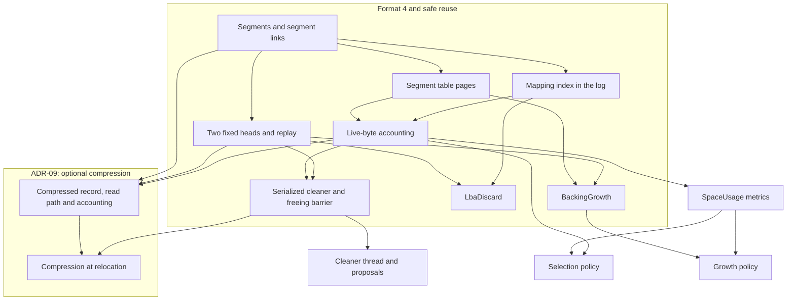

# Review of ADR-08

Date: 2026-09-20 Reviewer: Codex Original revision reviewed: the editorial revision of
[ADR-08](../ADR-08-SEGMENTED-LOG-AND-SPACE-RECLAMATION.md), 653 lines, SHA-256
`31feede6b8ab6ca47eba2197037b71c5137681b49b2d372f066f4c242bfb768c`. Repository HEAD at review:
`bc801ad7a39340609e672d2992f8cbc5275aa6ec`. The ADR was untracked; that HEAD alone does not identify
the reviewed revision.

The user authorized editing the ADR before reviewing it, overriding the prompt's read-only
restriction. Technical findings below refer to the revised ADR, not its predecessor. That editorial
pass preserved all eight Rust layout blocks verbatim; the subsequent fixed-two-head amendment below
changes the affected layouts. It consolidates prose, states inherited safety contracts and exposes
unresolved rules. It does not implement the proposed fixes.

Evidence labels: **Measured** means document counts; **Computed** means arithmetic executed locally;
**Read** identifies inspected code or paper sections; **Judgment** means review reasoning, including
hypothetical failure executions. No format-4 engine or crash experiment ran. Line ranges below refer
to ADR-08 unless another file is named.

**Decision amendment, 2026-09-20:** the current decision is [two fixed append
heads](../ADR-08-SEGMENTED-LOG-AND-SPACE-RECLAMATION.md#why-two-fixed-append-heads), User and
Relocation. User receives new payloads, discard, growth and generated metadata; Relocation receives
accepted payload and metadata copies. Links remain on the head they advance. Raw and compressed
relocation records can share a segment. Lifetime separation is the rationale; its benefit remains
unmeasured.

The descriptor stores two named `u32` boundaries, with no head count or spare head slots. Segment
entries and links use `HeadId::User = 0` and `HeadId::Relocation = 1`; the owning-head byte is zero
outside Open. Recovery merges the two chains by global LSN. The proposed floor uses two open
segments: 20/12/8 segments for 8/16/32 MiB segment sizes at 128 MiB live payload (160/192/256 MiB,
plus descriptors). These remain sizing hypotheses, not progress proofs.

The numbered findings, quotations, counts and line references below preserve the original reviewed
revision identified above. T1–T5 and the reserve/accounting findings remain unresolved. T6's
configurable unused-head slots and array-derived open-segment comment are superseded, but initial
boundaries, bootstrap, segment-link framing and sanitation still require a complete protocol. The
original two-head replay check applies again. The dependency graph, proposed split, phases and
deferred work reflect the fixed roles. Codec selection edits made separately from this amendment are
outside its scope; original codec-specific findings retain their historical context.

Amendment checked against ADR SHA-256
`ae6581da151a5ce775969212771b7d6893c05a95e165859c949f2677ae8b170b`: two named boundaries, fixed IDs,
descriptor fields end at byte 4072 followed by 16 zero bytes and the checksum, unchanged 930
table-pointer capacity. This was a focused consistency check, not a new full technical review.

## Compression split, 2026-09-20

The user separated compression from this delivery.
[ADR-08](../ADR-08-SEGMENTED-LOG-AND-SPACE-RECLAMATION.md) now specifies raw relocation and reuse,
including the cleaner thread and its metrics. [ADR-09](../ADR-09-RELOCATION-COMPRESSION.md) owns
optional compression, its encoding, accounting, measurements and any later decoded-chunk cache. No
codec is selected. The raw path emits ordinary `Data` records without a no-op codec abstraction.

This supersedes the earlier recommendation to include compressed encodings in format 4 and split
only worker policy into ADR-09. Format 4 rejects reserved record kind 6 and mapping bit 31; the
compression extension requires an explicit compatibility decision. The dependency graph, split and
phases below follow the new scope. Numbered findings, quotations and document counts remain evidence
about the original reviewed revision.

T3 and T11 move to ADR-09, together with compressed occupancy in T10, chunk capacity in T12 and
compression-specific parts of T14–T16. They are not fixed. T1/T2/T4/T5, remaining
framing/publication/recovery findings and raw reservation/accounting remain ADR-08 obligations. In
particular, raw proposal rejection removes the partial-chunk encoding issue from ADR-08, but not its
stale-source identity problem. This amendment checks the document boundary; it is not a new full
technical review or an implementation test.

## Layout and scheduling amendment, 2026-09-20

ADR-08 now uses a 64-bit seal LSN and orders checkpoints by checkpoint LSN, without a separate
generation counter. Each new publication must advance the log; unchanged checkpoints can be skipped.
The freeing barrier retains two publications. The writer scheduling sketch separates idle detection
from the maintenance deadline and includes checkpoint progress under backpressure.

Repeated metadata entries in both ADRs now use parallel arrays. Segment flags use bits 0–2 for
state, bit 7 for head, and zero in reserved bits 3–6. A segment table page holds 448 entries; 930
pointers cover 416,640 segments. A 4 TiB backing with 16 MiB segments requires 586 table pages.
These supersede the historical table counts and width finding below. ADR-09 uses its formerly
reserved 80 footer bytes for five more chunks, raising capacity to 24 while retaining 304 payload
slots. This gain comes from using reserved space; the array conversion alone saves no bytes per
chunk.

Compiled layout checks confirm the segment table, discard page and compressed-footer sketch remain 4
KiB, with the stated offsets. All 256 segment flag bytes were checked against the permitted states
and head rules. The Rust data declarations also compile in isolation. This is a layout and
consistency check, not a new technical review or evidence of engine correctness. Existing protocol
findings remain open.

## Summary

The original editorial pass reduced the ADR from 13,144 to 7,286 words, a measured 44.6% reduction.
Later amendments changed that revision; the numbered findings retain its line references and counts.
The proposal is still not a closed specification: stale source identity, abandoned-tail replay and
allocation during checkpoint publication remain unresolved. The current split keeps raw format,
allocation, recovery, reuse and the cleaner in ADR-08, with optional compression in ADR-09.
Compression acceptance requires effective storage savings and read/CPU measurements against the
independently accepted raw cleaner.

## Prose findings

1. **Lines 16–24, 85–144, 181–278, 378–653: retain the integrated safety argument.** **Judgment.**
   The format/layout-versus-cleaner cut is too early. A descriptor's meaning depends on which
   generations can reuse its referenced segments. Encoding without that protocol cannot be reviewed
   independently. The revised order is problem → decision → state → representation → operations →
   recovery/reuse → policy/evidence → growth → consequences → delivery outline → encoding reference.
   This is easier to follow than the original's separate literature essay, placement debate, design
   and repeated literature table.

**Read in papers:** LFS §2 states the problem; §§3.1–3.3 explain mechanisms; §§3.4–3.5 develop
policy through simulation; §4 specifies recovery. Logical Disk §2.1 gives the interface, §2.2 its
implementation and §3 measurements. Neither follows the prompt's suggested order exactly. Keep the
useful structure, not a supposed paper template.

2. **Lines 282–337, 365–653: density needs a comparable denominator.** **Measured.** Raw whitespace
   counts are 13,144 original words and 7,286 revised words. The revised encoding reference accounts
   for 1,896. Removing necessary encoding to imitate a short paper would hide the design again.

For comparison with extracted PDF text, count whitespace tokens containing an alphanumeric
character. Remove PDF running heads and join words split by line-end hyphenation. Include captions,
tables, diagrams and code; exclude punctuation-only tokens. This gives 12,507 original ADR tokens,
6,657 revised tokens and 5,115 for LFS §3. LFS §3.5 alone has 1,695 words (33.1%). LFS §3 excludes
its recovery section and implementation evaluation.

**Judgment, using the same classification rule:** count an independently selectable mechanism or
policy once; group its parameters with it. Exclude measurements, rejected alternatives and deferred
ideas. The revised ADR has **52 choices**, or **128.0 comparable words per choice**. LFS §3 has
**18**, or **284.2**. The catalog makes that subjective denominator reviewable:

   | Revised ADR lines | Decisions counted |
   |---|---|
   | 20–83, 268, 272, 341–343 | 1 two heads; 2 one mutable owner; 3 immutable cleaner view; 4 mixed segments; 5 copy-on-write ext2-shaped index; 6 relocation-only zstd1; 7 logged discard; 8 backing discard; 9 durable idempotent growth; 10 no conversion; 11 completion/durability separation; 12 failed-volume latch. |
   | 87–144 | 13 fixed segment geometry; 14 bounded non-crossing records; 15 serialized global LSNs; 16 segment links; 17 no header/epoch/summary; 18 persistent states with rebuilt counts; 19 tagged mappings; 20 flat resident index. |
   | 150–173 | 21 buffer coalescing/read precedence; 22 clean-only CLOCK eviction; 23 group preflight; 24 LBA sorting and exact-completion publication; 25 admission reservation; 26 footer/frame/payload read validation. |
   | 185–229 | 27 generation ordering; 28 publication barriers; 29 complete root validation; 30 merged replay; 31 independent traversal checksum; 32 windowed recovery; 33 recovery-output reservation; 34 stale-tail sanitation. |
   | 235–280 | 35 replay-path eligibility; 36 bounded multi-victim preparation; 37 conditional payload apply; 38 conditional snapshot apply; 39 pressure fallback; 40 idle wake-up; 41 two-checkpoint release; 42 chunking; 43 raw routing; 44 split checksum bindings; 45 dead-chunk repacking/unchanged-frame reuse. |
   | 302–335, 380, 411–415, 606 | 46 foreground/background selectors; 47 compression benefit term; 48 head/cleaner reserve; 49 separate write accounting; 50 bounded proposal ownership; 51 explicit encoding/validation; 52 fixed checksum trailers. |

LFS's 18 choices are: buffered log writes; inode/indirect reads; logged inode map; map caching;
copying within/threading between segments; fixed segment size; multi-victim repacking; ownership
summaries; authoritative liveness checks; versioned file IDs; watermarks; tens of victims per pass;
cost-benefit selection; age sorting; usage table; decrement/zero-live shortcut; logged usage pages;
file-age approximation (respectively §§3 opening, 3.1, 3.1, 3.1, 3.2, 3.2, 3.3, 3.3, 3.3, 3.3, 3.4,
3.4, 3.5, 3.5, 3.6, 3.6, 3.6, 3.6).

**Judgment:** the ADR spends more on byte encoding, explicit fallback and Rust ownership. LFS spends
more on simulation evidence and worked figures. Bitcask's six pages are not a comparable closed
specification: p.4 explicitly says its goal is “the general mechanisms of Bitcask” and omits locking
details. A word/decision ratio describes editorial density; it does not measure completeness.

3. **Lines 20–24, 44–73, 103–278, 386–653: distinguish orientation from duplicate rules.**
   **Judgment.** The opening decision and glossary may summarize mechanisms. The following are the
   remaining substantive repeated rule groups; each pair quotes at most two sentences. Use the
   detailed mechanism as authority and shorten the other occurrence to a reference.

   | Rule | First occurrence | Repeated occurrence | Recommendation |
   |---|---|---|---|
   | Single mutable owner | 44: “It serves requests and alone mutates the log, mapping cache, mapping index and segment table.” | 73: “Only the writer mutates the mapping cache, mapping index, segment table and log.” | Keep invariant 5; shorten the glossary. Ownership inventory at 63 is useful detail. |
   | Per-head chain | 107: “Each head has its own chain.” | 211: “Recovery keeps one cursor per head and one expected global LSN.” | Keep both: representation and algorithm, not conflicting specifications. |
   | Serialized record issue | 107: “The writer completes a record before issuing the next and assigns consecutive LSNs across both heads.” | 223: “With two heads, serialization of record issue prevents an outstanding earlier record on one head while a later record completes on the other.” | Keep the rule at 107; make 223 its short recovery rationale. |
   | First record after a link | 109: “The first record there points back to the link.” | 512–513: “The first record of the next segment has `previous_boundary` equal to this record's `boundary`.” | Keep the exact field relation beside the type. |
   | Compressed address | 127: “A flagged address identifies a compressed footer; the footer locates the LBA's chunk.” | 598–599: “is a CompressedDataFooter; find the LBA in it” | Keep the readable rule and exact bit encoding; do not expand both. |
   | Source validation | 70: “Replace a relocated mapping only if it still points to the proposed source at apply time.” | 245: “At a quiescent point after a request batch, the writer checks each proposed LBA's current `physical_addr` against its source block.” | Keep invariant plus precise algorithm. Correct the identity defect in T1. |
   | Snapshot condition | 247: “For a snapshot proposal, the source must still match the current index and the page must be clean.” | 650: “the mapping index entry for page_id must still equal this at apply, and the page must be clean” | Keep one exact rule beside apply; the type need only identify the source. |
   | Worker-only compression | 272: “Only the cleaner compresses.” | 276: “The writer computes that checksum without decompressing.” | Keep both constraints, but resolve their partial-chunk consequence in T3. |
   | Checksum binding | 276: “The payload checksum binds uncompressed bytes to volume ID and LBA, so the cleaner computes it before destination allocation.” | 602: “The payload checksum is location-free; the frame checksum is location-bound.” | Remove the restatement at 602; exact inputs remain in fields 562–575. |
   | Discard durability | 177: “FLUSH makes the discard durable; replay applies it in LSN order with writes.” | 533: “A discard is durable after the next successful FLUSH, like a write.” | Device contract 79 is authoritative; keep only ordering details here. |
   | Growth before use | 341: “It appends and fsyncs that record before allocating any new segment.” | 522–523: “Replay applies it before any later record may reference a segment in the new range.” | Keep both: runtime durability and replay order are different obligations. |
   | Two-checkpoint release | 117: “checkpoint G+1” | 261: “Checkpoint `G+1` durable” | Keep state diagram plus the root-state table; remove further prose recaps. |

The papers also repeat orientation: LFS Table I summarizes structures explained elsewhere; Bitcask
repeats its goals on pp.1 and 5. “State everything once” is not an absolute rule. Avoid multiple
normative definitions, not useful cross-checks.

4. **Lines 131–144, 189–229, 237–249, 255–278, 309–337: replace unresolved argument with a concrete
   object or experiment.** **Judgment.** The new layout diagram, replay-action table and freeing
   table already replace several long paragraphs. Add one two-head replay trace with a link,
   checkpoint and reused segment. Use a source-identity timeline for T1, and a chunk membership
   table for T3. Replace the accounting paragraph at 278 with defined counters and update equations.
   Define admission as an exact packing calculation, not another reassurance paragraph.

**Read in papers:** LFS Table I lists purpose/location; Fig.1 walks through two file creations;
Figs.3–7 connect policy to simulation. Logical Disk Table 1 summarizes structures. Seltzer §4 pairs
workload Table 3 with measured Figure 7. Here, measurements must replace guesses about 64 KiB
chunks, 12.5% savings, four victims and seal-generation age (239–241, 272–274, 305–311). Performance
evidence cannot replace missing recovery rules.

5. **Lines 36, 179, 239, 268, 286–311: citation density is now useful.** **Measured:** section
   markers fell from 126 to 15. **Read:** the remaining citations support specific choices: logged
   metadata (LFS §§3.6/4.1), free-block notification (Logical Disk §3), worker isolation (Seltzer
   §4; EBS §3.1), survivor sorting (LFS §3.5; Lomet–Luo §5.3), release ordering (WiscKey §3.3.2),
   downward discard (INFLOW §4.5.1), and selector policy (F2FS §2.5). The uniform table now states
   its model conditions.

**Judgment:** retain these. The removed broad survey and source-by-source recap were mostly
repetition. Their original universal statements about batching, equal uniform-policy behavior and
guaranteed amplification were not needed to choose the design. Do not restore them as authority. T16
covers the remaining cold-data inference.

6. **Lines 49–61, 129–144, 160, 321, 621–651: vocabulary still hides distinct objects.**
   **Judgment.** “Mapping index” names both a persistent tree (49) and a resident flat array (144,
   621). Use “mapping index tree” and “resident mapping index.” “Live record” (52) includes
   individual payloads although a record can contain both live and dead payloads. Separate payload
   liveness from required metadata and recovery protection. Define physical live bytes before using
   `u` or `F`.

The overload of `R` at 160/321 is disclosed but avoidable: use separate names for data-record count
and reserve segments. `CleanerView.live_bytes` (623) needs the segment object, for example
`segment_live_bytes`. `RelocationProposal.victims` and `snapshots` (629–631) can say
`victim_segments` and `mapping_snapshots`; `ProposedSnapshot.bytes` (651) should distinguish encoded
record bytes from mapping entries. Generic `kind`, `state` and `page_id` have adequate type context;
prefixing every field would add noise. No bare `indirect` or `Provision` field remains. The other
glossary terms retain one spelling; T10 addresses the remaining ambiguity in what live bytes count.

## Prose verdict

**Judgment:** the original was about 5,800 words too long for this scope; the revised 7,286-word
draft is not obviously too long. Target approximately **6,500–7,500 words for the integrated safety
specification**, including its encodings. Missing protocol definitions will consume some of the
editorial savings. Do not trade those definitions for a shorter count.

These are approximate further savings from the revised document, not claims that the moves are
already made:

| Section and lines | Action | Destination | Estimated words saved from core |
|---|---|---|---:|
| Evidence and policy, 282–337 | Move policy comparison, measurement procedures and tuning; retain exact capacity/reservation rules and metric definitions | Second ADR and workbench | 400 |
| Cleaner preparation/compression, 237–241, 272–280 | Move victim-count, sort-key and codec-tuning rationale; retain proposal/encoding constraints | Second ADR | 150 |
| Proposed deliveries, 365–376 | Replace large groups with a link once a delivery plan exists | Delivery plan | 180 |
| Repeated explanatory text, especially 602 | Shorten recaps; retain algorithm/type relationships | Same document | 100 |
| Backing growth, 339–345 | Keep durable protocol; move only controller and logical-growth policy | ADR-04 revision | 40 |
| Encoding reference, 378–653 | Keep | Same document | 0 |

This removes roughly 870 words, leaving about 6,400 before completing the missing rules. A second
ADR should own policy choices without becoming an alternate recovery specification. ADR-07 can
remain canonical for unchanged CLOCK, prefetch and cache-budget mechanics (16, 154).

## Technical findings

Severity order: **P1** potential data loss/corruption; **P2** availability or incomplete
format/operation contract; **P3** performance; **P4** clarity. All failure executions are
**Judgment**, not reproduced engine bugs.

1. **P1: a physical-address equality check admits stale proposals after reuse. Lines 65, 245–249,
   627–651.** The cleaner reads value A for `X → P` and pauses. The writer replaces X, removes both
   roots' references to P's segment, reuses it and eventually writes value C at `X → P`. The stale
   proposal now passes the address check and restores A over C. Its old source checksum validates A;
   no rule compares source incarnation with current state. A clean snapshot at a recycled address
   has the same problem. `view_generation` is carried but never checked.

Define source identity and view lifetime. Pin the view's dependencies until its work retires, or
validate an incarnation that changes on reuse. A generation field without an acceptance rule is
insufficient. Check current mappings and pending buffer state under the writer's ownership.

2. **P1: the no-reuse-generation argument excludes abandoned allocations. Lines 109–123, 211–229.**
   Root LSN 100 says V is free. An unflushed suffix contains `SegmentLink 101 → V`, Data 102 and
   Data 103. A medium interruption leaves the link wholly absent or unrecognizable but preserves V's
   records. V lies outside the old head's sanitation window. Recovery stops at 100 and sanitizes
   that head, leaving V free. A new run reissues the same link 101 and a same-sized Data 102, then
   flushes and crashes. Old Data 103 can match the expected LSN, volume and both physical
   boundaries. If it targets the same LBA, it replaces the newly flushed value.

The two-root barrier covers recognized prior allocations; it does not prove that every byte in a
free segment has an LSN below both roots. Specify sanitation when allocating a segment, a reuse
identity, or another complete freshness protocol. Test interrupted sanitation and repeated crashes.
This challenges the correctness claim, not the decided threading or index shape. The scenario needs
medium-fault injection; sequential issue alone does not guarantee persistence ordering before fsync.

3. **P1: partial compressed-chunk acceptance has no valid encoding. Lines 215, 245–249, 551–567.** A
   frame contains 16 payloads; three fail current-source validation. Writing all 16 footer entries
   but installing only 13 mappings now is unsafe: replay installs all 16 and resurrects the rejected
   versions. Shrinking the footer to 13 without rewriting the frame changes ordinal-to-payload
   correspondence. It can return the wrong slice or fail verification.

Choose an explicit rule. The smallest is to reject the entire affected chunk and let the worker
rebuild it; ensure pressure handling can still progress. Recompression or a persistent acceptance
mask needs a fuller protocol. Also constrain record packing: chunks containing LBAs `{1,3}` and
`{2,4}` cannot simply share a globally sorted footer with implicit chunk membership. Age-based
ordering at 239 must preserve the encoding's ordinal rule.

4. **P1: checkpoint output can change allocation after the table snapshot. Lines 142, 189–199.**
   Publication writes table pages before index pages. Appending an index page can fill the head,
   emit a link and allocate segment T after the table encoded T as free. The descriptor then points
   into T while its table calls T free. Reallocation corrupts the index; rejecting the inconsistent
   root instead loses availability. Appending table pages can itself cause another state change.

Plan and reserve all publication records and segment transitions before encoding the final table, or
specify a bounded completion algorithm that rewrites affected pages. The published table, head
cursors and metadata pointers must describe one final allocation state. Include crossings caused by
table pages themselves in the crash matrix.

5. **P1: discard does not order itself against buffered writes. Lines 150, 175–179, 532–545.** A
   completed write to X remains in the payload buffer. Discard appends its record and unmaps X but
   does not remove that buffered value. Reads still see it; a later FLUSH appends it after the
   discard. Recovery then restores data discarded by the later request.

Define buffer invalidation or draining before discard, using request order. Specify range
validation, cache-pressure handling and reservation for ranges larger than cache capacity. Define
write-zeroes, including supported flags and persistence, before advertising it. A count of 504
ranges does not bound their total mapping work.

6. **P2: record bootstrap and segment transitions remain incomplete. Lines 105–123, 203, 418–422,
   495–498.** After a link, `previous_boundary` is in another segment; subtraction no longer yields
   raw payload count or record start. After a link but before the first destination record, the last
   boundary still lies in the sealed source, contradicting the descriptor comment that derives the
   open segment from that boundary. Zero means an unused head, but initial used-head sentinels and
   format-time table publication are unspecified.

Define initial descriptors/table/heads, per-head append state, link traversal, record-length
derivation, footer search bounds and the reserved final link slot. Replace format-3 physical-order
checks with format-4 membership/LSN rules. **Read:** current `mapping_page.rs` and checkpoint
validation assume monotonically increasing physical positions; backward reuse invalidates that
assumption. Resolve exact checksum coverage too: 415 hashes bytes 0..4088, while 420 describes
format 3 hashing all 4096 bytes with the checksum zeroed. The byte width of each frame-checksum
input at 574 also needs definition.

7. **P2: fallback cannot reconstruct a lawful reuse from `PendingFree`. Lines 121, 211–221,
   255–264.** G records V pending; G+1 records it free. The writer reuses V and flushes new data.
   Damage to G+1's replacement segment-table page forces fallback to G. That page differs from G's
   table page, so the older candidate remains valid. Replay ignores table-page bodies, so V is still
   pending when a later link allocates it. A strict free-only transition rejects this valid suffix.
   Repeating a future barrier at 262 does not explain recovery of the allocation that already
   happened.

Define how replay authorizes that transition without relying on G+1's unusable table or descriptor.
Keep old-root safety separate from reconstruction of the current allocator. Test fallback after
reuse with new data in V, not only whether old payloads remain readable.

8. **P2: the cleaner cannot yet relocate every live metadata kind. Lines 144, 237–249, 627–651.**
   Proposals and apply rules cover payloads and mapping snapshots. They do not define validation and
   parent updates for direct index pages, indirect pages or table pages. A victim containing only
   one current table/index page can remain permanently ineligible for release. Ignoring that
   reference would instead corrupt recovery.

Specify liveness, source identity, re-encoding and parent-pointer changes for every metadata kind.
Relocating a direct page can dirty an indirect page; relocating a table page changes a descriptor
pointer. Checkpoint planning must include those consequences and source/view protection.

9. **P2: admission and the progress floor omit transient costs. Lines 109, 156–160, 309–329.**
   **Computed:** `N=1, R=1, D=0, P=1` reserves three blocks. Data, its snapshot and one new direct
   index page already require four. Table pages, indirect pages, links and stranded segment tails
   add more. A completely full segment also has nowhere to put its mandatory link.

**Computed transaction-size example:** 4,032 incompressible payloads plus 12 footers fit in a 16 MiB
victim (4,044 blocks). Put each payload in a different mapping page across about 5.168 GiB logical
space. Copies plus 4,032 changed snapshots require 8,076 blocks before index/table writes and both
publications. This exceeds one 4,096-block reserve if open heads have no usable tail. The fully live
victim need not be profitable to clean; this is not itself a counterexample to positive-net-gain
progress. It shows why whole-victim output cannot be assumed to fit. Staging smaller batches might
solve this; the draft does not bound that protocol.

Keep the arithmetic floor as a sizing hypothesis. Derive admission and a complete release
transaction from actual packing, cache windows, both roots, metadata, view pins and recovery output.
“Positive net gain” alone cannot promise bounded stalls if work cannot start or copy bandwidth is
below demand.

10. **P2: live bytes mix logical benefit with physical occupancy. Lines 52–61, 177, 207, 278, 335,
    609–623.** One 16-payload chunk compressed to eight blocks still retains all eight after one
    payload is discarded. Subtracting 4 KiB per dead LBA undercounts physical occupancy and becomes
    negative after nine invalidations. Fractional allocation across payloads would be an estimate of
    repacking benefit, not immediately reusable bytes.

Define logical mapped bytes, current physical references, bytes protected by roots/views,
reclaimable segment capacity and estimated compressed repacking benefit. Charge shared frames and
footers once. Re-emitting an unchanged frame charges its destination once, changes the frame
checksum and retains source protection until release. Rebuild and incremental updates must use the
same deduplication rules. **Read:** current `SpaceUsage.live_bytes` in `rust/src/lib.rs:166–174`
counts logical mapped bytes, so it cannot silently become physical compressed occupancy.

11. **P2: compressed-read validation is ordered correctly but not fully specified. Lines 164–171,
    380, 551–575.** Require footer kind/version/volume/self-position, sorted unique LBAs, count
    consistency, requested-LBA membership and zero unused entries. Check frame offset/length
    overflow, containment in the record, non-overlap and padding before I/O. Require one complete
    frame, exactly the expected decoded payload count and bounded decoder workspace. Compare the
    requested payload against the current mapping's checksum and require agreement with the footer
    entry.

The generic instruction to check bounds does not define these predicates. **Read:** the [zstd
format, frame
header](https://github.com/facebook/zstd/blob/dev/doc/zstd_compression_format.md#frame_header)
permits varying window/content sizes and explicitly allows decoders to reject excessive memory
requirements. An authenticated/checksummed frame is not itself an allocation bound. No ordinary
footer-bit-corruption execution bypasses the checksum order stated here; this finding concerns
malformed but checksum-valid metadata and source identity.

12. **P2: footer capacity and one table count are wrong; generation widths disagree. Lines 142, 185,
    441, 493, 552–565.** **Computed:** a 304-payload record needs 76 chunks at four payloads/chunk,
    or 38 at eight. Only 19 fit. Require `payload_count <= min(304, 19 × payloads_per_chunk)` or
    change the encoding. The maxima for 4/8/16/32 are 76/152/304/304.

A 4 TiB backing with 16 MiB segments has `floor((2^42−8192)/2^24)=262143` whole segments and needs
**521** table pages, not 520. Finally, `generation` is `u64` but `seal_generation` is `u32`. Define
conversion/overflow behavior before generation `2^32`; wrapping would break age estimates. These are
format rules, not benchmark choices.

13. **P2: the idle apply path is feasible but unproved. Lines 251, 266, 358.** **Read in pinned
    code:** libublk 0.4.7 exposes arbitrary SQE submission, target completion tags and extra queue
    slots. Its `io.rs:2667–2671` documents an eventfd wake-up approach. The current daemon callback
    in `rust/src/bin/block-storage-ublk.rs:798–803` ignores completion context and immediately
    indexes request state by tag. A maintenance completion needs classification before that
    indexing.

Define reserved tags, queue capacity, event draining, rearm, cancellation and shutdown. Test a
proposal arriving with zero client requests, then checkpoint-only progress from pending to free, and
shutdown during each state. API availability is source evidence; no wake-up latency or lifecycle
test has run.

14. **P3: cleaner memory has an example, not a bound. Lines 237–241, 606–645.** Four fully live
    incompressible 16 MiB victims can retain nearly 64 MiB of raw payloads, plus read scratch,
    sorting state, codec workspace and proposals. Sorting across all victims occurs before
    compression, so the 16 MiB compressed-output example does not bound peak input storage. Old
    `Arc` views can also survive later checkpoints.

Specify caps for retained victims, uncompressed payloads, proposal bytes, workspace and live views;
define backpressure and cancellation. Count the complete peak before selecting four victims. Source
identity protection in T1 must fit the same memory and space budget.

15. **P3: greedy minimizes current live bytes, not necessarily foreground service cost. Lines 251,
    304–309.** A highly compressed victim with few physical bytes can require more decompression and
    mapping work than a raw victim. Repacking can also create new metadata. Keep greedy as the
    chosen initial selector, but measure bounded apply latency and include all work in its budget.
    Selection score alone does not establish the bounded-stall promise.

16. **P3: cold-by-update does not mean rarely read. Lines 173, 239, 298, 305–311.** The draft says
    “Relocation selects data cold by update frequency,” but greedy uses live bytes and the
    background score uses seal generation. Neither observes reads. A read-heavy immutable database
    table can be an attractive victim and pay decompression on every access.

State this as an expected update-lifetime heuristic. Gate compression with mixed read/update
workloads. **Read in papers:** LFS §§3.5–3.6 and Lomet–Luo §§4/6 concern update age/frequency. They
do not establish that relocated data receives few reads. Other remaining paper claims checked in P5
agree with the cited sections; no further material misquotation remains in this revision.

## Checked and sound

“Sound” here means the stated rule is internally consistent under its named preconditions. It does
not certify the unresolved surrounding protocol.

| Requested check | Result and evidence |
|---|---|
| Invariant 1 across allocation, checkpoint, reuse and backing discard | The two-root dependency rule (69, 264) is necessary and correctly includes metadata/replay; T4, T6–T8 prevent a complete proof. Backing discard must finish while the segment remains unavailable for reallocation. |
| Invariant 2 across writes, discard, snapshots and compressed copies | Validate-at-apply at 70 is necessary. T1, T3 and T5 show source identity, chunk acceptance and buffer ordering are incomplete. |
| Invariant 3 across replay, growth and allocation | Consecutive global replay is coherent; T2 and T6 leave freshness and transition framing unsafe/incomplete. |
| Invariant 4 across admission, cleaning and recovery output | Reservation before mutation is correct; T9–T10 leave the required quantity unproved. |
| Invariant 5 across all mutable state | Writer-only log/cache/index/table mutation (63–73) is sound. The worker's read ring and transferred proposals do not require a second writer. |
| Crash between G and G+1 | G retains V as pending (260), so allocation must wait. A failed G+1 publication does not permit reuse. |
| Crash after reuse with fallback to G | G's data dependencies must already exclude old V (264). That protects old data; replay of the new allocation remains T7. |
| Torn `SegmentTablePage` / `MappingIndexPage` | Reject it when validating a root; fall back. Traverse only independently valid framing in a replay suffix (203–221). Do not apply damaged metadata bodies. T4/T7 still apply. |
| Torn `SegmentLink` | A valid independent checksum covers link routing fields through byte 39. Damaged recognizable framing must fail closed. Missing/unrecognizable link bytes before an unflushed suffix expose T2; never infer a destination from damaged routing fields. |
| Durable `BackingGrowth`, non-durable new checkpoint | Replay from the older bound applies the growth record before new-range references (341–343). Unrecorded external extension remains unavailable. Validate the full growth record: its new bound is outside the independent 40-byte header checksum. |
| Two heads with one record in flight | The proposed writer cannot issue the other head's next record before completion (107, 223). Thus the alleged simultaneous in-flight gap is excluded. Medium durability gaps before fsync remain distinct; T2 covers one. |
| Compressed-read I/O/checksum order | With a resident mapping: one footer read, then one contiguous aligned frame-range read. Verify footer, frame, then requested payload. A mapping miss adds metadata I/O. An unaligned 32 KiB frame spans nine blocks, not eight. T11 adds exact validation. |
| Capacity arithmetic | Direct reach 82.6875 GiB; indirect reach 10.1744384765625 TiB; total 10.25518798828125 TiB. Table: 468,720 segments, reaching 3.57605/7.15210/14.30420 TiB at 8/16/32 MiB. The payload-address limit remains 8 TiB. The six 128 MiB floor entries calculate correctly; they are not progress proofs. |
| Partial chunk and live accounting | Checked; do not pass. T3 and T10 cover 3-of-16 rejection, unchanged re-emission and compressed discard. |
| Idle libublk apply | Source feasibility checked; runtime behavior remains unverified (T13). |
| Paper claims | Reviewed cited sections. The revised cost formula distinguishes I/O traffic from writes, and Table 1 is conditional (286–298). T16 identifies the remaining unsupported performance inference. |

## Dependency graph

**Judgment.** An arrow means the integrated feature at the destination cannot be accepted before the
source contract works. Codecs and model tests can be developed earlier. Braces group one coupled
format/safety contract; an acyclic implementation sequence does not imply those protocols can be
specified in isolation.

Compressed accounting extends L only in ADR-09. Raw accounting and `SpaceUsage` belong to ADR-08
from the first integrated allocator. Neither compression nor its measurements gate raw reuse or the
worker. Codec experiments can run independently; extension activation needs a complete raw-cleaning
baseline. Selection policy means measured tuning, beyond the deterministic victim choice required to
test K.

## Proposed split

The split now follows independent behavior: raw reclamation first, optional compression later.
ADR-08 still owns the integrated representation and safe-reuse protocol. Moving compressed encodings
out removes decoder validation, partial-chunk acceptance and shared-chunk occupancy from its
acceptance scope.

| Document | Decision | Format | Required scope |
|---|---|---|---|
| [ADR-08: Segmented log and space reclamation](../ADR-08-SEGMENTED-LOG-AND-SPACE-RECLAMATION.md) | Reclaim obsolete space by relocating raw payloads and metadata under writer ownership. | Format 4; reserved compressed encodings are rejected. | Complete raw layout, allocation, publication, replay, source identity, reservation/accounting, discard/growth, serialized reuse, worker lifetime, idle progress and aged raw acceptance. |
| [ADR-09: Compression at relocation](../ADR-09-RELOCATION-COMPRESSION.md) | Add optional compression only after demonstrating its savings and costs against raw cleaning. | Future version or incompatible-feature gate, still undecided. | Codec/chunk comparison, full compressed encoding and read/replay validation, partial acceptance, shared-chunk accounting, off-mode behavior, bounded memory, metrics and separate acceptance. |

ADR-08 must not depend on a codec, compressed fixture or assumed compression gain. ADR-09 must not
redefine the base freeing barrier or silently extend images that raw-only readers would accept.
Workload implementation details remain in the workbench. The inherited compressed-footer sketch is
retained in ADR-09 as an unresolved proposal, not an accepted format.

## Proposed phases

These are raw-reclamation review units, not a promise that each fits one PR. Keep changes
independently reviewable and activation last. The six current delivery groups in ADR-08 map onto
these finer phases; the old mixed-compression delivery table is superseded.

1. **Resolve and freeze the core protocol.** Ship reviewed tables for source identity, head
   bootstrap, publication allocation and exact admission/accounting. User observes no behavior
   change. Crash matrix: specify the raw counterexamples in T1/T2 and T4–T9 with expected outcomes;
   T3 belongs to ADR-09. Gate: every transition has a validator and failure result. Rollback:
   document changes only.

2. **Build mapping-index codecs and isolated publication fixtures.** Ship test-only format-4 index
   pages and both root arrays at fixed fixture locations. Integrated publication waits for phase 3's
   allocator. User observes smaller dirty-index output in fixtures. Crash matrix: each
   direct/indirect append and all three barriers, including fallback through damaged bodies. Gate:
   exact byte counts, maximum coverage and current memory-budget regression. Rollback: disable
   test-only format4; format3 images remain unchanged.

3. **Build segment/table bootstrap and planned allocation.** Ship fixture format/open, raw records,
   link slots, initial space/write counters and table updates for publication's own allocations.
   User observes predictable segment exhaustion. Crash matrix: initial root publication, table
   self-allocation, full/exact-fit tails and first record after a link. Gate: allocator conservation
   and no live pointer into a free segment. Rollback: discard format4 fixtures.

4. **Integrate two-head replay and bounded recovery.** Ship global-LSN merge, per-head segment-link
   traversal, freshness/sanitation and recovery windows. User observes successful reopen after
   interleaved user, relocation and metadata records across both heads. Crash matrix: interrupted
   links, abandoned destinations, smaller-cache reopen, repeated recovery crashes and backward reuse
   fixtures. Gate: every flushed mapping survives and ignored suffixes remain ignored. Rollback:
   fixture reformat; no backward reader claim.

5. **Complete raw liveness/accounting and `SpaceUsage`.** Ship definitions and counters for data
   plus every metadata kind. User observes exact current/protected/free quantities. Crash matrix:
   compare rebuilt counts after the phase-4 cases with runtime counts. Gate: byte conservation under
   writes, checkpoints and replay. Rollback: disable new reports with no format change.

6. **Add conditional raw relocation.** Ship serialized copy/apply for payloads, snapshots,
   direct/indirect pages and table pages. User observes relocated data remains identical. Crash
   matrix: each copy/parent-update boundary, dirty snapshots and stale source identities. Gate:
   exact copy/metadata reservation without releasing a victim. Rollback: stop relocation; copies
   already written remain valid records.

7. **Enable two-checkpoint release and reuse.** Ship pending/free transitions and progress under
   repeated raw overwrites. User observes writes exceeding backing capacity. Crash matrix: both
   publications, failed publications, reused V then older-root fallback, and metadata-only victims.
   Gate: verified overwrite cycles, source protection and bounded reserve demand. Rollback: disable
   cleaning only while free capacity permits; keep a format4 reader or copy into a freshly formatted
   older image.

8. **Add client discard, then backing discard.** Ship bounded client ranges, buffer ordering and
   tested zero semantics; enable hole punching/device discard only after release. User observes
   zeros and reusable capacity after deletion. Crash matrix: write/discard/write, FLUSH/FUA
   boundaries and release versus physical discard. Gate: no resurrection and correct counters after
   restart. Rollback: disable advertisement/physical discard; existing records still require the
   format4 reader.

9. **Add the worker, views and idle apply using raw proposals.** Ship bounded lifetime, channel and
   eventfd integration. User observes cleaning during idle periods with writer-owned mutations.
   Crash matrix: stale views, address reuse, apply cancellation, event rearm and shutdown. Gate:
   zero lost wake-ups, bounded memory/pins and acceptable request latency. Rollback: return to
   serialized preparation with the same format and correctness contract.

10. **Add backing-growth control and aged acceptance.** Ship durable `BackingGrowth`, its daemon
    control path and end-to-end reports. User observes externally added capacity become usable
    exactly once. Crash matrix: every growth boundary, old-root fallback, new-range allocation and
    ambiguous retry. Gate: monotonic bound validation, repeatable aged workloads and restart
    verification. Rollback: disable further growth; never shrink or let an older reader ignore
    already-used capacity.

Compression experiments, codecs and activation are separate [ADR-09
deliveries](../ADR-09-RELOCATION-COMPRESSION.md#acceptance-and-delivery). In particular, the raw
worker and aged acceptance no longer wait for compressed-record fixtures. All base source-identity,
publication and reserve findings must still close. No phase authorizes device formatting, mounts or
privileged experiments in this documentation task.

## Deferred

- Logical growth and automatic grow-versus-clean control: separate size/ownership contracts; raw
  overwrite reclamation needs neither.
- State-change journals, segment summaries/bitmaps and extra index levels: optimize only measured
  metadata/read cost or an actual capacity limit.
- Additional heads or dynamic role assignment: require evidence beyond the two fixed roles. Compare
  the chosen design with one head in aged amplification, latency and reserve cost. Frequency
  estimators, shared workers and foreground compression also wait for measurements.
- Broad workload/trace infrastructure details: keep them in the workbench; minimum correctness
  fixtures must not depend on completing that catalogue.

## Not reviewed

All eleven requested technical topics were examined; the table above distinguishes passed rules from
unresolved protocols. Required repository documents and the four named source files were read. Paper
reads covered LFS §§3–4, Logical Disk §§2–3, all Bitcask pages, Seltzer §4 and relevant aging
sections (§§5.1–5.3/5.6), plus the cited F2FS, WiscKey, LSVD, INFLOW, Lomet–Luo and EBS sections.
Local source inspection covered the pinned libublk hooks. Only source sections actually read support
the claims here.

No format4 code exists to execute. No benchmark, live ublk/mount test, full medium-fault campaign,
decoder fuzzing or power-cycle test ran. The old draft's kernel compression-size claims and FAST26
Figure13 visual values were removed, so they are not used as evidence. The workbench's
workload-driver availability and capture fidelity were read as dependencies, not independently
audited. No code, Git index, existing unrelated edits, host configuration or external artifact was
changed by this review.
