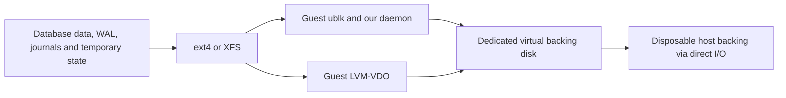

# Workbench VM environment

Date: 2026-09-20
Status: environment decision accepted; storage and CPU isolation integration pending
Related: [benchmark plan](V1.3-BENCHMARK-PLAN.md), [readiness](WORKBENCH-READINESS.md), [workbench proposal](../TMD-WORKBENCH.md)

## Why QEMU/KVM?

The initial SQLite timing runs served their reads from RAM. Limiting the database
cache alone did not constrain the filesystem page cache. We also need to account
for filesystem metadata, block-layer structures and our daemon's memory when
comparing storage implementations.

We use QEMU with KVM and run the entire tested stack inside the guest. Its RAM
budget covers the guest kernel, filesystem caches, go-ycsb, database and either
our daemon plus ublk or LVM-VDO. Both implementations use the same boundary.
We do not pass a host-created ublk or VDO device through as the tested backend.

The guest gives us a reproducible kernel, tool builds, CPU topology, device
geometry and filesystem configuration. Containers with cgroups can constrain
process memory and charged page cache, but share the host kernel. A separate
guest makes the complete machine's memory boundary explicit.

QEMU provides direct host I/O for virtual disks: use `cache=none`, equivalent
to `cache.direct=on` with `cache.no-flush=off`. This bypasses host page caching
for disk data while retaining guest flush requests. Verify these options and
the actual I/O counters; a guest RAM limit alone does not prevent host caching.
[QEMU block options](https://www.qemu.org/docs/master/system/qemu-manpage.html)

Kata adds an OCI runtime interface around VMs, which this standalone lab does
not need. Firecracker is also KVM-based, but its inspected built-in block
backend uses buffered host I/O; adopting another backend would add integration
work. QEMU exposes the storage controls we need directly.
[Kata architecture](https://github.com/kata-containers/kata-containers/blob/main/docs/design/architecture/README.md),
[Firecracker block implementation](https://github.com/firecracker-microvm/firecracker/blob/main/src/vmm/src/devices/virtio/block/virtio/device.rs)

## What runs inside the memory budget?

Start at 320 MiB and increase in 64 MiB steps until every selected stack passes
load, workload, drain and validation without OOM or allocation failures.
Include PostgreSQL when sizing. Then fix one common RAM size for all paired
runs, including 128 MiB and 4 GiB logical devices. Logical device capacity,
larger backing-store capacity and guest RAM are three separate quantities.

Disable guest swap, zram and ballooning. Keep the dataset/cache calibration
separate: a stack fitting in RAM does not prove its reads reach storage.
Record configured RAM, guest `MemTotal`, available memory, cache use and OOM
events. The [benchmark plan](V1.3-BENCHMARK-PLAN.md#memory-and-4-kib-geometry)
owns database settings and dataset calibration.

QEMU and KVM's host-side overhead is outside guest RAM. Record it separately,
including host memory and CPU use. A host cgroup can constrain QEMU with enough
headroom for the guest and virtualization overhead; do not set its limit equal
to guest RAM. Prevent host swapping of the VM during measurements. These controls
constrain our test environment, not the RAM used by unrelated host processes.

## Two disks, one tested storage path

| Guest disk | Contents and role |
|---|---|
| OS disk | Minimal root filesystem, pinned tools and configuration; excluded from test-disk I/O totals |
| Test backing disk | One dedicated raw virtual disk, backed by an explicitly disposable host LV or raw image; all tested database state ultimately resides here |

Inside the guest, the two alternative test paths are:

Each run selects one backend. Our daemon opens the guest test backing disk
and exposes `/dev/ublkb*` there; the alternative creates VDO there. The database
filesystem sits above that selected device. Raw-volume support and identity
validation must be integrated before this topology qualifies for acceptance.

Keep database data, WAL/journals, SST files and temporary database state on the
test filesystem. Keep expected results and evidence outside it, and exclude
verification from workload timings. Use distinct stable disk identities and
check the target before formatting. Expose 4 KiB logical/physical sectors and
verify filesystem geometry. Do not substitute a host-shared filesystem for the
test disk. Separate disk counters distinguish OS traffic; separate virtual
disks on one physical drive still share that drive's bandwidth and latency.

## CPU control and its limits

Fix the vCPU count and CPU model across paired runs; the initial probe uses
one vCPU. The database, our daemon or VDO, and guest kernel work share that
guest CPU budget. QEMU's host I/O and emulator threads consume additional host
CPU, which we measure separately.

Pin vCPU threads and QEMU I/O/emulator threads to recorded host CPU sets.
Reserve physical cores for the benchmark, and keep interactive sessions,
builds and other agents off those cores and their SMT siblings. Affinity alone
does not reserve CPUs: use an exclusive host cpuset partition when claiming
exclusive CPU placement. Verify its effective CPU set and validity before each
run. [Kernel cpuset partitions](https://docs.kernel.org/admin-guide/cgroup-v2.html#cpuset)

Record topology, affinity, NUMA placement, frequency policy, host load and guest
steal time. Core isolation does not eliminate shared last-level cache, memory
bandwidth, interrupt or physical-storage contention. Keep those limits visible
in the results. All comparisons use the same virtual hardware and are reported
as VM measurements.

## What is verified?

The [320 MiB boot probe](../evidence/vm-320m-1789931760947726172/console.log)
passed with ublk, ext4, XFS and no swap, then powered off cleanly. It did not
attach test disks, run databases or reserve host CPUs. The complete stack's
RAM requirement, two-disk lifecycle, direct-I/O validation and CPU isolation
remain implementation and measurement work.
